NEA mackerel HCR explorations
================
Simon Fischer (Cefas)
August 25, 2026

------------------------------------------------------------------------

## Introduction

This document sets up the modules for the 2026 NEA mackerel shortcut MSE
and runs some EXPLORATORY (not final!) projections.

This document illustrates how results could like, and how the results
can be presented.

Background material on how to use FLR mse is available from a recent
ICES MSE course:
<https://github.com/shfischer/ICES_MSE_course_2025_public>, e.g. a
tutorial about the MSE and debugging:
<https://github.com/shfischer/ICES_MSE_course_2025_public/blob/main/FLR_examples/7_FLR_MSE/7_FLR_MSE.md>

## R packages

``` r
library(FLCore)
library(FLasher)
library(mse)
library(msemodules)
library(ggplot2)
library(ggplotFL)
library(foreach)
library(dplyr)
library(tidyr)
library(doFuture)
library(patchwork)

sessionInfo()
```

Load some functions from external scripts

``` r
source("funs_OM.R")
source("funs_MSE.R")
```

## Load input objects

Load input objects created in `mac.27.nea_MP.Rmd`

``` r
input_path <- paste0("data/mac.27.nea/1000/")
### stock
stk_fwd <- readRDS(file = paste0(input_path, "stk.rds"))
stk_fwd_rps <- readRDS(file = paste0(input_path, "stk_rps.rds"))
### stock recruitment
sr <- readRDS(file = paste0(input_path, "sr.rds"))
sr_rps <- readRDS(file = paste0(input_path, "sr_rps.rds"))
### process error
proc_res <- readRDS(file = paste0(input_path, "proc_res.rds"))
### observed stock
stk_oem <- readRDS(file = paste0(input_path, "stk_oem.rds"))
### SSB & F shortcut uncertainty
error_SSB <- readRDS(file = paste0(input_path, "retro_error_SSB.rds"))
error_F <- readRDS(file = paste0(input_path, "retro_error_F.rds"))
### Implementation error
iem_0 <- readRDS(file = paste0(input_path, "iem_0.rds"))
iem_5 <- readRDS(file = paste0(input_path, "iem_5.rds"))
iem_20 <- readRDS(file = paste0(input_path, "iem_20.rds"))
```

## ICES (management) reference points

Values from ICES advice sheet 2025, Version 2, 3 October 2025
<https://doi.org/10.17895/ices.advice.27202689>, Table 4

``` r
Fmsy <- 0.191
Btrigger <- 4119337
Blim <- 3067017
```

## Illustrate harvest control rules (HCRs)

``` r
### requested HCRs with Fmin
df_hcr <- foreach(Bto0 = c(0, Blim), Bto0_label = c("0", "Blim"),
                  .combine = bind_rows) %:%
  foreach(Fmin = seq(0, 0.1, 0.025), .combine = bind_rows) %do% {
    SSBs <- c(0,
              rep(ifelse(Bto0 == 0,
                         Blim,
                         Bto0 + (1 - (Fmsy - Fmin)/Fmsy)*
                           (Btrigger - Bto0)),
                  2),
              Btrigger, Btrigger * 10)
    df_i <- data.frame(
      Bto0 = Bto0,
      Bto0_label = Bto0_label,
      Fmin = Fmin,
      SSB = SSBs)
    df_i$Fbar <- c(Fmin, Fmin,
                   (df_i$SSB[3] - Bto0)/(Btrigger - Bto0)*Fmsy,
                   Fmsy, Fmsy)
    return(df_i)
}
p_Fmin <- df_hcr %>%
  mutate(Bto0_label = factor(Bto0_label, levels = c("0", "Blim"),
                             labels = c("'F reduced to 0 at SSB=0'",
                                        "'F reduced to 0 at SSB='*B[lim]"))) %>%
  mutate(Fmin = factor(Fmin, levels = rev(unique(Fmin)))) %>%
  ggplot(aes(x = SSB/1e+6, y = Fbar,
             colour = Fmin, linetype = Fmin)) +
  geom_line() +
  scale_colour_discrete(expression(F[min])) +
  scale_linetype_discrete(expression(F[min])) +
  facet_wrap(~ Bto0_label,
             labeller = "label_parsed") +
  labs(x = "SSB", y = "Target F") +
  coord_cartesian(xlim = c(0, 2*Btrigger/1e+6), ylim = c(0, 0.2),
                  expand = FALSE) +
  scale_x_continuous(breaks = c(0, Blim/1e+6, Btrigger/1e+6),
                     labels = c(0, expression(B[lim]),
                                expression(MSY~B[trigger]))) +
  theme_bw(base_size = 8) +
  theme(legend.key.height = unit(0.6, "lines"),
        axis.text.x = element_text(angle = 45))

### standard ICES advice rule (AR) without Fmin
p_ICES_AR <- data.frame(
  Bto0 = "ICES AR", Bto0_label = "ICES AR", 
  lty = c(rep("dashed", 2), rep("solid", 3)), 
  SSB = c(0, rep(Blim, 2), Btrigger, Btrigger * 10),
  Fbar = c(0, rep(Blim/Btrigger * Fmsy, 2), Fmsy, Fmsy)) %>%
    ggplot(aes(x = SSB/1e+6, y = Fbar, linetype = lty)) +
    geom_line(show.legend = FALSE) +
    scale_linetype_manual(values = c("dashed" = "1111", "solid" = "solid")) +
    facet_wrap(~ "ICES AR") +
    labs(x = "SSB", y = "Target F") +
    coord_cartesian(xlim = c(0, 2*Btrigger/1e+6), ylim = c(0, 0.2),
                    expand = FALSE) +
    scale_x_continuous(breaks = c(0, Blim/1e+6, Btrigger/1e+6),
                       labels = c(0, expression(B[lim]),
                                  expression(MSY~B[trigger]))) +
    theme_bw(base_size = 8) +
    theme(legend.key.height = unit(0.6, "lines"),
          axis.text.x = element_text(angle = 45))

p_ICES_AR + 
  p_Fmin + 
  plot_layout(axes = "collect", axis_titles = "collect", widths = c(0.33, 0.67))
```

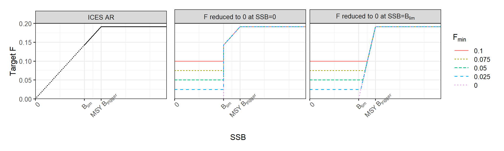<!-- -->

## Set up parallelisation backend

We can use FLR mse’s `dofuture` functionality

``` r
plan(multisession, workers = 10)
nbrOfWorkers()
```

    ## [1] 10

``` r
### load packages and functions into parallel workers
. <- foreach(x = seq(nbrOfWorkers())) %dofuture% {
  pkgs <- c("ggplot2", "FLCore", "FLasher", "mse", "msemodules",
            "foreach", "dplyr", "tidyr", "doFuture")
  for (i in pkgs)
    suppressWarnings(suppressMessages(library(package = i, character.only = TRUE)))
  source("funs_OM.R")
  source("funs_MSE.R")
}
```

## Set up MSE modules for projections

The functions for the MSE modules are defined in the script
`funs_MSE.R`, also attached as an [Appendix at the end of this
document](#appendix).

``` r
### OM
om <- FLom(stock = stk_fwd,
           sr = sr,
           projection = mseCtrl(method = fwd_procres,
                                args = list(proc_res = proc_res)))

### OEM
oem <- FLoem(method = oem_shortcut,
             observations = list(
               stk = stk_oem,
               idx = FLIndices(a = FLIndex())))

### MP control object
ctrl <- mpCtrl(list(
  est = mseCtrl(method = SAM_emulator,
                args = list(### shortcut error in SSB
                  SSB_dev = error_SSB,
                  ### short-term forecast (STF) to get to advice year
                  forecast = TRUE,
                  ### add 2 years: intermediate year and advice year
                  fwd_yrs = 2,
                  ### what to target:
                  ### - intermediate year: catch advice
                  ### - advice year: same (irrelevant)
                  fwd_trgt = c("advice", "advice"),
                  ### averages for biological/selectivity data in STF
                  fwd_yrs_average = 3,
                  ### recruitment assumption in STF
                  fwd_yrs_rec_start = 2014)),
  hcr = mseCtrl(method = hcr_hockeystick,
                args = list(Ftarget = Fmsy,
                            Btrigger = Btrigger,
                            Bto0 = 0,
                            Bdrop = Blim,
                            Fmin = 0
                )),
  isys = mseCtrl(method = isys_shortcut,
                 args = list(F_dev = error_F))

))

### Implementation error
iem <- FLiem(method = iem_shortcut,
             args = list(iem_dev = iem_5))

### general arguments
args <- list(iy = 2026, fy = 2126)
```

## Debugging etc

``` r
### only works when run sequentially

### the elements of the MSE can be debugged easily:

debugonce(mp) ### setting up simulations
debugonce(goFish, signature = "FLom") ### year loop
debugonce(oem@method) ### observation module
debugonce(ctrl$est@method) ### estimator (emulator)
debugonce(ctrl$hcr@method) ### harvest control rule (HCR)
debugonce(ctrl$isys@method) ### convert HCR F into catch
debugonce(iem@method) ### implementation error
debugonce(om@projection@method) ### OM projection

res0 <- mp(om = om, oem = oem, control = ctrl, iem = iem,
           args = args, parallel = FALSE, verbose = TRUE)
```

## Standard ICES advice rule explorations - incrementally add uncertainty

``` r
### 1 - turn off all uncertainty
### apart from:
### - stochastic initial starting condition of OM
### - resampled values for weights at age and selectivity
om@sr@residuals[] <- 1 ### stock-recruit residuals
ctrl$est@args$SSB_dev[] <- 1 ### shortcut error for SSB perception
ctrl$isys@args$F_dev[] <- 1 ### shortcut error for F implementation
iem@args$iem_dev[] <- 1 ### implementation error (catch overshoot)

res1_none <- mp(om = om, oem = oem, control = ctrl, iem = iem,
                args = args, parallel = 10, verbose = FALSE)
plot(res1_none)
dir.create("output/explorations/")
saveRDS(res1_none, file = "output/explorations/res1_none.rds")

### 2 - add stock-recruit residuals
om@sr@residuals[] <- sr@residuals
res2_SR <- mp(om = om, oem = oem, control = ctrl, iem = iem,
              args = args, parallel = 10, verbose = FALSE)
plot(res2_SR)
saveRDS(res2_SR, file = "output/explorations/res2_SR.rds")

### 3 - add SSB shortcut error
ctrl$est@args$SSB_dev[] <- error_SSB
res3_SSB <- mp(om = om, oem = oem, control = ctrl, iem = iem,
               args = args, parallel = 10, verbose = FALSE)
plot(res3_SSB)
saveRDS(res3_SSB, file = "output/explorations/res3_SSB.rds")

### 4 - add F shortcut error
ctrl$isys@args$F_dev[] <- error_F
res4_F <- mp(om = om, oem = oem, control = ctrl, iem = iem,
             args = args, parallel = 10, verbose = FALSE)
plot(res4_F)
saveRDS(res4_F, file = "output/explorations/res4_F.rds")

### 5 - add implementation error (catch overshoot)
iem@args$iem_dev[] <- iem_5
res5_iem <- mp(om = om, oem = oem, control = ctrl, iem = iem,
               args = args, parallel = 10, verbose = FALSE)
plot(res5_iem)
saveRDS(res5_iem, file = "output/explorations/res5_iem.rds")

### compare first 20 years for all runs
plot(window(FLStocks("1 none" = res1_none@om@stock,
                     "2 SR" = res2_SR@om@stock,
                     "3 SSB" = res3_SSB@om@stock,
                     "4 F" = res4_F@om@stock,
                     "5 IEM" = res5_iem@om@stock),
            end = 2046))

### 1st iteration only
plot(window(iter(FLStocks("1 none" = res1_none@om@stock,
                          "2 SR" = res2_SR@om@stock,
                          "3 SSB" = res3_SSB@om@stock,
                          "4 F" = res4_F@om@stock,
                          "5 IEM" = res5_iem@om@stock), 1),
            end = 2046))
```

## MSE runs

We will only use one recruitment scenario because the alternative
recruitment model (hockey-stick model)

The request asked for 2 different HCRs:

- standard ICES advice rule ($F$ is reduced linearly below MSYBtrigger
  to $F=0$ at $\text{SSB}=0$)

- alternative HCR where $F$ is reduced linearly below MSYBtrigger to
  $F=0$ at $\text{SSB}=B_\text{lim}$

The request asked for 5 different values for $F_\text{min}$:

- $F_\text{min}$: 0, 0.025, 0.05, 0.075, 0.1

Furthermore, WGWIDE asked for 3 scenarios for the implementation error
(catch overshoot):

- based on last 5 years (default)

- no implementation error (sensitivity check)

- based on last 20 years (sensitivity check)

This means there are a total of $2 \times 5 \times 3 = 30$ runs
required.

``` r
val_Fmin <- seq(0, 0.1, 0.025)
val_SR <- c("default")
val_HCR <- c("0", "Blim")
val_IEM <- c(5, 0, 20)

dir.create("output/runs")
```

    ## Warning in dir.create("output/runs"): 'output\runs' already exists

``` r
### go through all runs and save to files
. <- foreach(SR = val_SR) %:% 
  foreach(HCR = val_HCR) %:%
  foreach(IEM = val_IEM) %:%
  foreach(Fmin = val_Fmin) %do% {
    
    ### set file name and check if results already exist
    file_i <- paste0(paste(SR, HCR, IEM, Fmin, sep = "_"), "_res.rds")
    if (file.exists(paste0("output/runs/", file_i))) return(NULL)
    
    ### insert IEM error
    iem_i <- iem
    iem_i@args$iem_dev[] <- switch(ac(IEM), 
                                   "0" = iem_0, "5" = iem_5, "20" = iem_20)
    
    ### configure HCR
    ctrl_i <- ctrl
    ctrl_i$hcr@args$Bto0 <- switch(HCR, "0" = 0, "Blim" = Blim)
    ctrl_i$hcr@args$Bdrop <- Blim
    ctrl_i$hcr@args$Fmin <- Fmin
    
    ### run 
    res_i <- mp(om = om, oem = oem, control = ctrl_i, iem = iem_i,
                 args = args, parallel = 10, verbose = FALSE)
    
    saveRDS(res_i, file = paste0("output/runs/", file_i))
    return(NULL)
    
}

### also run standard ICES AR without Fmin
. <- foreach(SR = val_SR) %:% 
  foreach(HCR = "ICESAR") %:%
  foreach(IEM = val_IEM) %:%
  foreach(Fmin = NA) %do% {#browser()
    
    ### set file name and check if results already exist
    file_i <- paste0(paste(SR, HCR, IEM, Fmin, sep = "_"), "_res.rds")
    if (file.exists(paste0("output/runs/", file_i))) return(NULL)
    
    ### insert IEM error
    iem_i <- iem
    iem_i@args$iem_dev[] <- switch(ac(IEM), 
                                   "0" = iem_0, "5" = iem_5, "20" = iem_20)
    
    ### configure HCR
    ctrl_i <- ctrl
    ctrl_i$hcr@args$Bto0 <- 0
    ctrl_i$hcr@args$Bdrop <- 0
    ctrl_i$hcr@args$Fmin <- 0
    
    ### run 
    res_i <- mp(om = om, oem = oem, control = ctrl_i, iem = iem_i,
                 args = args, parallel = 10, verbose = FALSE)
    
    saveRDS(res_i, file = paste0("output/runs/", file_i))
    return(NULL)
    
}
```

Plot some runs (implementation error, F reduced to 0 at Blim, different
Fmin values)

``` r
res_list <- foreach(Fmin = val_Fmin) %do% {
  readRDS(paste0("output/runs/", 
                 paste0(paste("default", "0", 5, Fmin, sep = "_"), "_res.rds")))
}
names(res_list) <- val_Fmin

### compare different Fmin options
plot(window(FLStocks(lapply(res_list, stock)), end = 2046))
```

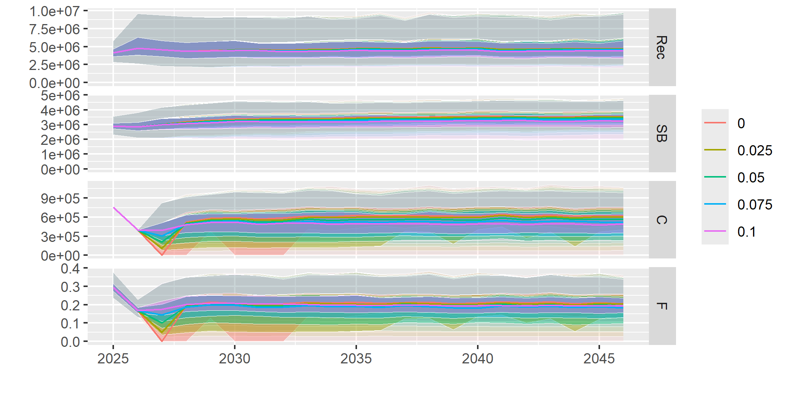<!-- -->

``` r
plot(window(FLStocks(lapply(res_list, stock)), end = 2046), probs = 0.5) ### median only
```

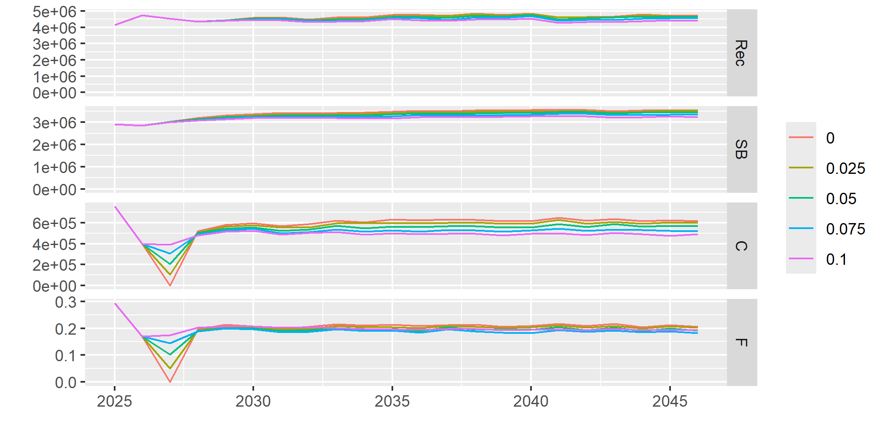<!-- -->

``` r
### plot Fmin=0 with example iterations
plot(window(stock(res_list$`0`), end = 2046), iter = 1:5)
```

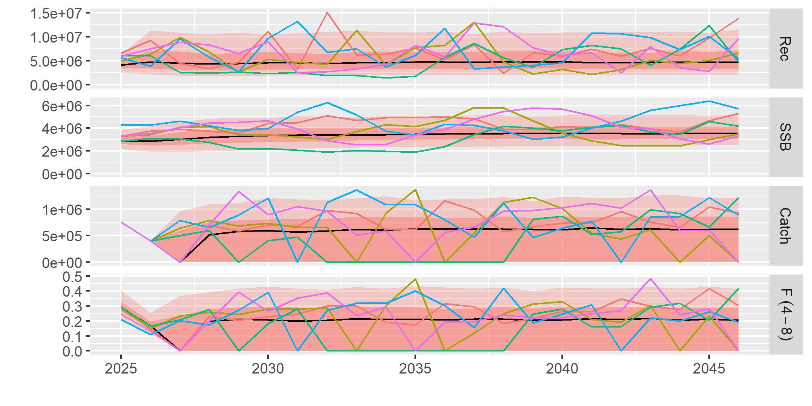<!-- -->

``` r
### plot Fmin=0.1 with example iterations
plot(window(stock(res_list$`0.1`), end = 2046), iter = 1:5)
```

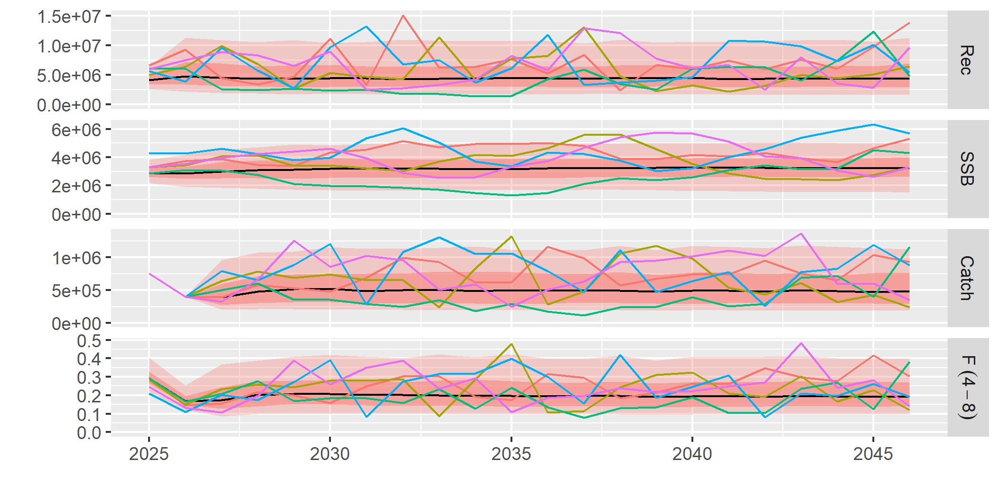<!-- -->

``` r
### compare to standard ICES AR
res_ICESAR <- readRDS("output/runs/default_ICESAR_5_NA_res.rds")
res_list_2 <- c(res_list, res_ICESAR)
names(res_list_2)[6] <- "ICES AR"
plot(window(FLStocks(lapply(res_list_2, stock)), end = 2046), probs = 0.5)
```

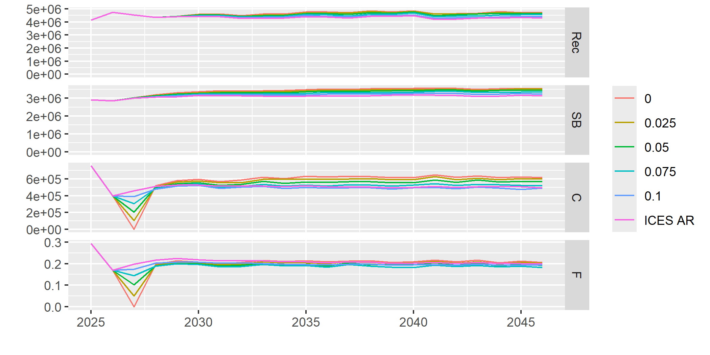<!-- -->

Some comparison plots of trajectories for different HCR options

``` r
### load results with HCR where F reduced to 0 at Blim
res_list_Blim <- foreach(Fmin = val_Fmin) %do% {
  readRDS(paste0("output/runs/", 
                 paste0(paste("default", "Blim", 5, Fmin, sep = "_"), "_res.rds")))
}
names(res_list_Blim) <- paste0("Blim_", val_Fmin)
names(res_list) <- paste0("0_", val_Fmin)

res_list_tmp <- c(res_list, res_list_Blim, res_ICESAR)
names(res_list_tmp) <- c(names(res_list), names(res_list_Blim), "0_ICESAR")
df <- lapply(names(res_list_tmp), function(x) {
  #browser()
  stk_i <- stk_fwd
  stk_i[, ac(2027:2126)] <- stock(res_list_tmp[[x]])[, ac(2027:2126)]
  qnts <- FLQuants(R = iterMedians(rec(stk_i))/1e+6, 
                   SSB = iterMedians(ssb(stk_i))/1e+6, 
                   Catch = iterMedians(catch(stk_i))/1e+6, 
                   Fbar = iterMedians(fbar(stk_i)))
  df_i <- as.data.frame(qnts)[, c("year", "data", "qname")]
  df_i$type <- x
  return(df_i)
})
df <- do.call(rbind, df)
df_plot <- df %>%
  separate("type", sep = "_", into = c("Fto0", "Fmin")) %>%
  mutate(qname = factor(qname, levels = c("R", "SSB", "Catch", "Fbar"),
                        labels = c("'Recruitment (billions)'",
                                   "'SSB (million t)'",
                                   "'Catch (million t)'",
                                   "'F (ages 4-8)'")),
         Fto0 = factor(Fto0, levels = c("0", "Blim"),
                       labels = c("'F reduced to 0 at SSB=0'",
                                        "'F reduced to 0 at SSB='*B[lim]")),
         Fmin = factor(Fmin, levels = rev(c(0, 0.025, 0.05, 0.075, 0.1, "ICESAR")),
                       labels = rev(c(0, 0.025, 0.05, 0.075, 0.1, "ICES AR")))
         ) 

df_plot %>%
  filter(year >= 2024) %>%
  ggplot(aes(x = year, y = data, colour = Fmin)) +
  geom_vline(xintercept = 2026.5, colour = "grey", linetype = "1111") +
  geom_hline(data = df_plot %>%
               filter(qname == "'SSB (million t)'") %>%
               group_by(Fto0) %>% 
               slice_head(n = 1) %>%
               mutate(Blim = Blim/1e+6),
             aes(yintercept = Blim),
             linetype = "2222") +
  geom_line() +
  scale_colour_discrete(expression(F[min])) +
  facet_grid(qname ~ Fto0, scales = "free_y", labeller = "label_parsed", 
             switch = "y") +
  scale_x_continuous(breaks = seq(2025, 2035, 2)) +
  coord_cartesian(xlim = c(2024, 2036), ylim = c(0, NA), expand = FALSE) +
  theme_bw(base_size = 8) +
  theme(strip.placement = "outside",
        strip.background.y = element_blank(),
        strip.text.y = element_text(size = 8),
        axis.title = element_blank(),
        legend.key.height = unit(0.6, "lines"))
```

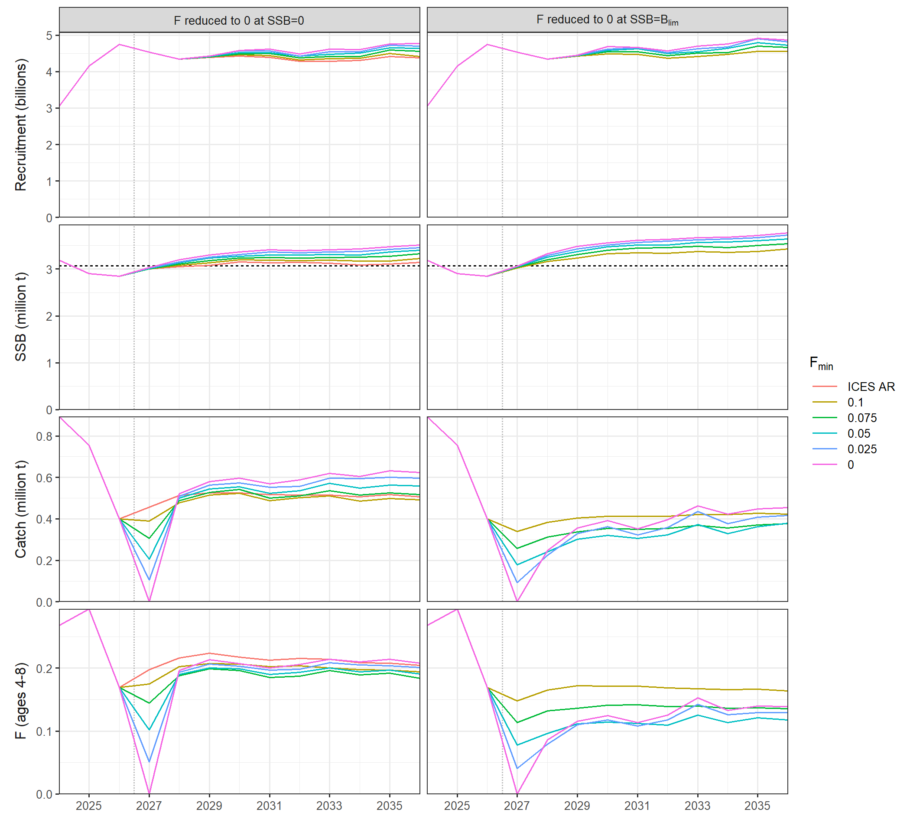<!-- -->

## Performance metrics

The request asked for several metrics:

- 2027-2036 annual: SSB, R, F, catch (1, 4)
- 2027-2036 annual: % change in catch and SSB (6, 7)
- time until above Blim and MSYBtrigger (2)
- duplicate - SSB 2036 (3)
- SSB 2036 relative to 2026 (3)
- 2027-2036 annual: Blim and MSYBtrigger prob (5)
- indicate step change in HCR at any point (8)

Let’s calculate these metrics

``` r
stats <- foreach(SR = val_SR, .combine = rbind) %:% 
  foreach(HCR = val_HCR, .combine = rbind) %:%
  foreach(IEM = val_IEM, .combine = rbind) %:%
  foreach(Fmin = val_Fmin, .combine = rbind) %do% { #browser()

    res_i <-  readRDS(paste0("output/runs/", 
                 paste0(paste(SR, HCR, IEM, Fmin, sep = "_"), "_res.rds")))

    ### get main metrics
    qnts <- FLQuants(SSB = ssb(res_i),
                     R = rec(res_i),
                     "F" = fbar(res_i),
                     Catch = catch(res_i))
    qnts_med <- iterMedians(qnts)
    ### relative to previous year
    qnts_med_rel <- (window(qnts_med, start = dims(qnts_med[[1]])$minyear + 1)/
      window(qnts_med, end = dims(qnts_med[[1]])$maxyear - 1))
    names(qnts_med_rel) <- paste0(names(qnts_med_rel), "_rel")
    ### 2036 relative to 2026
    qnts_med_rel_2 <- FLQuants(
      SSB_rel_start = qnts_med$SSB[, ac(2036)]/qnts_med$SSB[, ac(2026)])
    ### Blim and MSYBtrigger probabilities
    qnts_probs <- FLQuants(
      prob_Blim = iterMeans(ssb(res_i) > Blim),
      prob_MSYBtrigger = iterMeans(ssb(res_i) > Btrigger)
    )
    ### time to reach Blim and MSYBtrigger
    ### calculate annual probability and find years where median (50%) exceeds value
    time_Blim <- (which(iterMeans(window(ssb(res_i), start = 2027) > Blim) >= 0.5))[1]
    time_Btrigger <- (which(iterMeans(window(ssb(res_i), start = 2027) > Btrigger) >= 0.5))[1]
    ### time to reach Blim with 95% probability
    time_Blim95 <- (which(iterMeans(window(ssb(res_i), start = 2027) > Blim) >= 0.95))[1]

    ### combine into data.frame
    df_i <- bind_rows(
      as.data.frame(qnts_med) %>%
        filter(year %in% 2027:2036),
      as.data.frame(qnts_med_rel) %>%
        filter(year %in% 2027:2036) %>%
        mutate(data = (data - 1)*100),
      as.data.frame(qnts_med_rel_2) %>%
        filter(year %in% 2027:2036) %>%
        mutate(data = (data - 1)*100),
      as.data.frame(qnts_probs) %>%
        filter(year %in% 2027:2036),
      data.frame(qname = c("time_Blim", "time_Blim95", "time_Btrigger"),
                 data = c(time_Blim, time_Blim95, time_Btrigger))
    ) %>%
      select(qname, year, data) %>%
      mutate(SR = SR, HCR = HCR, IEM = IEM, Fmin = Fmin) %>%
      select(SR, HCR, IEM, Fmin, qname, year, data)
    return(df_i)
}
saveRDS(stats, file = "output/smry.rds")
write.csv(stats, file = "output/smry.csv", row.names = FALSE)
```

``` r
p_list <- foreach(SR = val_SR) %:% 
  foreach(HCR = val_HCR) %:%
  foreach(IEM = val_IEM) %do% { #browser()
    
    stats_i <- stats %>% 
      filter(SR == {{ SR }} & HCR == {{ HCR }} & IEM == {{ IEM }}) %>%
      mutate(data = ifelse(qname %in% c("SSB", "Catch", "R"), data/1e+6, data))
    #stats_i 
      
    p_abs <- foreach(qnt = c("SSB", "Catch", "F", "R"),
                     title_i = c("SSB (million tonnes)", 
                                 "Catch (million tonnes)",
                                 "mean F (ages 4-8)",
                                 "Recruitment (billions)")) %do% { #browser()
      p_i <- stats_i %>%
        filter(qname == qnt) %>%
        mutate(title = title_i) %>%
        ggplot(aes(x = year, y = as.factor(Fmin))) +
        geom_tile(aes(fill = data), alpha = 0.7, show.legend = FALSE) +
        scale_fill_gradientn(colours = hcl.colors(10),
                             na.value = "red") +
        geom_text(aes(label = sprintf(data, fmt = "%.2f")), size = 2.5) +
        facet_wrap(~ title) +
        labs(x = "Year", y = expression(F[min])) +
        scale_x_continuous(breaks = seq(2027, 2036, 2)) +
        theme_bw()
      return(p_i)
    }
    p_rel <- foreach(qnt = c("SSB_rel", "Catch_rel", "F_rel", "R_rel"),
                     title_i = c("SSB (% change)", "Catch (% change)",
                                 "mean F (% change)", 
                                 "Recruitment (% change)")) %do% { #browser()
      p_i <- stats_i %>%
        filter(qname == qnt) %>%
        mutate(title = title_i) %>%
        mutate(data = ifelse(data > 1e+6, NA, data)) %>%
        ggplot(aes(x = year, y = as.factor(Fmin))) +
        geom_tile(aes(fill = data), alpha = 0.7, show.legend = FALSE) +
        scale_fill_gradient2(low = "darkred", mid = "white", high = "darkblue",
                       midpoint = 0, na.value = "grey") +
        geom_text(aes(label = sprintf(data, fmt = "%.1f")), size = 2.5) +
        facet_wrap(~ title) +
        labs(x = "Year", y = expression(F[min])) +
        scale_x_continuous(breaks = seq(2027, 2036, 2)) +
        theme_bw()
      return(p_i)
    }
    p_probs <- foreach(qnt = c("prob_Blim", "prob_MSYBtrigger"),
                     title_i = c("'p(SSB>'*B[lim]*') (%)'", 
                                 "'p(SSB>'*MSY~B[trigger]*') (%)'")) %do% { #browser()
      p_i <- stats_i %>%
        filter(qname == qnt) %>%
        mutate(title = title_i) %>%
        ggplot(aes(x = year, y = as.factor(Fmin))) +
        geom_tile(aes(fill = data), alpha = 0.7, show.legend = FALSE) +
        scale_fill_gradientn(colours = hcl.colors(10),
                             na.value = "red") +
        geom_text(aes(label = sprintf(data*100, fmt = "%.1f")), size = 2.5) +
        facet_wrap(~ title, labeller = "label_parsed") +
        labs(x = "Year", y = expression(F[min])) +
        scale_x_continuous(breaks = seq(2027, 2036, 2)) +
        theme_bw()
      return(p_i)
    }
    p_recovery <- stats_i %>%
      filter(qname %in% c("time_Blim", "time_Blim95", "time_Btrigger")) %>%
      mutate(Bref = gsub(qname, pattern = "time_", replacement = "")) %>%
      mutate(Bref = factor(Bref, levels = c("Blim", "Blim95", "Btrigger"),
                           labels = c("B[lim]~'(50%)'", "B[lim]~'(95%)'",
                                      "MSY~B[trigger]~'(50%)'"))) %>%
      ggplot(aes(x = Bref, y = as.factor(Fmin))) +
      geom_tile(aes(fill = data), alpha = 0.7, show.legend = FALSE) +
      scale_fill_gradientn(colours = hcl.colors(10),
                           na.value = "red") +
      geom_text(aes(label = sprintf(data, fmt = "%.0f")), size = 2.5) +
      facet_wrap(~ "Time to biomass threshold (years)") +
      labs(x = "Reference biomass", y = expression(F[min])) +
      scale_x_discrete(labels = scales::label_parse()) +
      theme_bw()
      
    p <- p_abs[[1]] + p_rel[[1]] + 
      p_abs[[2]] + p_rel[[2]] +
      p_abs[[3]] + p_rel[[3]] + 
      p_abs[[4]] + p_rel[[4]] +
      p_probs[[1]] + p_probs[[2]] +
      plot_layout(ncol = 2, axes = "collect") +
      plot_annotation(title = paste0(
        "HCR: F reduced to 0 at SSB=", HCR, ";  ", 
        ifelse(IEM > 0, 
               paste0("implementation error based on last ", IEM, " years"),
               "no implementation error"))) +
      p_recovery
    
    return(p)
    
}
p_list
```

    ## [[1]]
    ## [[1]][[1]]
    ## [[1]][[1]][[1]]

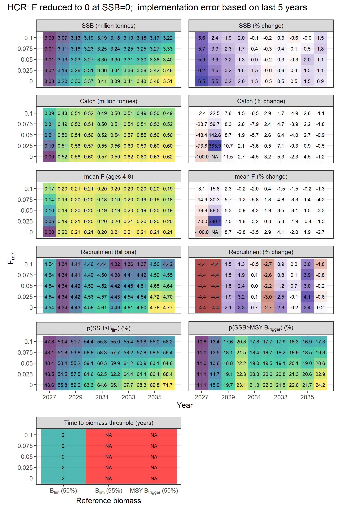<!-- -->

    ## 
    ## [[1]][[1]][[2]]

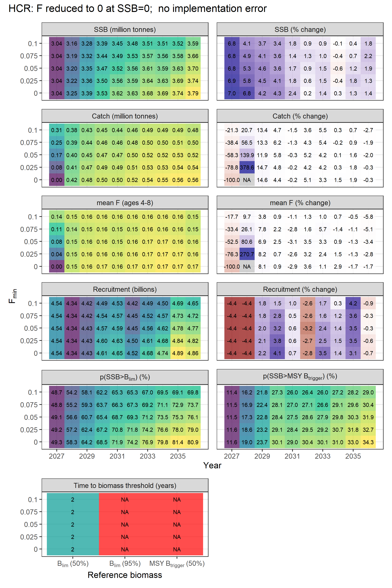<!-- -->

    ## 
    ## [[1]][[1]][[3]]

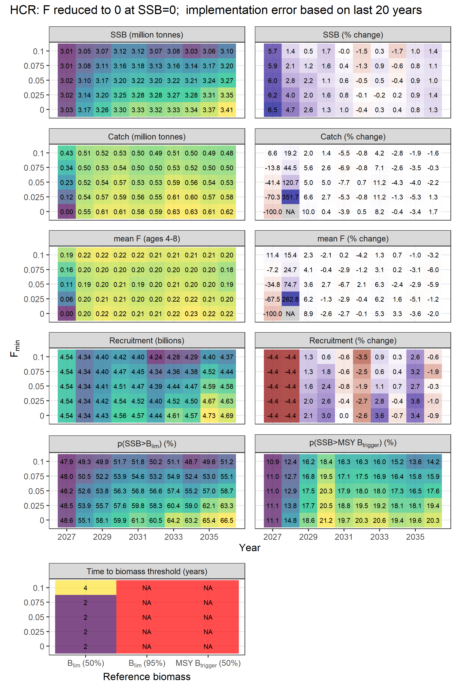<!-- -->

    ## 
    ## 
    ## [[1]][[2]]
    ## [[1]][[2]][[1]]

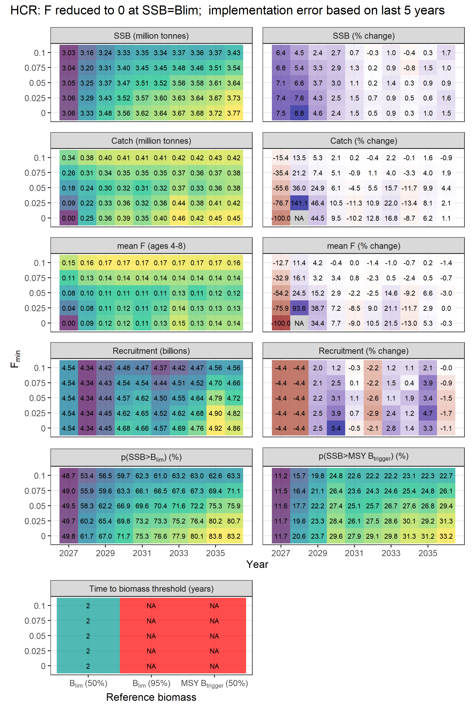<!-- -->

    ## 
    ## [[1]][[2]][[2]]

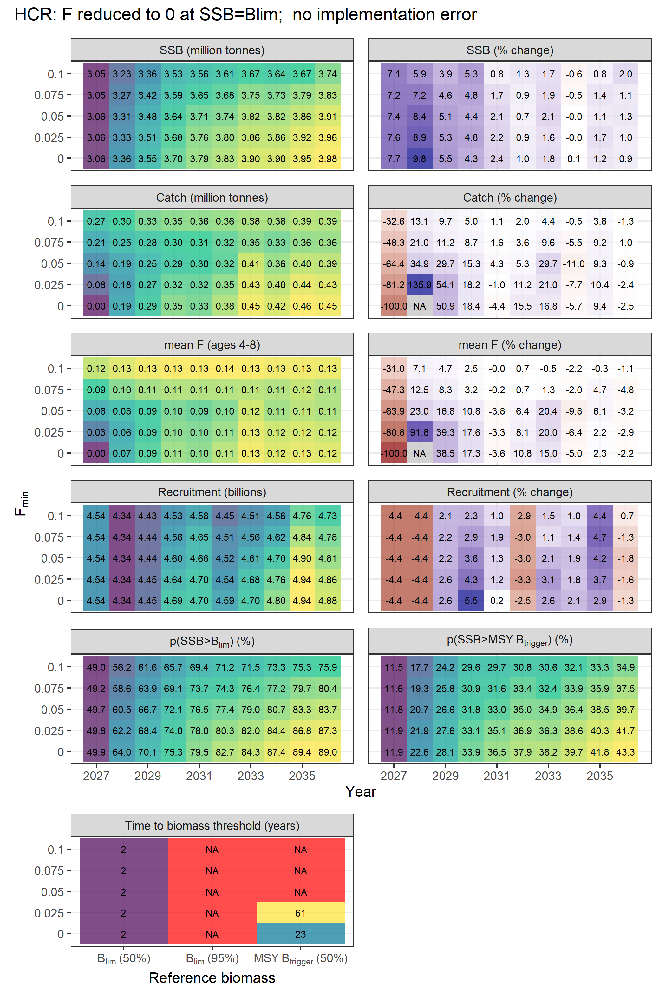<!-- -->

    ## 
    ## [[1]][[2]][[3]]

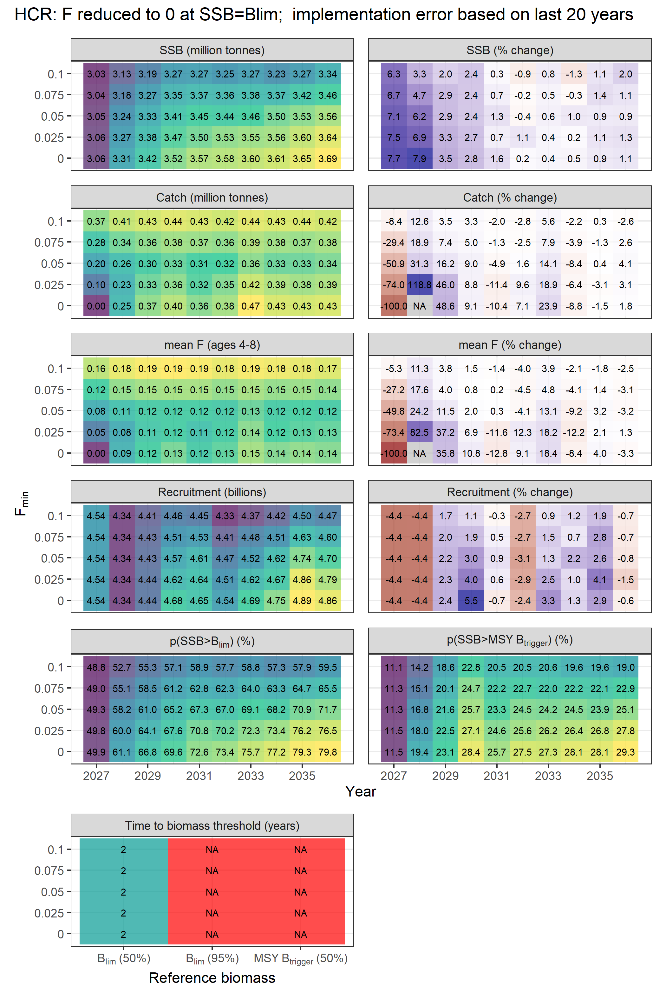<!-- -->

# Appendix

Source code for the MSE modules from the script `funs_MSE.R`:

``` r
### ------------------------------------------------------------------------ ###
### projection - fwd with process error ####
### ------------------------------------------------------------------------ ###
fwd_procres <- function(om, ctrl,
                        maxF = 5, ### maximum allowed Fbar
                        proc_res = NULL, ### process error noise,
                        ...) {

  stk <- stock(om)
  sr <- sr(om)
  sr.residuals <- residuals(sr(om))

  ### project forward with FLasher::fwd
  stk[] <- fwd(object = stk, control = ctrl, sr = sr,
               deviances = sr.residuals,
               maxF = maxF)

  ### add process error noise, if supplied
  if (!is.null(proc_res)) {

    ### projected years
    yrs_new <- seq(from = ctrl@target$year, to = range(stk)[["maxyear"]])

    if (!is(proc_res, "FLQuant"))
      stop("Process error needs to be provided in an FLQuant object")
    yrs_available <- as.numeric(dimnames(proc_res)$year)
    if (!all(yrs_new %in% yrs_available))
      stop("Process error years missing")

    ### check iterations
    ### may differ when parallelised -> subset
    if (isTRUE(dim(proc_res)[6] > dim(stk)[6])) {
      proc_res <- proc_res[,,,,, dimnames(stk)$iter]
    }

    ### implement process error
    stock.n(stk)[, ac(yrs_new)] <- stock.n(stk)[, ac(yrs_new)] *
      proc_res[, ac(yrs_new)]
    ### update stock biomass
    stock(stk) <- computeStock(stk)

  }

  ### return stock
  stock(om) <- stk
  return(list(om = om))

}

### ------------------------------------------------------------------------ ###
### OEM: shortcut observations ####
### ------------------------------------------------------------------------ ###
### return stock numbers etc without error
oem_shortcut <- function(stk, observations, deviances, tracking, args, ...){

  ### use OEM stock - biological data etc may differ from OM stock
  stk0 <- observations$stk

  ### update/insert fishery data without error
  catch.n(stk0) <- catch.n(stk)
  catch(stk0) <- catch(stk)
  discards.n(stk0) <- discards.n(stk)
  discards(stk0) <- discards(stk)
  landings.n(stk0) <- landings.n(stk)
  landings(stk0) <- landings(stk)

  ### shortcut - pass on N and F as observations without error
  stock.n(stk0) <- stock.n(stk)
  stock(stk0) <- stock(stk)
  harvest(stk0) <- harvest(stk)

  ### cut off observed stock to last data year
  stk0 <- window(stk0, end = args$dy)

  return(list(stk = stk0, idx = observations$idx, observations = observations,
              tracking = tracking))

}

### ------------------------------------------------------------------------ ###
### estimator emulator: SAM shortcut ####
### ------------------------------------------------------------------------ ###
SAM_emulator <- function(stk, idx, tracking,
                         args, ### contains ay (assessment year)
                         SSB_dev,
                         forecast = TRUE,
                         fwd_trgt = c("advice", "advice"), ### what to target in forecast
                         fwd_yrs = 2, ### number of years to add
                         fwd_yrs_average = 3, ### years used for averages
                         fwd_yrs_rec_start = 2014, ### recruitment
                         ...){

  ### no assessment
  stk0 <- stk

  ### implement SSB shortcut error - apply stock numbers at age
  ### entire stock scaled up/down
  if (!missing(SSB_dev)) {

    ### get years and iterations
    yrs_i <- dimnames(stk0)$year
    iter_i <- dimnames(stk0)$iter

    ### reshape SSB error into same format as stock numbers
    SSB_dev_i <- stock.n(stk0) %=% rep(c(SSB_dev[, yrs_i]),
                                       each = prod(dim(stk0)[1]))

    stock.n(stk0) <- stock.n(stk0) * SSB_dev_i

  }

  ### perform forecast to get SSB ay+1
  if (isTRUE(forecast)) {

    ### extend stock
    stk_stf <- stf(stk0, nyears = fwd_yrs, wts.nyears = fwd_yrs_average)

    ### recruitment: median to mimic average of SAM resampling
    rec_fc <- yearMedians(window(rec(stk0), start = fwd_yrs_rec_start))

    ### define STF target(s)
    if (isFALSE(identical(fwd_trgt, c("advice", "advice"))))
      stop("Unknown STF target(s)")

    ### 1st year (intermediate year) - catch
    if (identical(args$ay, args$iy)) {
      ### in first year of projection - extract from OM
      trgt1 <- tracking$data[tracking$metric == "C.om" & tracking$year == ac(args$ay)]
    } else {
      ### in future years, use catch advice
      trgt1 <- tracking$data[tracking$metric == "isys" &
                               tracking$year == ac(args$ay - args$management_lag)]
    }

    ### 2nd year - use same target (irrelevant)

    ### STF control object
    ctrl_stf <- fwdControl(list(year = c(args$ay, args$ay + 1),
                                quant = "catch",
                                value = rep(trgt1,  each = 2)))
    ### STF
    stk_stf[] <- fwd(stk_stf, control = ctrl_stf,
                     sr = FLSR(model = "geomean",
                               params = FLPar(a = c(rec_fc),
                                              iter = dims(stk_stf)$iter)),
                     verbose = FALSE)

    #print(args$ay)
    #browser()

    # fwd_warnings <- NULL
    # tc <- withCallingHandlers(
    #   expr = {
    #     stk_stf[] <- fwd(stk_stf, control = ctrl_stf,
    #                      sr = FLSR(model = "geomean",
    #                                params = FLPar(a = c(rec_fc),
    #                                               iter = dims(stk_stf)$iter)),
    #                      verbose = TRUE)
    #   },
    #   warning = function(w) {
    #     fwd_warnings <<- w$message
    #     invokeRestart("muffleWarning")
    #   }
    # )
    # ### rerun
    # if (isTRUE(grepl(x = fwd_warnings,
    #                  pattern = "^Unsolved targets at control rows*"))) {
    #   i <- 1
    #   browser()
    #   while (i <= 10) {
    #     fwd_warnings <- NULL
    #     tc <- withCallingHandlers(
    #       expr = {
    #         stk_stf[] <- fwd(stk_stf, control = ctrl_stf,
    #                          sr = FLSR(model = "geomean",
    #                                    params = FLPar(a = c(rec_fc),
    #                                                   iter = dims(stk_stf)$iter)),
    #                          verbose = TRUE)
    #       },
    #       warning = function(w) {
    #         fwd_warnings <<- w$message
    #         invokeRestart("muffleWarning")
    #       }
    #     )
    #     ### check if
    #     if ((!isTRUE(grepl(x = fwd_warnings,
    #                       pattern = "^Unsolved targets at control rows*")))) {
    #       break
    #     } else {
    #       i <- i + 1
    #     }
    #     print(paste0("rerun"))
    #   }
    #
    # }
    # fwd_warnings <- NULL

    stk0 <- stk_stf

  }

  ### return assessed stock
  return(list(stk = stk0, tracking = tracking))

}

### ------------------------------------------------------------------------ ###
### hockey stick HCR ####
### ------------------------------------------------------------------------ ###
hcr_hockeystick <- function(stk, ind, tracking, args,
                            Ftarget, Btrigger, Bto0 = 0, Bdrop = 0,
                            Fmin = 1e-6, Fmin0 = 1e-6, ...) {

  ### get SSB in advice year
  SSB <- c(ssb(stk)[, ac(args$ay + args$management_lag)])

  ### template for F multiplier
  Fmult <- rep(1, length(SSB))

  ### find SSB below Btrigger and reduce linearly to 0 at Bto0
  pos_below_Btrigger <- which(SSB < Btrigger)
  if (length(pos_below_Btrigger) > 0)
    Fmult[pos_below_Btrigger] <- (SSB[pos_below_Btrigger] - Bto0)/(Btrigger - Bto0)

  ### find SSB below Bdrop and set to 0
  pos_below_Bdrop <- which(SSB < Bdrop)
  if (length(pos_below_Bdrop) > 0)
    Fmult[pos_below_Bdrop] <- 0

  ### calculate resulting F
  Fout <- Ftarget * Fmult

  ### set F minimum
  pos_F_below_Fmin <- which(Fout < Fmin)
  if (length(pos_F_below_Fmin) > 0)
    Fout[Fout < Fmin] <- Fmin

  ### avoid 0 F target - can cause issues with fwd() later
  Fout[Fout < Fmin0] <- Fmin0

  ### create control object
  advice <- FLQuant(Fout,
                    dimnames = list(year = args$ay + args$management_lag,
                                    iter = seq(dim(stk)[6])))
  ctrl <- fwdControl(target = advice, quant = "f")


  return(list(ctrl = ctrl, tracking = tracking))

}

### ------------------------------------------------------------------------ ###
### implementation system for shortcut (including shortcut error on F) ####
### ------------------------------------------------------------------------ ###
isys_shortcut <- function(stk, args, ctrl, tracking,
                          F_dev,
                          fwd_yrs_average = 3, fwd_yrs_rec_start = 2014,
                          ...) {

  ### add shortcut error to target F
  if (!missing(F_dev))
    ctrl@iters[, "value", ] <- ctrl@iters[, "value", ] *
      c(F_dev[, ac(args$ay + args$management_lag)])

  ### recruitment for STF
  ### value already set in estimator - recycle
  rec_fc <- c(rec(stk)[, ac(args$ay + args$management_lag)])

  ### STF
  stk_stf <- fwd(stk, control = ctrl,
                 sr = FLSR(model = "geomean",
                           params = FLPar(a = c(rec_fc),
                                          iter = dims(stk)$iter)))

  ### extract catch
  catch_target <- catch(stk_stf)[, ac(args$ay + args$management_lag)]
  ### format into control object
  ctrl <- fwdControl(target = catch_target, quant = "catch")

  return(list(ctrl = ctrl, tracking = tracking))

}

### ------------------------------------------------------------------------ ###
### IEM for shortcut ####
### ------------------------------------------------------------------------ ###
iem_shortcut <- function(ctrl, args, tracking, iem_dev, ...) {

  if (!missing(iem_dev)) {

    ctrl@iters[, "value", ] <- ctrl@iters[, "value", ] *
      iem_dev[, ac(ctrl@target$year)]

  }

  return(list(ctrl = ctrl, tracking = tracking))

}
```
