Operating model(s) for shortcut MSE for Northeast Atlantic mackerel
(mac.27.nea) - WGWIDE 2026 update
================
Simon Fischer (Cefas) et al.,
August 27, 2026

------------------------------------------------------------------------

## Introduction

This document creates the objects required for an operating model for
Northeast Atlantic mackerel (mac.27.nea). It is based on the SAM
assessment accepted by *WGWIDE 2026*. It is an update to the previously
presented work based on the WGWIDE 2025 assessment.

The approach of generating the OM is the standard approach used in ICES
MSEs, i.e. sampling from the variance-covariance matrix from the SAM
model fit. This is the same approach as used in recent ICES MSEs,
e.g. WKNSMSE 2019 (<https://doi.org/10.17895/ices.pub.5090>), WKBPLAICE
2025 (<https://doi.org/10.17895/ices.pub.28400255>), WKMSEHERRING 2025
(<https://doi.org/10.17895/ices.pub.28868798>). Details of the approach
are e.g. described in this WKBPLAICE 2025 working document:
<https://github.com/shfischer/WKBPLAICE2024_ple.27.7e_MSE/blob/WKBPLAICE2024/WKBPLAICE2024_ple.27.7e_OM.pdf>

## R packages

``` r
library(ggplot2)
library(FLCore)
library(FLAssess)
library(FLasher)
library(FLfse)
library(ggplotFL)
library(stockassessment)
library(foreach)
library(dplyr)
library(tidyr)
library(doParallel)
library(doFuture)
library(mse)
library(patchwork)
library(MASS)

sessionInfo()
```

Load some functions from external scripts

``` r
source("funs_OM.R")
source("funs_MSE.R")
```

Load WGWIDE SAM assessment model fit as basis.

``` r
### SAM stock assessment from WGWIDE 2025 (model_0.01)
fit_2025 <- readRDS("input/fit.rds")
### Fit from WGWIDE 2026 (model_0.01)
fit <- readRDS("input/fit_2026.rds")

### refit model locally and check if identical
. <- capture.output(fit_new <- stockassessment:::refit(fit))
identical(fit, fit_new)
```

    ## [1] FALSE

``` r
all.equal(fit$opt, fit_new$opt)
```

    ## [1] "Component \"iterations\": Mean relative difference: 0.9863014" 
    ## [2] "Component \"evaluations\": Mean relative difference: 0.9848024"
    ## [3] "Component \"message\": 1 string mismatch"

``` r
all.equal(summary(fit), summary(fit_new))
```

    ## [1] TRUE

``` r
all.equal(fit$opt$objective, fit_new$opt$objective)
```

    ## [1] TRUE

``` r
### not identical but at least log likelihood and summary is the same
### use original fit from WGWIDE for now
```

Show some plots of the model

``` r
opar <- par() 
#dataplot(fit) ### not showing data...
#dev.off()

par(opar) ### stop SAM package from messing up plotting settings...
```

    ## Warning in par(opar): graphical parameter "cin" cannot be set

    ## Warning in par(opar): graphical parameter "cra" cannot be set

    ## Warning in par(opar): graphical parameter "csi" cannot be set

    ## Warning in par(opar): graphical parameter "cxy" cannot be set

    ## Warning in par(opar): graphical parameter "din" cannot be set

    ## Warning in par(opar): graphical parameter "page" cannot be set

``` r
par(mar = c(2, 4.5, 0.5, 0.5))
plot(fit)
```

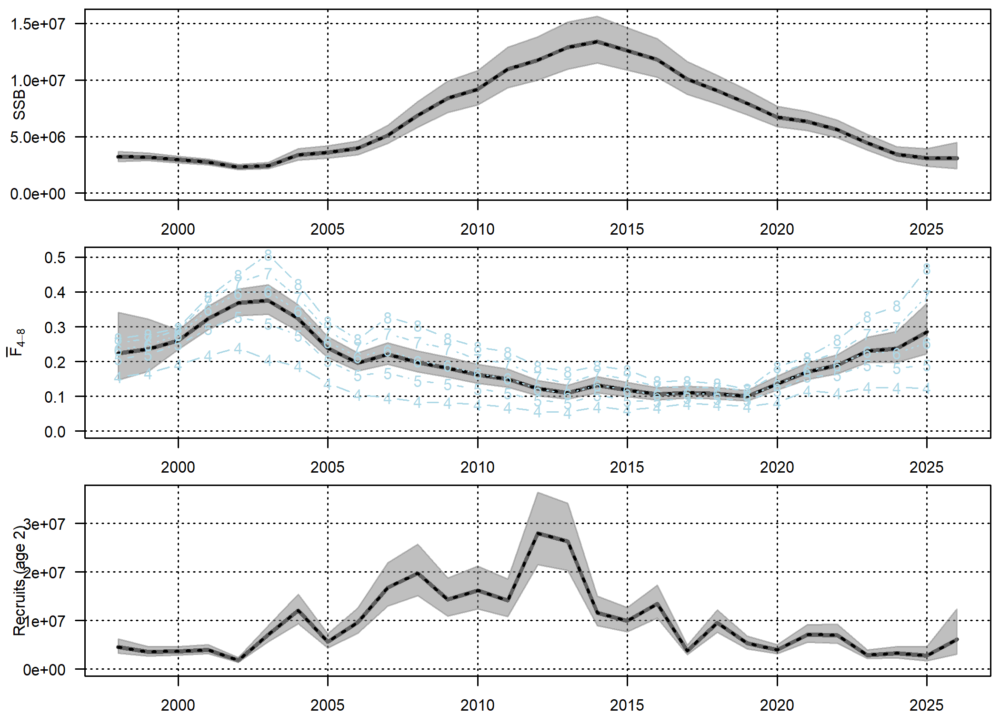<!-- -->

``` r
par(opar)
```

    ## Warning in par(opar): graphical parameter "cin" cannot be set

    ## Warning in par(opar): graphical parameter "cra" cannot be set

    ## Warning in par(opar): graphical parameter "csi" cannot be set

    ## Warning in par(opar): graphical parameter "cxy" cannot be set

    ## Warning in par(opar): graphical parameter "din" cannot be set

    ## Warning in par(opar): graphical parameter "page" cannot be set

``` r
### compare WGWIDE 2026 fit to WGWIDE 2025 fit
par(opar) 
```

    ## Warning in par(opar): graphical parameter "cin" cannot be set

    ## Warning in par(opar): graphical parameter "cra" cannot be set

    ## Warning in par(opar): graphical parameter "csi" cannot be set

    ## Warning in par(opar): graphical parameter "cxy" cannot be set

    ## Warning in par(opar): graphical parameter "din" cannot be set

    ## Warning in par(opar): graphical parameter "page" cannot be set

``` r
par(mar = c(2, 4.5, 0.5, 0.5))
plot(c("WGWIDE2026" = fit, "WGWIDE2025" = fit_2025))
```

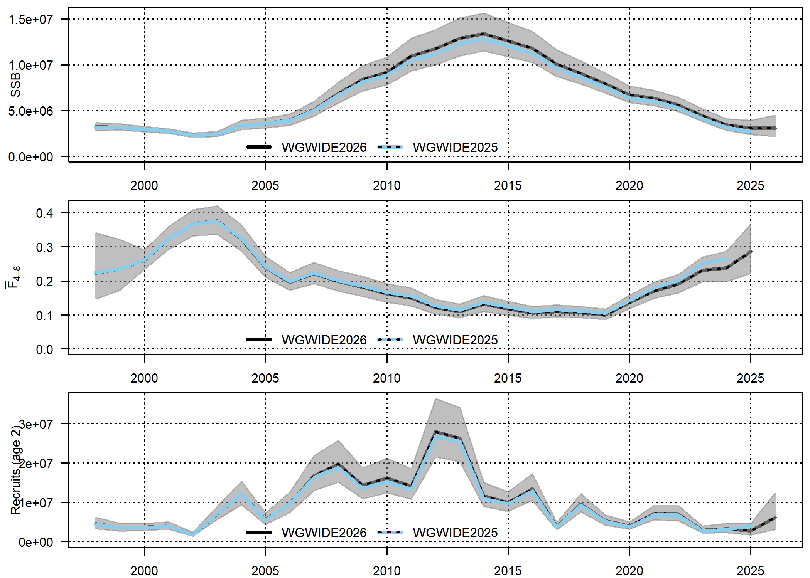<!-- -->

``` r
par(opar)
```

    ## Warning in par(opar): graphical parameter "cin" cannot be set

    ## Warning in par(opar): graphical parameter "cra" cannot be set

    ## Warning in par(opar): graphical parameter "csi" cannot be set

    ## Warning in par(opar): graphical parameter "cxy" cannot be set

    ## Warning in par(opar): graphical parameter "din" cannot be set

    ## Warning in par(opar): graphical parameter "page" cannot be set

## OM basics

Follow decisions of last benchmark (WKBMACNSSH 2025) and reference
points (WGWIDE 2025)

- Last benchmark: 2025

- Reference points: 2025

Some OM settings:

``` r
n <- 1000 ### number of iterations (simulation replicates)
n_years <- 100 ### number of projected years (can be reduced later)
               ### good to have more years initially for OM reference point estimation

### intermediate years
### project forward so that 2027 is first year of MSE projection
yr_data <- 2025 ### last data year
int_yr_add <- TRUE ### add intermediate year(s)
int_yr <- 2026
```

## FLStock object

``` r
### convert SAM fit into FLStock
stk <- SAM2FLStock(object = fit)
stk
```

    ## An object of class "FLStock"
    ## 
    ## Name:  
    ## Description: FLStock created from SAM model fit 
    ## Quant: age 
    ## Dims:  age   year    unit    season  area    iter
    ##  11  29  1   1   1   1   
    ## 
    ## Range:  min  max pgroup  minyear maxyear minfbar maxfbar 
    ##  2   12  12  1998    2026    4   8   
    ## 
    ## Metrics: 
    ##   rec: 1.9e+06 - 2.8e+07  (NA) 
    ##   ssb: 2.3e+06 - 1.3e+07  (NA) 
    ##   catch: NA - NA  (NA) 
    ##   fbar: 0.10 - 0.38  (f)

``` r
stk_median <- stk ### save median for later

### some year dimensions
yrs_hist <- as.numeric(dimnames(stk)$year)
yrs_proj <- seq(from = dims(stk)$maxyear + 1, length.out = n_years)
n_years_new <- n_years

### add intermediate year (2026, extend stock later)
if (isTRUE(int_yr_add)) {
  n_years_new <- n_years + length(setdiff(int_yr, yrs_hist))
  yrs_proj <- seq(from = dims(stk)$maxyear + 1, length.out = n_years_new)
  int_yr_yr <- min(yrs_proj)
}

yrs_mse <- sort(unique(c(yrs_hist, yrs_proj)))
```

## Add uncertainty to stock from SAM’s variance-covariance matrix

``` r
### add iteration dimension
stk <- FLCore::propagate(stk, n)
### add uncertainty estimated by SAM as iterations
set.seed(1)
uncertainty <- SAM_uncertainty(fit = fit, n = n, idx = FALSE) ### from FLfse

### add noise to stock
stock.n(stk)[] <- uncertainty$stock.n
stock(stk)[] <- computeStock(stk)

### add noise to F
harvest(stk)[] <- uncertainty$harvest

### add noise to catch numbers
yrs_hist_catch <- dimnames(uncertainty$catch.n)$year
catch.n(stk)[, ac(yrs_hist_catch)] <- uncertainty$catch.n[, ac(yrs_hist_catch)]
catch(stk) <- computeCatch(stk)

### update landings/discards
stk_tmp <- stk
landings.n(stk) <-  catch.n(stk_tmp) * 
  landings.n(stk_tmp)/(landings.n(stk_tmp) + discards.n(stk_tmp))
landings(stk) <- computeLandings(stk)
discards.n(stk) <-  catch.n(stk_tmp) * 
  discards.n(stk_tmp)/(landings.n(stk_tmp) + discards.n(stk_tmp))
discards(stk) <- computeDiscards(stk)

### biological data (weights at age, maturity, etc) are not modelled by SAM, so there is no variability in there

### show uncertainty
### each iteration corresponds to one possible self-consistent outcome from SAM
plot(stk) + theme_bw()
```

    ## Warning: Removed 1000 rows containing non-finite outside the scale range
    ## (`stat_fl_quantiles()`).
    ## Removed 1000 rows containing non-finite outside the scale range
    ## (`stat_fl_quantiles()`).
    ## Removed 1000 rows containing non-finite outside the scale range
    ## (`stat_fl_quantiles()`).
    ## Removed 1000 rows containing non-finite outside the scale range
    ## (`stat_fl_quantiles()`).

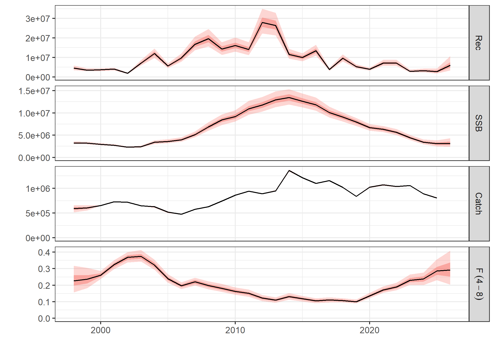<!-- -->

``` r
plot(stk, iter = 1:5) + theme_bw() ### with 1st 5 iterations
```

    ## Warning: Removed 1000 rows containing non-finite outside the scale range
    ## (`stat_fl_quantiles()`).
    ## Removed 1000 rows containing non-finite outside the scale range
    ## (`stat_fl_quantiles()`).
    ## Removed 1000 rows containing non-finite outside the scale range
    ## (`stat_fl_quantiles()`).
    ## Removed 1000 rows containing non-finite outside the scale range
    ## (`stat_fl_quantiles()`).

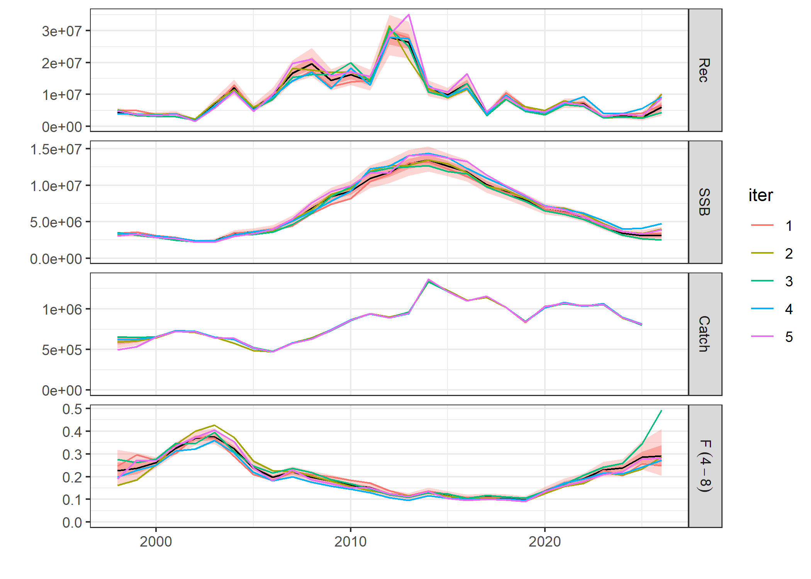<!-- -->

## Extend stock for MSE

``` r
stf_nyrs <- 5 ### use last 5 years for average (overwritten later)
stk_stf <- stf(stk, n_years_new, wts.nyears = stf_nyrs, 
               disc.nyears = stf_nyrs)
```

## Biological OM data (weights at age etc)

Show weights at age for stock, catch, landings, discards

``` r
df_wts <- as.data.frame(FLQuants("stock.wt" = stock.wt(stk),
                                 "catch.wt" = catch.wt(stk),
                                 "landings.wt" = landings.wt(stk),
                                 "discards.wt" = discards.wt(stk)))
df_wts %>%
  mutate(age = factor(age, levels = rev(sort(unique(age))))) %>%
  mutate(qname = factor(qname)) %>%
  group_by(qname) %>%
  ggplot(aes(x = year, y = data, colour = age)) +
  geom_line() +
  geom_text(data = . %>% group_by(qname) %>% filter(year == 2025),
            aes(x = year+1.5, y = data, label = age),
            colour = "black", show.legend = FALSE, size = 2) +
  scale_colour_discrete("Age (years)") +
  labs(x = "Year", y = "Weight (kg)") +
  facet_wrap(~ qname) +
  theme_bw(base_size = 8) +
  theme(legend.key.height = unit(0.6, "lines"))
```

    ## Warning: Removed 33000 rows containing missing values or values outside the scale range
    ## (`geom_line()`).

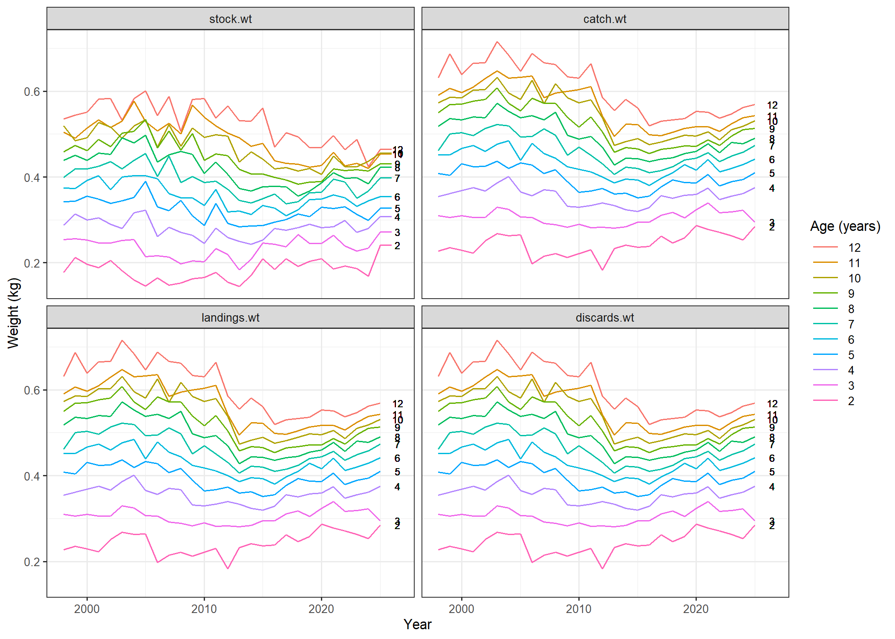<!-- -->

Catch weights are available until 2025.

Stock weights are shown until 2026, but the 2026 values are the same as
in 2025, i.e. only available until 2025.

For the MSE projection, weights need to be resampled from the past X
years.

WGWIDE decision:\*

- Use last 5 years, i.e. 2021-2025

``` r
n_sample_yrs <- 5
```

Justification: some changes over time and slight trend for some ages in
most recent decade but relatively stable in most recent years, possibly
influenced by other factors such as stock size, so using most recent
years seems appropriate.

``` r
df_wts %>%
  mutate(age = factor(age, levels = rev(sort(unique(age))))) %>%
  mutate(qname = factor(qname)) %>%
  group_by(qname) %>%
  ggplot(aes(x = year, y = data, colour = age)) +
  annotate("rect", xmin = 2020.5, xmax = 2025.5, ymin = -Inf, ymax = Inf,
           alpha = 0.05, fill = "red") + 
  geom_line() +
  geom_text(data = . %>% group_by(qname) %>% filter(year == 2025),
            aes(x = year+1.5, y = data, label = age),
            colour = "black", show.legend = FALSE, size = 2) +
  scale_colour_discrete("Age (years)") +
  labs(x = "Year", y = "Weight (kg)") +
  facet_wrap(~ qname) +
  theme_bw(base_size = 8) +
  theme(legend.key.height = unit(0.6, "lines"))
```

    ## Warning: Removed 33000 rows containing missing values or values outside the scale range
    ## (`geom_line()`).

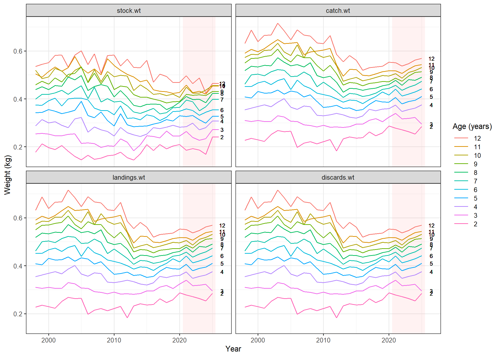<!-- -->

``` r
### Resample weights, maturity and natural mortality from the last X years 
### set up an array with one resampled year for each projection year 
### (including intermediate year) and replicate
### use the same resampled year for all biological parameters
set.seed(2)
### use last X data years to sample biological parameters
sample_yrs <- seq(to = yr_data, length.out = n_sample_yrs)
### get year position of sample years
sample_yrs_pos <- which(dimnames(stk_stf)$year %in% sample_yrs)

n_years_new_bio <- n_years_new + 1 ### +1 because 2026 is also overwritten

### create samples for biological data (weights, etc.)
### the historical biological parameters are identical for all iterations
### and consequently do not need to be treated individually
### (but keep age structure)
### create vector with resampled years
bio_samples <- sample(x = sample_yrs_pos, 
                      size = (n_years_new_bio) * n, replace = TRUE)
### years to be populated
bio_yrs <- which(dimnames(stk_stf)$year %in% 
                   (yr_data + 1):dims(stk_stf)$maxyear)
### insert values
catch.wt(stk_stf)[, bio_yrs] <- c(catch.wt(stk)[, bio_samples,,,, 1]) ### use 1st iteration only to extract values because all iterations have same value
stock.wt(stk_stf)[, bio_yrs] <- c(stock.wt(stk)[, bio_samples,,,, 1])
landings.wt(stk_stf)[, bio_yrs] <- c(landings.wt(stk)[, bio_samples,,,, 1])
discards.wt(stk_stf)[, bio_yrs] <- c(discards.wt(stk)[, bio_samples,,,, 1])
m(stk_stf)[, bio_yrs] <- c(m(stk)[, bio_samples,,,, 1])
mat(stk_stf)[, bio_yrs] <- c(mat(stk)[, bio_samples,,,, 1])

### show some example plot for catch weights
plot(catch.wt(stk_stf)) + ylim(c(0, NA)) + theme_bw()
```

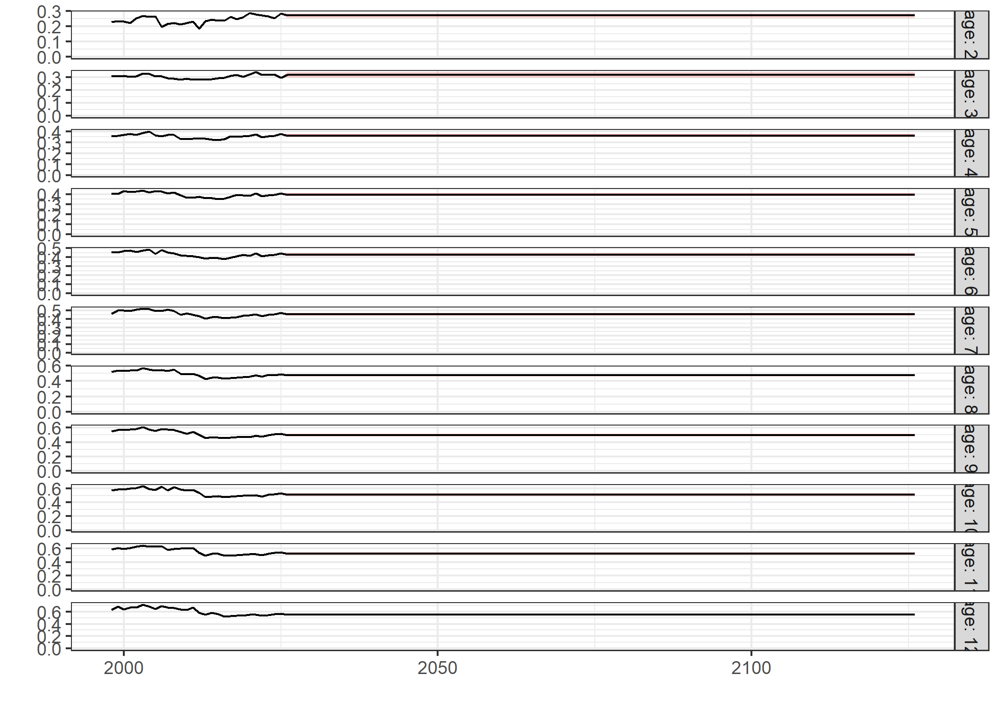<!-- -->

``` r
plot(iter(catch.wt(stk_stf), 1)) + ylim(c(0, NA)) + theme_bw() ### example iteration
```

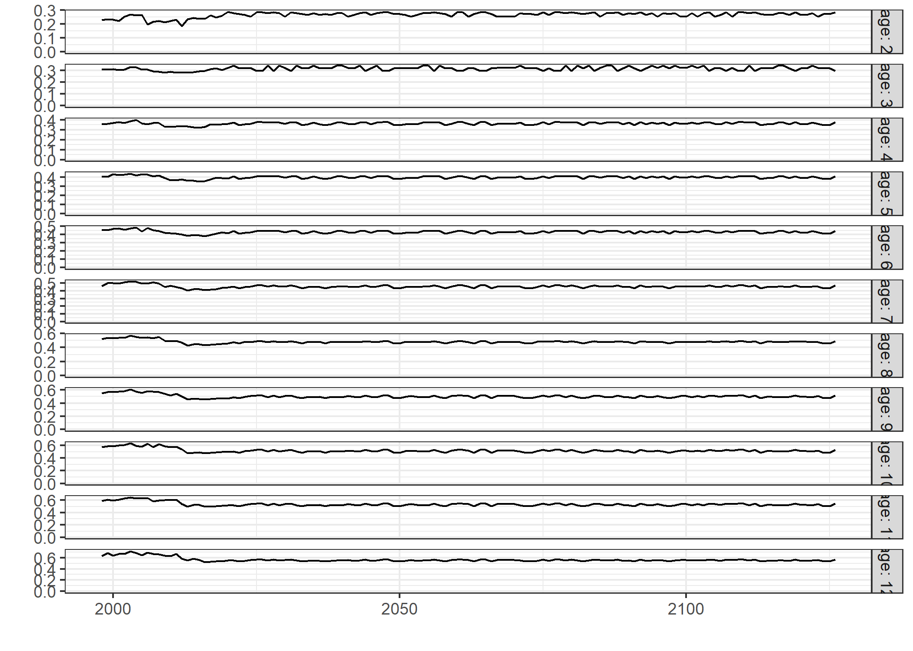<!-- -->

*Change 10/08/2026:* Use WKMSEHerring approach (randBlocks) to account
for temporal correlation in weights.

Still using the last 5 years, i.e. 2021-2025

Justification: retains temporal correlation between biological
parameters, a feature that is biologically more robust than simple
random sampling.

``` r
# create alternative stk object for comparison
stk_stf_rB <- stk_stf

### Resample weights only with randBlocks as maturity and nm are fixed through time
set.seed(2)

### use last X data years to sample biological parameters
sample_yrs <- seq(to = yr_data, length.out = n_sample_yrs)  
### get year position of sample years
sample_yrs_pos <- which(dimnames(stk_stf_rB)$year %in% sample_yrs)

n_years_new_bio <- n_years_new + 1 ### +1 because 2025 is also overwritten

### create vector with resampled years
bio_yrs <- which(dimnames(stk_stf_rB)$year %in% 
                   (yr_data + 1):dims(stk_stf_rB)$maxyear)

# generate random blocks for weight at age  (function defined in funs_OM.R)
yrChain   <- randBlocks(sample_yrs,yrs_mse[bio_yrs],n)

# inspect
head(do.call(rbind, yrChain))
```

    ##      1   21   22   23   24   31   32   33    4   51   52   53   54   55   61
    ## 1 2022 2022 2023 2024 2025 2023 2024 2025 2023 2021 2022 2023 2024 2025 2021
    ## 2 2022 2023 2024 2023 2024 2023 2024 2025 2024 2025 2021 2021 2022 2022 2023
    ## 3 2022 2023 2022 2023 2024 2021 2022 2023 2024 2025 2021 2022 2023 2023 2023
    ## 4 2022 2021 2022 2023 2024 2025 2021 2022 2023 2024 2023 2024 2022 2023 2024
    ## 5 2022 2023 2024 2025 2022 2023 2024 2025 2023 2024 2021 2022 2023 2024 2025
    ## 6 2022 2023 2024 2023 2024 2021 2023 2024 2021 2022 2023 2024 2025 2021 2022
    ##     62   63   64   65    7   81   82   83   84   85   91   92   93  101  102
    ## 1 2022 2023 2024 2025 2023 2021 2022 2023 2024 2025 2022 2023 2024 2021 2022
    ## 2 2023 2023 2022 2021 2022 2023 2024 2022 2023 2021 2022 2023 2024 2025 2022
    ## 3 2024 2021 2022 2023 2024 2023 2024 2021 2022 2023 2021 2022 2023 2024 2025
    ## 4 2021 2022 2023 2024 2022 2024 2021 2022 2023 2024 2025 2024 2025 2022 2023
    ## 5 2022 2023 2024 2024 2021 2022 2023 2024 2023 2024 2021 2022 2023 2024 2025
    ## 6 2023 2024 2025 2021 2022 2023 2024 2025 2023 2024 2023 2024 2023 2024 2021
    ##    103  111  112  113  121  122  131  132  133  134   14  151  152  153  161
    ## 1 2023 2022 2023 2024 2021 2022 2022 2023 2024 2025 2023 2023 2024 2025 2021
    ## 2 2023 2024 2022 2023 2024 2023 2024 2021 2022 2023 2024 2023 2021 2022 2025
    ## 3 2021 2022 2023 2024 2025 2021 2022 2023 2024 2025 2024 2021 2022 2023 2024
    ## 4 2024 2022 2023 2021 2024 2025 2022 2023 2021 2022 2023 2024 2025 2023 2022
    ## 5 2021 2022 2023 2024 2025 2021 2022 2024 2025 2023 2024 2025 2022 2023 2024
    ## 6 2022 2023 2024 2025 2025 2024 2022 2021 2022 2023 2024 2025 2025 2023 2022
    ##    162  163  164  165  171  172  173  174  175  181  182  191  192  193   20
    ## 1 2022 2023 2024 2025 2021 2022 2023 2024 2025 2022 2023 2022 2023 2024 2022
    ## 2 2021 2022 2023 2024 2025 2021 2022 2023 2024 2025 2022 2023 2022 2023 2024
    ## 3 2025 2022 2023 2024 2024 2024 2025 2021 2022 2023 2024 2025 2021 2022 2023
    ## 4 2023 2024 2022 2023 2024 2025 2022 2023 2024 2025 2021 2022 2023 2024 2022
    ## 5 2022 2022 2023 2024 2024 2025 2021 2022 2023 2024 2025 2022 2023 2024 2025
    ## 6 2023 2024 2025 2023 2024 2025 2023 2024 2023 2021 2022 2023 2024 2021 2022
    ##    211  212  213  214  221  222  231  232  233  234  235   24  251  252  261
    ## 1 2021 2022 2023 2024 2023 2024 2021 2022 2023 2024 2025 2024 2022 2023 2022
    ## 2 2025 2022 2023 2021 2022 2023 2024 2025 2022 2023 2023 2024 2021 2022 2023
    ## 3 2024 2025 2024 2025 2021 2022 2023 2024 2022 2023 2024 2023 2024 2022 2023
    ## 4 2023 2022 2023 2024 2022 2023 2021 2022 2023 2024 2025 2021 2022 2021 2022
    ## 5 2024 2025 2022 2023 2024 2021 2022 2023 2024 2025 2021 2022 2023 2024 2023
    ## 6 2023 2024 2025 2022 2023 2022 2023 2024 2025 2021 2022 2023 2024 2025 2022
    ##    262  263   27  281  282  291  292  293  294  295   30   31   32  331  332
    ## 1 2023 2024 2021 2022 2023 2021 2022 2023 2024 2025 2022 2024 2022 2021 2022
    ## 2 2023 2024 2025 2022 2022 2023 2024 2024 2021 2021 2022 2023 2023 2021 2022
    ## 3 2024 2025 2023 2024 2023 2024 2021 2022 2023 2024 2025 2025 2021 2022 2023
    ## 4 2023 2024 2025 2021 2022 2023 2024 2021 2022 2021 2022 2023 2024 2025 2021
    ## 5 2024 2025 2023 2024 2023 2024 2022 2023 2024 2025 2021 2022 2023 2024 2025
    ## 6 2023 2024 2025 2024 2025 2021 2022 2023 2024 2025 2021 2022 2023 2024 2025
    ##    333  334  335  341  342  343  344  345  351  352  353
    ## 1 2023 2024 2025 2021 2022 2023 2024 2025 2021 2022 2023
    ## 2 2023 2021 2022 2023 2024 2025 2021 2022 2023 2024 2025
    ## 3 2024 2025 2022 2023 2022 2023 2024 2025 2021 2022 2023
    ## 4 2022 2023 2024 2022 2023 2024 2025 2021 2022 2023 2024
    ## 5 2021 2022 2023 2024 2025 2022 2023 2024 2022 2023 2024
    ## 6 2021 2022 2023 2024 2021 2022 2023 2024 2021 2022 2023

``` r
table(unlist(yrChain))
```

    ## 
    ##  2021  2022  2023  2024  2025 
    ## 13616 23493 26530 23660 13701

``` r
# sample using year blocks (takes a few mins)
for(idxIter in 1:n){
  # print(paste('init step 4 bio variables - iter=',idxIter))
  
  # future stock weight at age
  stk_stf_rB@stock.wt[,bio_yrs,,,,idxIter] <- 
    array(iter(stk_stf_rB@stock.wt[,ac(yrChain[[idxIter]])],idxIter),
          dim=dim(iter(stk_stf_rB@stock.wt[,bio_yrs],idxIter)))
  
  # future catch weight at age
  stk_stf_rB@catch.wt[,bio_yrs,,,,idxIter] <- 
    array(iter(stk_stf_rB@catch.wt[,ac(yrChain[[idxIter]])],idxIter),
          dim=dim(iter(stk_stf_rB@catch.wt[,bio_yrs],idxIter)))
  
  # future landings weight at age
  stk_stf_rB@landings.wt[,bio_yrs,,,,idxIter] <- 
    array(iter(stk_stf_rB@landings.wt[,ac(yrChain[[idxIter]])],idxIter),
          dim=dim(iter(stk_stf_rB@landings.wt[,bio_yrs],idxIter)))
  
  # future discards weight at age
  stk_stf_rB@discards.wt[,bio_yrs,,,,idxIter] <- 
    array(iter(stk_stf_rB@discards.wt[,ac(yrChain[[idxIter]])],idxIter),
          dim=dim(iter(stk_stf_rB@discards.wt[,bio_yrs],idxIter)))
}

# example plot to compare with simple resampling - catch.wt
plot(catch.wt(stk_stf), catch.wt(stk_stf_rB), 
     names = c("resampled", "randBlocks")) +
  facet_wrap(~age, scales = "free_y") +
  theme_bw() + ggtitle("catch.wt") + labs(x = "", y = "Weight (kg)")#+ylim(0,NA)
```

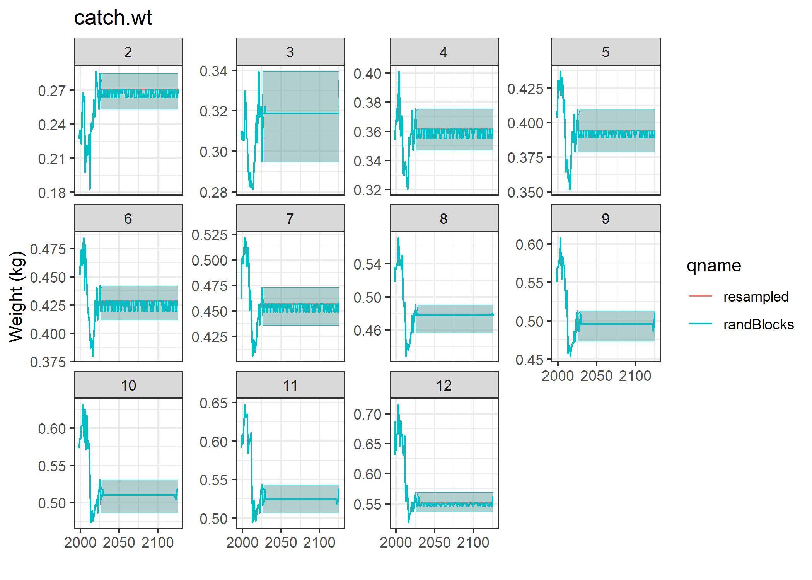<!-- -->

``` r
# example iteration
plot(window(iter(catch.wt(stk_stf), 1), start  = 2020),
     window(iter(catch.wt(stk_stf_rB), 1), start = 2020), 
     names = c("resampled", "randBlocks")) +
  annotate("rect", xmin = as.Date("2020-06-30"), xmax = as.Date("2025-06-30"), 
           ymin = -Inf, ymax = Inf,
           alpha = 0.3, fill = "black") +
  facet_wrap(~age, scales = "free_y", ncol = 3) +
  theme_bw() + ggtitle("catch.wt") + labs(x = "", y = "Weight (kg)")#+ylim(0,NA)
```

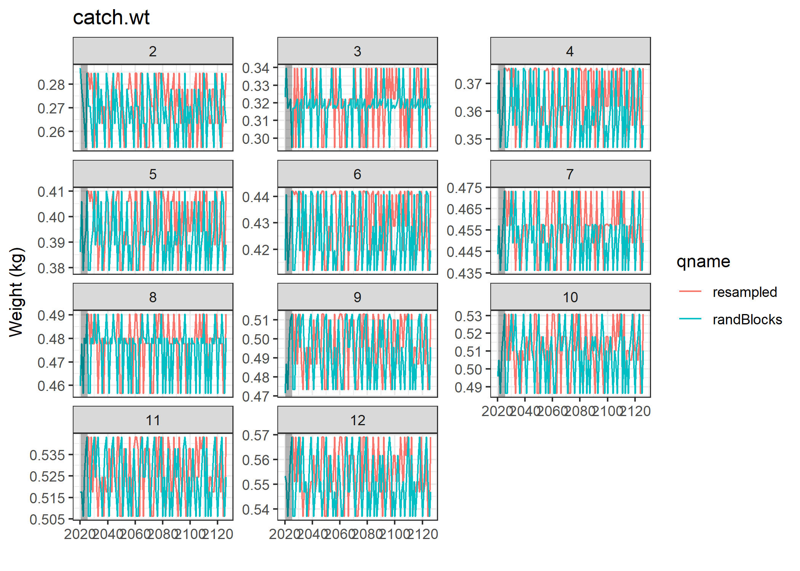<!-- -->

``` r
# Overwrite weights with randBlocks values.
stk_stf <- stk_stf_rB
```

## Fisheries selectivity

Visualise fisheries selectivity first

``` r
### 1st plot F at age time series
df_f <- as.data.frame(harvest(stk_median))
df_f %>%
  mutate(age = factor(age, levels = rev(sort(unique(age))))) %>%
  ggplot(aes(x = year, y = data, colour = age)) +
  geom_line() +
  geom_text(data = . %>% filter(year == max(year)),
            aes(x = year+1, y = data, label = age),
            colour = "black", show.legend = FALSE, size = 2) +
  scale_colour_discrete("Age (years)") +
  labs(x = "Year", y = "F at age") +
  theme_bw(base_size = 8) +
  theme(legend.key.height = unit(0.6, "lines"))
```

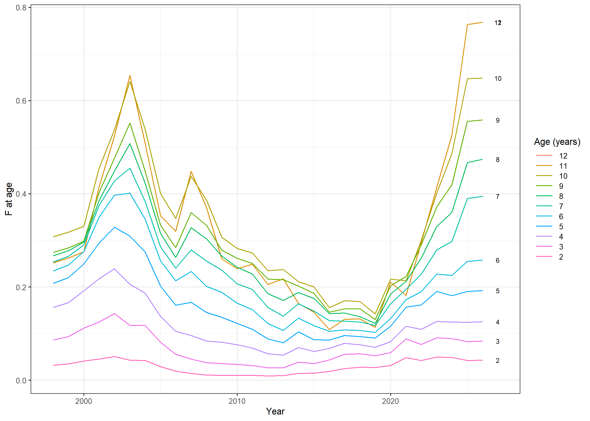<!-- -->

``` r
### selectivity (F scaled to max F per year)
df_f %>% 
  group_by(year) %>%
  mutate(data_rel = data/max(data)) %>%
  ggplot(aes(x = age, y = data_rel)) +
  geom_line() +
  facet_wrap(~ year) +
  scale_x_continuous(breaks = scales::pretty_breaks()) +
  ylim(c(0, NA)) +
  labs(x = "Age (years)", y = "Selectivity (F_a_yr/max(F_a_yr))") +
  theme_bw(base_size = 8)
```

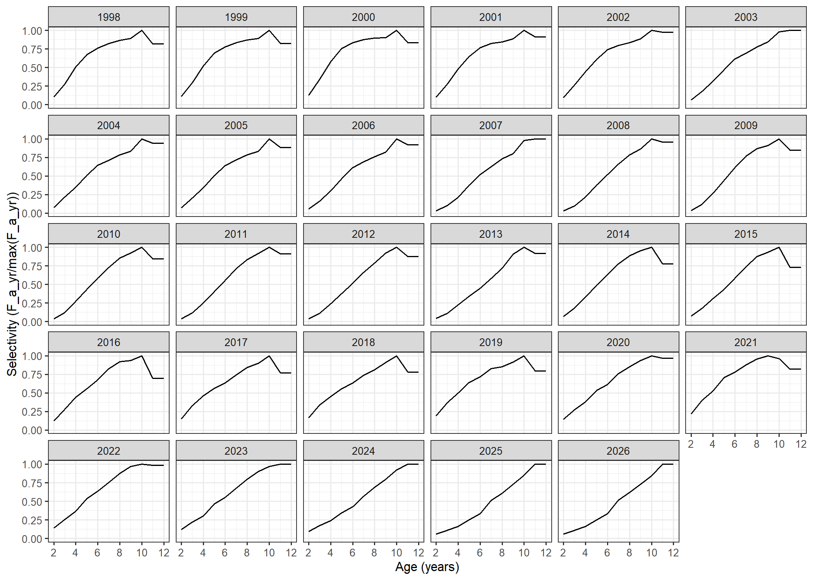<!-- -->

``` r
### last 10 years only
df_f %>% 
  group_by(year) %>%
  mutate(data_rel = data/max(data)) %>%
  filter(year >= 2016) %>%
  ggplot(aes(x = age, y = data_rel)) +
  geom_rect(data = . %>% filter(year %in% 2021:2025),
            xmin = -Inf, xmax = Inf, ymin = -Inf, ymax = Inf, 
            fill = "red", alpha = 0.02,  
            show.legend = FALSE) +
  geom_line() +
  facet_wrap(~ year) +
  scale_x_continuous(breaks = scales::pretty_breaks()) +
  ylim(c(0, NA)) +
  labs(x = "Age (years)", y = "Selectivity (F_a_yr/max(F_a_yr))") +
  theme_bw(base_size = 8)
```

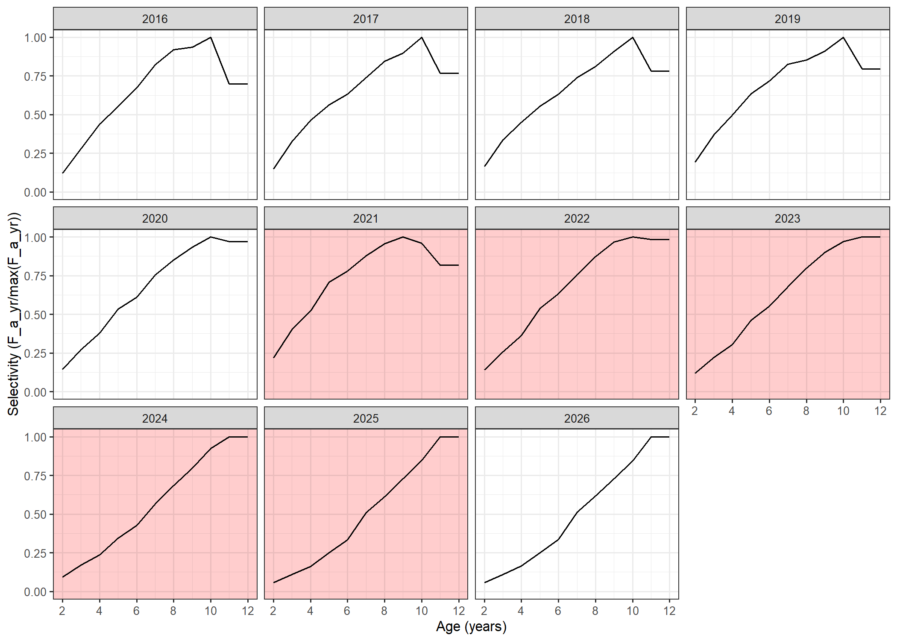<!-- -->

The 2026 selectivity is not real and rather an average of previous
years.

*Decision at meeting with WGWIDE 8 July 2026:*

- Use last 5 years, i.e. 2021-2025 (same period as for weights)

``` r
n_sample_yrs <- 5
```

Justification: same period as for weights at age, some changes over
time, previously more dome shaped but most recent years are more
logistic, fishing quota reduced recently so there is a focus on older
higher values fish, suggesting a more dome shaped selectivity, so using
most recent years seems appropriate.

*Change 07/08/2026*: Use WKMSEHerring approach to account for temporal
correlation in selectivity.

``` r
### Selectivity via variance-covariance forward projection (random walk)
### Adapted from mk.selex.base (WKMSEHerring), but with all ages jointly
### in a single covariance matrix (no 0:2 / 3:8 split)
### code provided by Niels Hintzen
set.seed(3)

ages_sel <- dimnames(stk_stf)$age
n_ages   <- length(ages_sel)
n_fut    <- length(bio_yrs) ### number of projection years to fill (== n_years_new_bio)

### container for simulated future selectivity [age, year, iter]
sel_fut <- array(0, dim = c(n_ages, n_fut, n),
                 dimnames = list(age = ages_sel, year = NULL, iter = seq(n)))
m <- array(0 , dim = c(n_ages , n , 2))
for (x in seq(n)) {
  ### historical F-at-age for this replicate over the sample period [age, year]
  hist_f <- drop(harvest(stk)[, sample_yrs_pos, , , , x])

  ### normalised selectivity (F scaled to max F per year)
  Fsel <- sweep(hist_f, 2, apply(hist_f, 2, max, na.rm = TRUE), "/")

  ### log-differences of F-at-age between consecutive years -> [year-diff, age]
  log_diffs <- apply(log(hist_f), 1, diff)

  ### covariance matrix across ALL ages jointly
  covmat <- cov(log_diffs)
  covmat[is.na(covmat)] <- 0

  ### relative bounds from mean +/- 1.96 sd of log selectivity
  mu_log <- apply(log(Fsel), 1, mean, na.rm = TRUE)
  sd_log <- apply(log(Fsel), 1, sd,   na.rm = TRUE)
  sd_log[is.na(sd_log)] <- 0
  max_fs <- exp(mu_log + 1.96 * sd_log); max_fs[is.na(max_fs)] <- 0
  min_fs <- exp(mu_log - 1.96 * sd_log); min_fs[is.na(min_fs)] <- 0
  ### drop degenerate 0/1 bounds from the acceptance test
  excl_max <- which(max_fs == 0 | max_fs == 1)
  excl_min <- which(min_fs == 0 | min_fs == 1)
  ### try to fix vector of zero length...
  incl_max <- which(max_fs != 0 & max_fs != 1)
  incl_min <- which(min_fs != 0 & min_fs != 1)

  ### starting pattern = most recent selectivity
  current_f <- Fsel[, ncol(Fsel)]
  
  m[,x,1] <- max_fs ; m[,x,2] <- min_fs

  for (yy in seq(n_fut)) {
    proposed_f <- max_fs + 1   ### force at least one while iteration
    while (any(proposed_f[incl_max] > max_fs[incl_max]) |
           any(proposed_f[incl_min] < min_fs[incl_min])) {
      ### multivariate normal draw of log-differences (all ages jointly)
      draw       <- MASS::mvrnorm(1, rep(0, n_ages), covmat)
      proposed_f <- current_f * exp(draw)
      ### normalise to max selectivity = 1
      proposed_f <- proposed_f / max(proposed_f) 
    }
    sel_fut[, yy, x] <- proposed_f
    current_f        <- proposed_f
  }
}

### insert into the projection stock (same slot as before)
harvest(stk_stf)[, bio_yrs] <- as.numeric(sel_fut)

# Note: the plots using stk_stf are a little bit misleading. bio_yrs is selectivity whereas the previous years are f
# This makes it seem like selectivity is much higher in the projected period. Suggest using stk_tmp to plot

f <- drop(harvest(stk_stf))
### normalised selectivity (F scaled to max F per year)
sel <- sweep(f, 2:3 , apply(f, 2:3, max, na.rm = TRUE), "/")
stk_tmp <- stk_stf
harvest(stk_tmp) <- as.numeric(sel)

### show some example plot for selectivity
plot(harvest(stk_tmp)) + 
    annotate("rect", xmin = 2020.5, xmax = 2025.5, ymin = -Inf, ymax = Inf,
           alpha = 0.05, fill = "black") +
  ylim(c(0, NA)) + theme_bw()
```

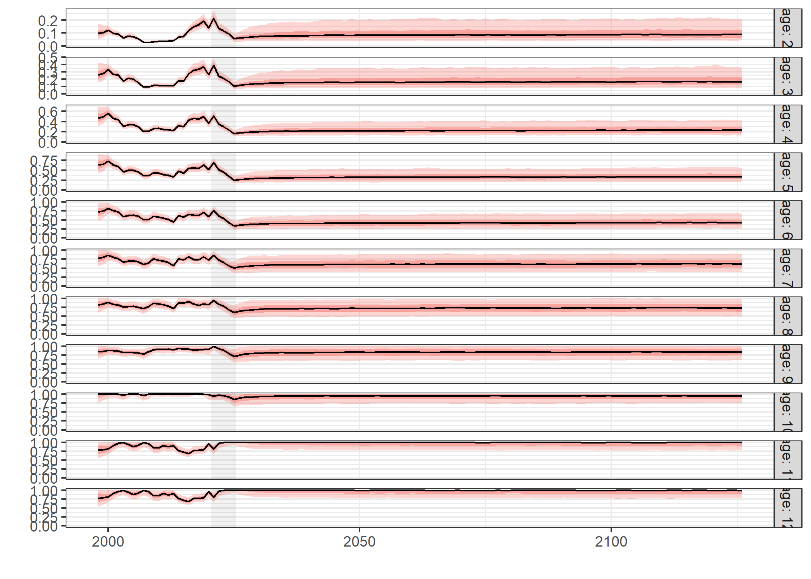<!-- -->

``` r
plot(iter(harvest(stk_tmp), 1)) + 
  annotate("rect", xmin = 2020.5, xmax = 2025.5, ymin = -Inf, ymax = Inf,
           alpha = 0.05, fill = "black") +
  ylim(c(0, NA)) + theme_bw() ### example iteration
```

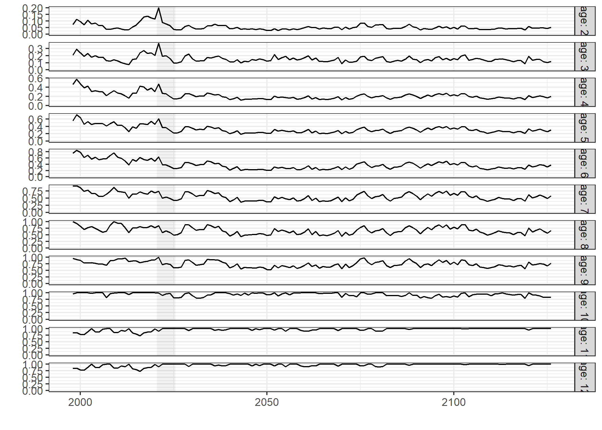<!-- -->

``` r
as.data.frame(harvest(stk_tmp)) %>%
  filter(year %in% 2021:2030) %>%
  filter(iter %in% 1:5) %>%
  group_by(year) %>%
  mutate(data_rel = data/max(data)) %>%
  ggplot(aes(x = age, y = data_rel, colour = iter)) +
  geom_rect(data = . %>% filter(year %in% 2021:2025 & iter == 1),
            xmin = -Inf, xmax = Inf, ymin = -Inf, ymax = Inf, 
            fill = "red", alpha = 0.02,  
            show.legend = FALSE) +
  geom_line() +
  facet_wrap(~ year) +
  scale_x_continuous(breaks = scales::pretty_breaks()) +
  ylim(c(0, NA)) +
  labs(x = "Age (years)", y = "Selectivity (F_a_yr/max(F_a_yr))") +
  theme_bw(base_size = 8)
```

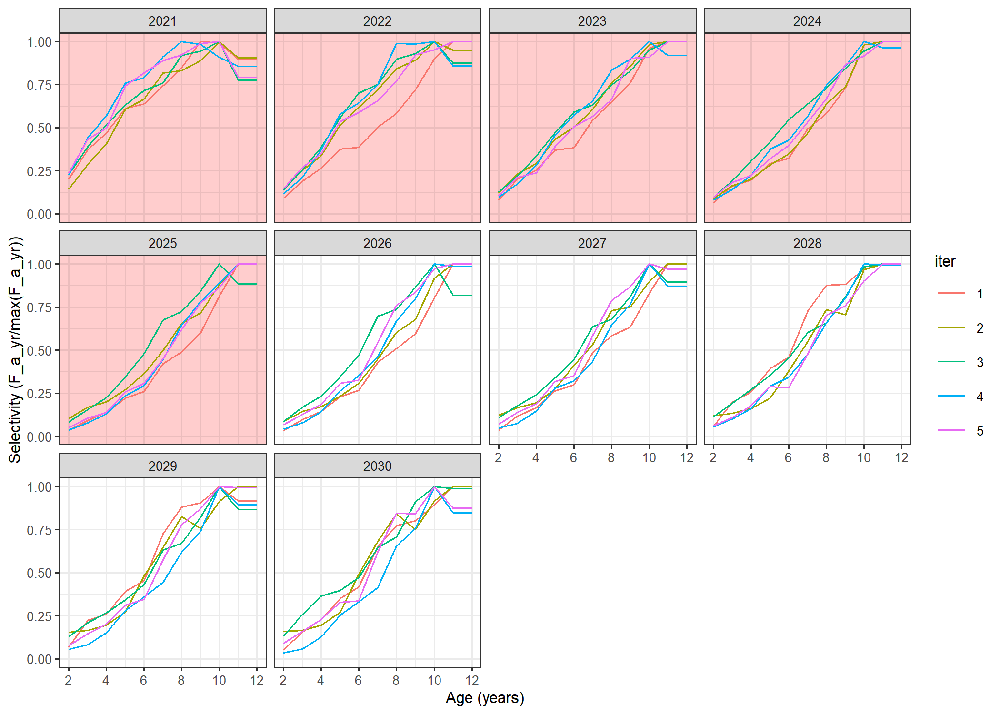<!-- -->

``` r
### all iterations
as.data.frame(harvest(stk_tmp)) %>%
  filter(year %in% 2021:2030) %>%
  #filter(iter %in% 1:5) %>%
  group_by(year, iter) %>%
  mutate(data_rel = data/max(data)) %>%
  ggplot(aes(x = age, y = data_rel, group = iter)) +
  geom_rect(data = . %>% filter(year %in% 2021:2025 & iter == 1),
            xmin = -Inf, xmax = Inf, ymin = -Inf, ymax = Inf, 
            fill = "red", alpha = 0.02,  
            show.legend = FALSE) +
  geom_line(alpha = 0.01) +
  facet_wrap(~ year) +
  scale_x_continuous(breaks = scales::pretty_breaks()) +
  ylim(c(0, NA)) +
  labs(x = "Age (years)", y = "Selectivity (F_a_yr/max(F_a_yr))") +
  theme_bw(base_size = 8)
```

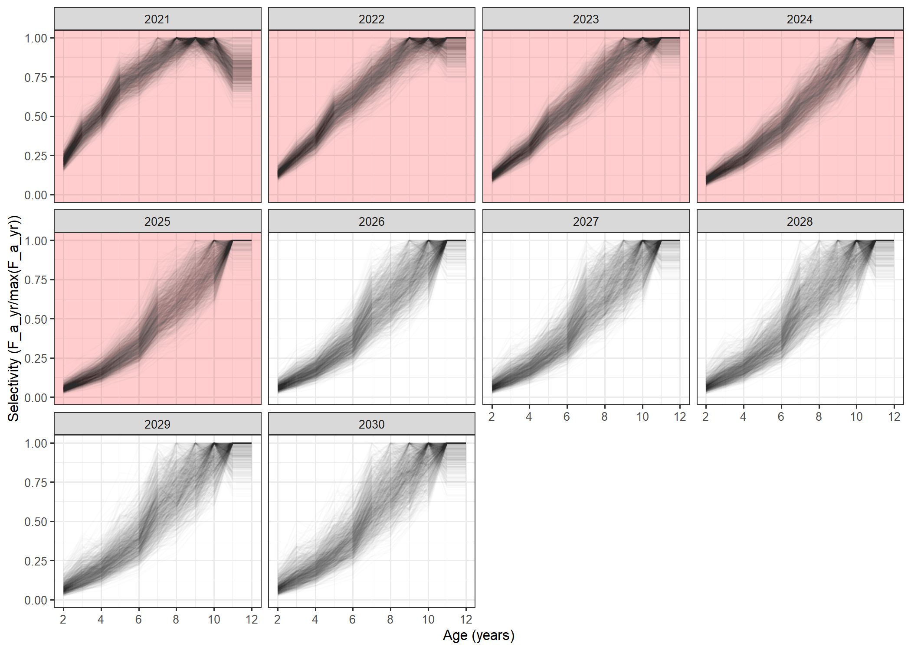<!-- -->

## Stock-recruitment model

Productivity in the MSE projection is mainly set by the
stock-recruitment model.

The recruitment model in the MSE projection should represent the current
(low) recruitment regime.

Let’s look at R/SSB first (accounting for the recruitment age 2, i.e. R
now compared to SSB two years before)

``` r
### R/SSB
### account for time lag SSB and rec age
sr_tmp <- as.FLSR(stk)
plot(rec(sr_tmp)/ssb(sr_tmp)) +
  ylim(c(0, NA)) +
  labs(x = "Year", y = "R/SSB") + 
  theme_bw(base_size = 8) +
  theme(strip.text = element_blank())
```

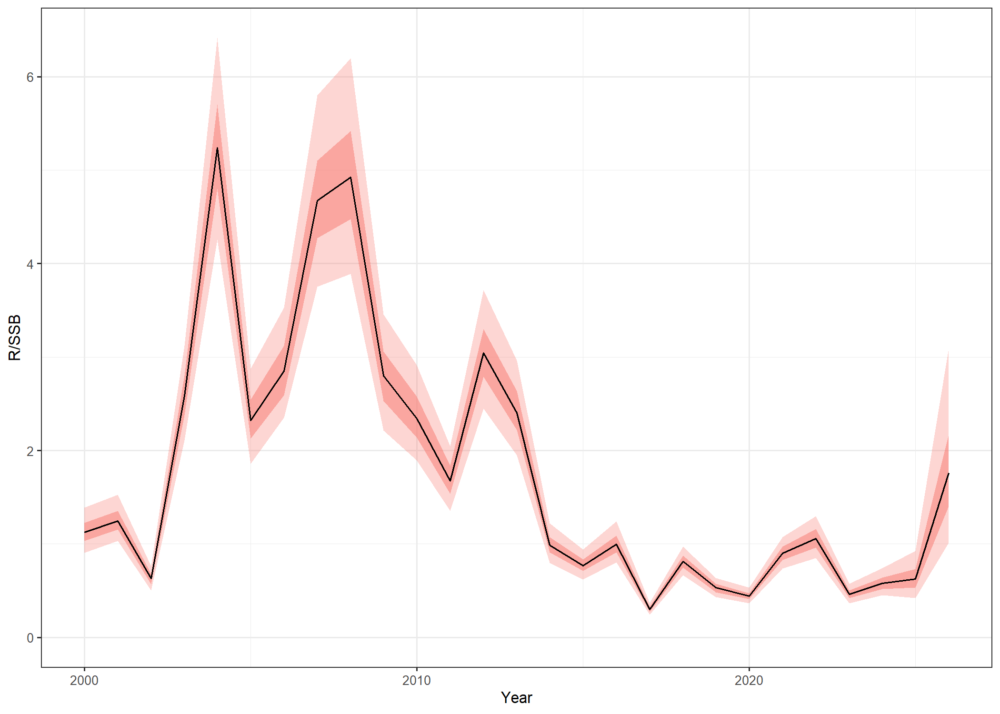<!-- -->

``` r
rm(sr_tmp)
```

There is a clearly lower phase since around 2014.

``` r
srplot(fit)
```

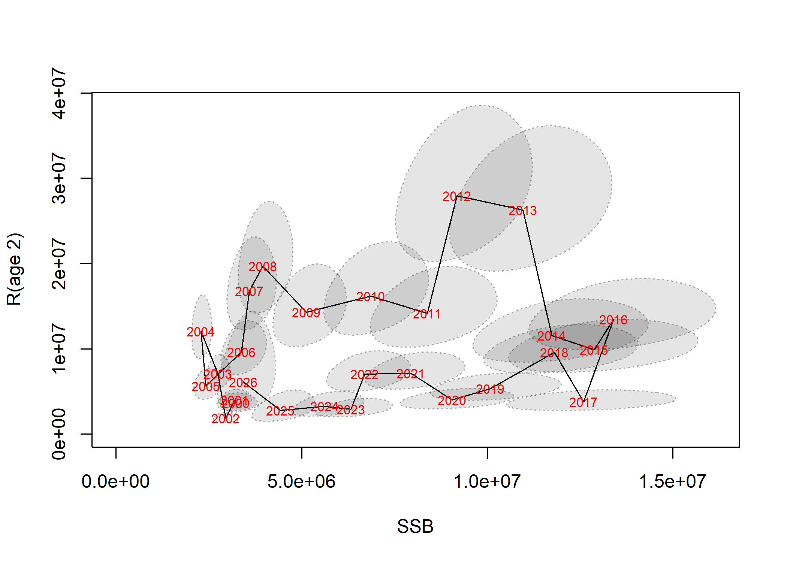<!-- -->

Management reference points were set by WKBMACNSSH in 2025 and $B_{lim}$
set to $B_{lim}=3 067 017$ tonnes. $B_{lim}$ should be the point below
which productivity (recruitment) is impaired:

``` r
srplot(fit)
abline(v = 3067017, col = "red", lty = "1212", lwd = 3)
```

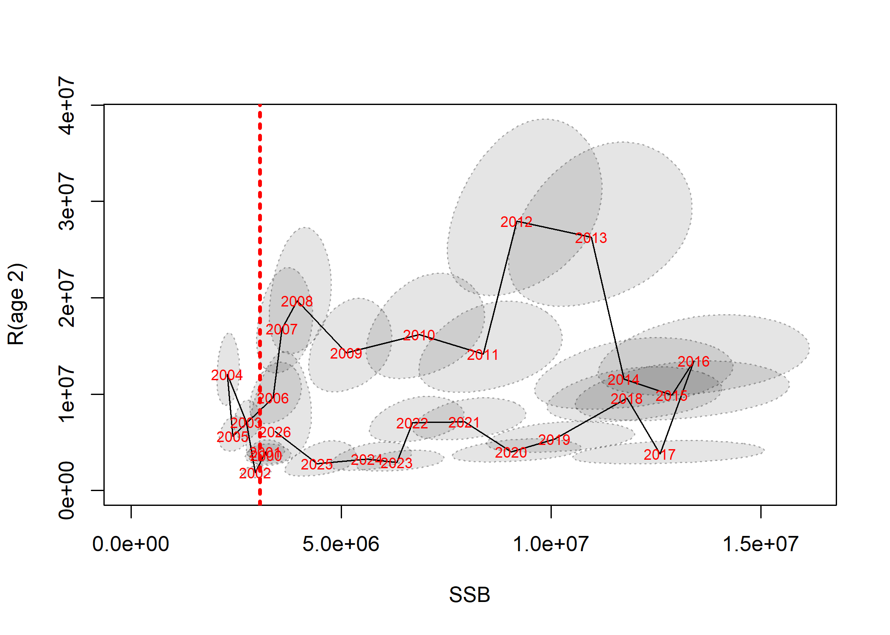<!-- -->

If only the recent (lower) stock-recruit pairs are used to fit a
recruitment model, $B_{lim}$ is below all those values.

The simplest stock-recruitment model with density dependance and a clear
$B_{lim}$ is a hockey-stick model (segmented regression). It may make
sense to fix the breakpoint to the $B_{lim}$ value from WKBMACNSSH. This
then means that the plateau of the recruitment model is approximately
the average of the recruitment values considered (lower if 5 years are
used, a bit higher if 10 years are used).

Approach:

- fit stock-recruitment model to individual iterations

- generate recruitment residuals by sampling from historical residuals
  (smoothed with kernel density smoother to get wider range and
  non-discrete values)

Decisions:

- Use *2017-2026* (current low recruitment regime)

- Hockey-stick (segmented regression) - not biologically plausible but
  ensure reduced productivity below breakpoint

- Fix breakpoint to $B_{lim}=3 067 017$ tonnes (ICES management
  reference point)

- include auto-correlation (AR1) if residuals show significant
  auto-correlation

``` r
### create FLSR object
sr_model <- "segreg"
sr <- as.FLSR(stk_stf, model = sr_model)
rec(sr)[, ac(2000:2016)] <- NA

### fix breakpoint
sr_fixed = list(b = 3067017) ## list()

### 1st: fit model to median estimates from SAM
sr_med <- as.FLSR(stk_median, model = sr_model)
rec(sr_med)[, ac(2000:2016)] <- NA
### parameter b (breakpoint) is fixed, i.e. only parameter a needs to be estimated
### use optim()'s "Brent" ('L-BFGS-B' for multiple parameters not required)
sr_med <- fmle(sr_med, method = 'Brent', fixed = sr_fixed,
               control = list(trace = 0), lower = 0, upper = 1e+9)
plot(sr_med)
```

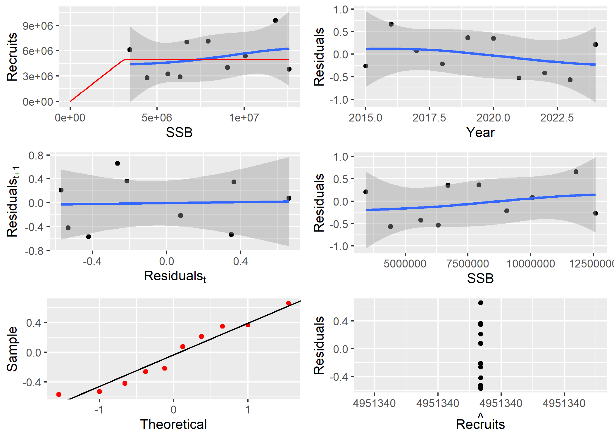<!-- -->

``` r
### fit model to all iterations
### run in parallel to speed up processing
cl_tmp <- makeCluster(10) ### 10 parallel workers
registerDoParallel(cl_tmp)
sr <- fmle_parallel(sr, cl_tmp, method = 'Brent', fixed = sr_fixed,
                    lower = 0, upper = 1e+9)

stopCluster(cl_tmp)
### or run sequentially (slower)
### sr <- fmle(sr, method = 'Brent', fixed = sr_fixed, 
###            control = list(trace = 0), lower = 0, upper = 1e+9)

### sometimes fmle fails in first attempt for some iterations
### but simple 1-dimensional optimisation here -> doesn't fail
which(is.na(params(sr)[1]))
```

    ## integer(0)

``` r
### check autocorrelation of residuals
### for simplicity, use SAM median 
check_AR1(residuals(sr_med), plot = TRUE)
```

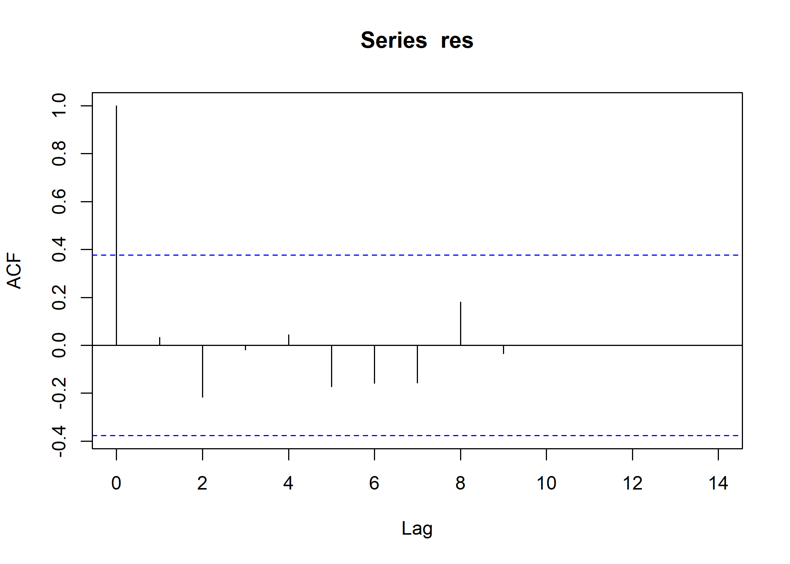<!-- -->

    ## [1] "lag-1 auto-correlation: 0.0335;  NOT statistically significant"

``` r
include_ar <- FALSE ### do not include
```

Now, lets generate the recruitment residuals for the MSE projection

``` r
### generate residuals for MSE
### years with missing residuals
yrs_res <- colnames(rec(sr))[which(is.na(iterMeans(rec(sr))))]
yrs_res <- yrs_res[yrs_res >= 2026]

### generate residuals (function defined in funs_OM.R)
res_new <- dens_resids(
  res = residuals(sr), 
  template = window(residuals(sr), start = 2027), res_ar1 = FALSE, 
  cut_2SD = TRUE)
### Niels approach for bias correction:
### bias-correct per iteration so mean(exp(dev)) == 1 (natural scale)
res_new <- res_new - (res_new %=% log(yearMeans(exp(res_new))))
summary(exp(res_new))
```

    ## An object of class "FLQuant" with:
    ## 
    ## dim:    age year unit season area iter 
    ##         1   100  1    1      1    1000 
    ## units:   
    ## 
    ##    Min. 1st Qu.  Median    Mean 3rd Qu.    Max.    %NAs 
    ##    0.19    0.61    0.88    1.01    1.30    4.08    0.00

``` r
### insert into model
residuals(sr)[, yrs_res] <- res_new
### exponentiate residuals to get factor
residuals(sr) <- exp(residuals(sr))
sr_res <- residuals(sr)

### plot residuals
plot(sr_res) + ylim(c(0, NA)) + theme_bw() + theme(strip.text = element_blank())
```

    ## Warning: Removed 17000 rows containing non-finite outside the scale range
    ## (`stat_fl_quantiles()`).
    ## Removed 17000 rows containing non-finite outside the scale range
    ## (`stat_fl_quantiles()`).
    ## Removed 17000 rows containing non-finite outside the scale range
    ## (`stat_fl_quantiles()`).
    ## Removed 17000 rows containing non-finite outside the scale range
    ## (`stat_fl_quantiles()`).

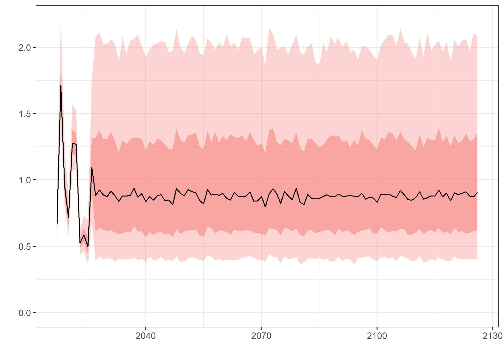<!-- -->

``` r
plot(sr_res, iter = 1:5) + ylim(c(0, NA)) + theme_bw()  + theme(strip.text = element_blank()) ### show 1st 5 iterations
```

    ## Warning: Removed 17000 rows containing non-finite outside the scale range
    ## (`stat_fl_quantiles()`).
    ## Removed 17000 rows containing non-finite outside the scale range
    ## (`stat_fl_quantiles()`).
    ## Removed 17000 rows containing non-finite outside the scale range
    ## (`stat_fl_quantiles()`).
    ## Removed 17000 rows containing non-finite outside the scale range
    ## (`stat_fl_quantiles()`).

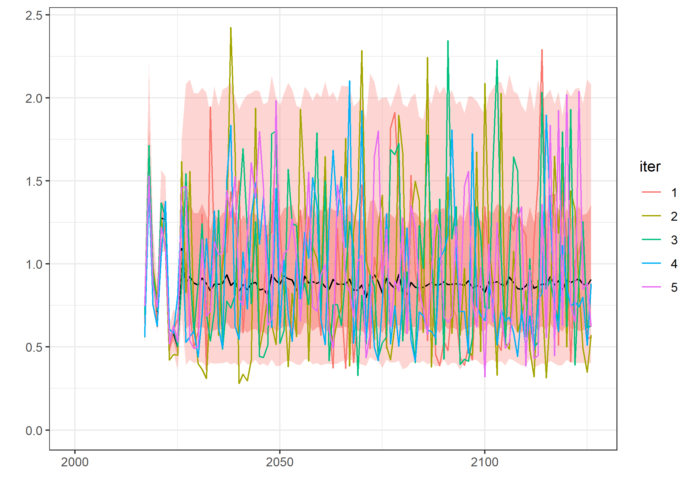<!-- -->

Illustrate process of generating recruitment residuals

``` r
### code snippet for illustration purposes only - model and residuals defined previously

### median model fit
sr_params <- params(sr_med)
sr_params <- list(a = c(sr_params$a), b = c(sr_params$b))
sr_model <- function(ssb, a, b) {ifelse(ssb <= b, a * ssb, a * b)}
### median - data.frame with data
df_sr <- data.frame(year = as.numeric(dimnames(sr_med)$year),
                    ssb = c(ssb(sr_med)), 
                    rec = c(rec(sr_med)), 
                    fitted = c(fitted(sr_med)),
                    residuals = c(residuals(sr_med))) %>%
  filter(year >= 2017)
### median - get density
dens <- density(x = df_sr$residuals)
df_dens <- data.frame(x = dens$x, y = dens$y)

### iterations - get density
sr_om <- window(sr, start = 2017)
df_dens_iter <- lapply(seq(dim(sr_om)[6]), function(i) {
  dens <- density(log(c(iter(sr_om@residuals, i))))
  data.frame(x = dens$x, y = dens$y, iter = i)
})
df_dens_iter <- bind_rows(df_dens_iter)

p_res <- df_sr %>%
  ggplot(aes(x = ssb, y = rec)) +
  #geom_blank(data = data.frame(ssb = 9, rec = 18)) +
  geom_linerange(aes(x = ssb, ymin = rec, ymax = fitted), 
                 colour = "blue", linewidth = 0.2, 
                 linetype = "2121") +
  geom_point(aes(x = ssb, y = rec), size = 0.5) +
  geom_function(fun = sr_model, args = sr_params, linewidth = 0.4) +
  scale_colour_manual(values = c(observation = "black", model = "black")) +
  scale_y_continuous(breaks = scales::pretty_breaks(),
                     limits = c(0, 9.5*1e+6), expand = c(0, 0), ) +
  scale_x_continuous(breaks = scales::pretty_breaks(),
                     limits = c(0, 1.3e+7), expand = c(0, 0)) +
  labs(x = "SSB (t)", y = "Recruitment") +
  theme_bw(base_size = 8)
#p_res
df_dens_max <- max(df_dens$y)
p_hist <- df_sr %>%
  ggplot(aes(residuals)) +
  geom_histogram(bins = 13, colour = "black", fill = "white",
                 linewidth = 0.4) +
  geom_line(aes(x = x, y = y * 5 * df_dens_max, colour = "kernel"), 
            data = df_dens, show.legend = TRUE, linewidth = 0.4) + 
  scale_x_continuous(breaks = c(-1, 0, 1),
                     limits = c(-1.5, 1.5)) +
  scale_y_continuous(breaks = scales::pretty_breaks(),
                     sec.axis = sec_axis(~./(5 * df_dens_max), 
                                         name = "Density", 
                                         breaks = scales::pretty_breaks()),
                     limits = c(0, 4.1), expand = c(0, 0)) +
  scale_colour_manual("", values = c(kernel = "red"), 
                      labels = c("kernel\ndensity")) +
  labs(y = "Residual count", x = "Log residuals") +
  theme_bw(base_size = 8) +
  theme(axis.title.y.right = element_text(angle = 90),
        legend.position = "inside",
        legend.position.inside = c(0.78, 0.9),
        legend.background = element_blank(),
        legend.key = element_blank())
#p_hist
df_dens_iter_max <- max(df_dens_iter$y)
p_hist_iter <- ggplot() +
  geom_line(data = df_dens_iter, 
            aes(x = x, y = y, group = iter), 
            linewidth = 0.1, alpha = 0.05) + 
  scale_y_continuous(position = "right",
                     breaks = scales::pretty_breaks(),
                     limits = c(0, df_dens_iter_max*1.05), expand = c(0, 0)) +
  scale_x_continuous(breaks = scales::pretty_breaks(),
                     limits = c(-2.5, 2.5)) +
  labs(y = "Density", x = "Log residuals") +
  theme_bw(base_size = 8) +
  theme(axis.title.y.right = element_text(angle = 90))
#p_hist_iter
p_res / p_hist / p_hist_iter + plot_annotation(tag_levels = "a", 
                                 tag_prefix = "(", tag_suffix = ")")  &
  theme(plot.tag = element_text(face = "bold"))
```

    ## Warning: No shared levels found between `names(values)` of the manual scale and the
    ## data's colour values.

    ## Warning: Removed 1 row containing missing values or values outside the scale range
    ## (`geom_segment()`).

    ## Warning: Removed 1 row containing missing values or values outside the scale range
    ## (`geom_point()`).

    ## Warning: Removed 2 rows containing missing values or values outside the scale range
    ## (`geom_bar()`).

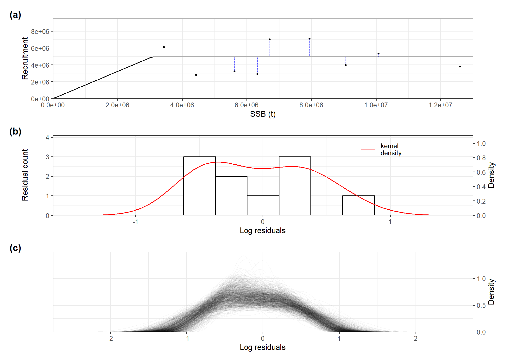<!-- -->
Visualisation of recruitment modelling for the baseline operating model.
Panels (a) and (b) illustrate the process for the median stock-recruit
pairs. Shown are (a) the stock-recruitment model fit (solid black curve;
points are stock-recruit pairs) and (b) the distribution of log
residuals (histogram). Residuals for the projection are sampled from the
kernel density distribution (red curve in b). Panel (c) illustrates the
kernel densities for all 1,000 simulation replicates.

``` r
df_sr_median <- data.frame(year = as.numeric(dimnames(ssb(sr))$year),
                               ssb = c(iterMedians(ssb(sr))), 
                               rec = c(iterMedians(rec(sr)))) %>%
  filter(year <= 2026) %>%
  mutate(type = "median")
df_sr_iter <- data.frame(year = as.numeric(dimnames(ssb(sr))$year),
                             ssb = c(ssb(sr)), 
                             rec = c(rec(sr)),
                             iter = c(as.numeric(dimnames(sr)$iter))) %>%
  filter(year <= 2026) %>%
  mutate(type = "replicates")
df_sr <- bind_rows(df_sr_median, df_sr_iter) %>%
  mutate(type = factor(type, levels = c("median", "replicates"),
                       labels = c("median (stock-\nrecruit pairs)", 
                                  "replicates (stock-\nrecruit pairs)")))
sr_pars <- params(sr)
sr_pars_med <- list(a = c(iterMedians(sr_pars$a)), 
                    b = c(iterMedians(sr_pars$b)))
sr_model <- function(ssb, a, b) {ifelse(ssb <= b, a * ssb, a * b)}
ssbs <- c(0, 3067017, 1.5e+7)
sr_df <- lapply(seq(dim(sr@rec)[6]), function(x) {
  data.frame(ssb = ssbs,
             rec = sr_model(ssb = ssbs, 
                            a = c(sr_pars$a[, x]),
                            b = c(sr_pars$b[, x])),
             iter = x)
})
sr_df <- bind_rows(sr_df)
sr_df <- bind_rows(data.frame(ssb = ssbs,
                              rec = sr_model(ssb = ssbs, 
                                       a = c(iterMedians(sr_pars$a)),
                                       b = c(iterMedians(sr_pars$b))),
                              iter = 0) %>%
                     mutate(type = "median"),
                   sr_df %>%
                     mutate(type = "replicates")) %>%
  mutate(type = factor(type, levels = c("median", "replicates"),
                       labels = c("median (model)", 
                                  "replicates (model)")))

ggplot() +
  ### print points/lines separately so that median is on top
  geom_point(data = df_sr %>% 
               filter(type == "replicates (stock-\nrecruit pairs)"),
             aes(x = ssb, y = rec, 
                 colour = type), 
             alpha = 0.05, size = 0.3) +
  geom_line(data = sr_df %>% filter(type == "replicates (model)"),
            aes(x = ssb, y = rec, group = iter,
                colour = type),
          linewidth = 0.1, alpha = 0.05) +
  geom_point(data = df_sr %>% filter(type == "median (stock-\nrecruit pairs)"),
             aes(x = ssb, y = rec, 
                 colour = type),
             size = 0.4) +
  geom_line(data = sr_df %>% filter(type == "median (model)"),
            aes(x = ssb, y = rec, group = iter,
                colour = type),
            linewidth = 0.4, alpha = 1) +
  scale_colour_manual("", 
    values = c("median (stock-\nrecruit pairs)" = "red", 
               "replicates (stock-\nrecruit pairs)" = "black",
               "median (model)" = "red", 
               "replicates (model)" = "black")) +
  guides(colour = guide_legend(override.aes = list(alpha = 1))) +
  scale_x_continuous("SSB (t)", breaks = scales::pretty_breaks()) +
  scale_y_continuous("Recruitment") +
  #coord_cartesian(xlim = c(0, 10), ylim = c(0, 17.5), expand = FALSE) +
  theme_bw(base_size = 8) +
  theme(legend.key.height = unit(0.7, "lines"))
```

    ## Warning: Removed 19000 rows containing missing values or values outside the scale range
    ## (`geom_point()`).

    ## Warning: Removed 19 rows containing missing values or values outside the scale range
    ## (`geom_point()`).

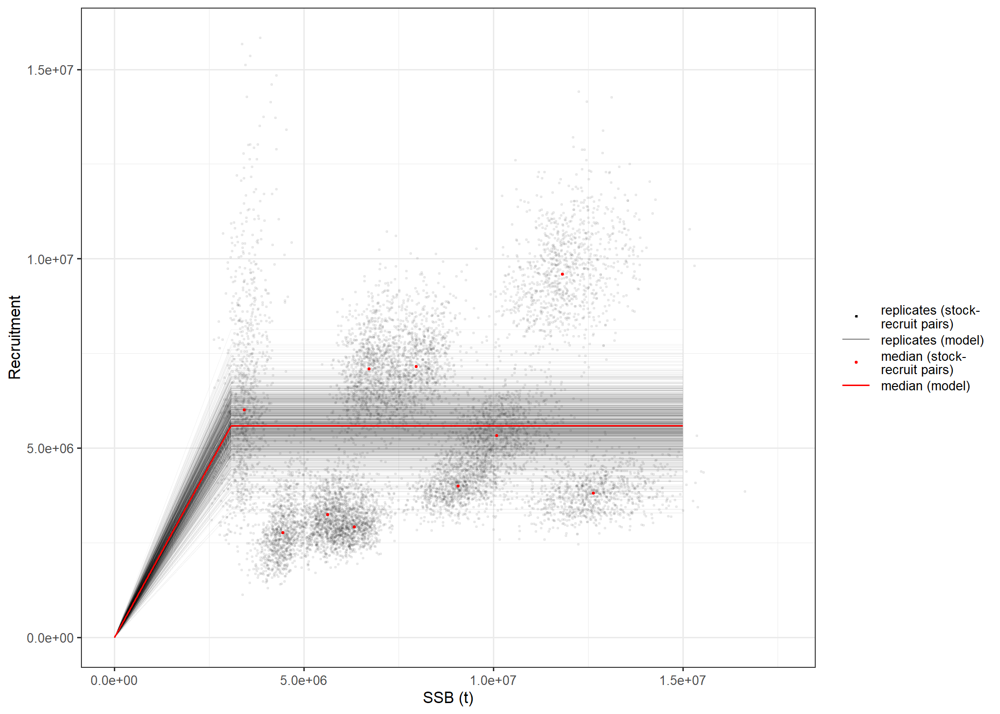<!-- -->

## Alternative recruitment model - recruits per spawner

The recruits per spawner (R/SSB) dropped already in 2014 (i.e. earlier
than the absolute numbers of recruits) and stayed at a lower level since
then:

``` r
sr_tmp <- as.FLSR(stk_stf, model = "segreg")
plot(rec(sr_tmp)/ssb(sr_tmp)) +
  ylim(c(0, NA)) +
  labs(x = "Year", y = "R/SSB") + 
  annotate("rect", xmin = 2013.5, xmax = 2026.5, ymin = -Inf, ymax = Inf,
           alpha = 0.05, fill = "black") + 
  theme_bw(base_size = 8) +
  theme(strip.text = element_blank())
```

    ## Warning: Removed 100000 rows containing non-finite outside the scale range
    ## (`stat_fl_quantiles()`).
    ## Removed 100000 rows containing non-finite outside the scale range
    ## (`stat_fl_quantiles()`).
    ## Removed 100000 rows containing non-finite outside the scale range
    ## (`stat_fl_quantiles()`).
    ## Removed 100000 rows containing non-finite outside the scale range
    ## (`stat_fl_quantiles()`).

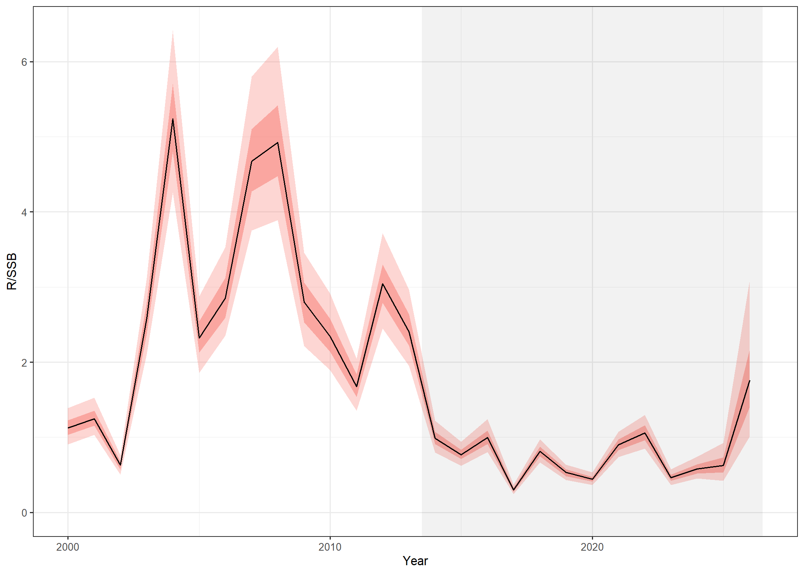<!-- -->

The meeting with WGWIDE on 8 July 2026 suggested to explore an
alternative recruitment based on this, where recruitment (R) is modelled
as a function of SSB: $R=a \times \text{SSB}$. The view was that this
may lead to more plausible recruitment values in the short term of a
projection. However, it has the drawback that recruitment is increasing
linearly with SSB, i.e. it leads to unrealistically high recruitment at
higher SSB, e.g. once the stock recovers.

While custom recruitment models are theoretically possible, they cause
issues with Flasher’s `fwd()`. A workaround is to use an existing
recruitment model and fix some parameters. Here, we use a Cushing model
and fix $b=1$: $R=a \times \text{SSB}^b$

Let’s fit this model to the median stock:

``` r
sr_med_rps <- as.FLSR(stk_median, model = "cushing")
sr_med_rps@initial <- function() return(FLPar(a = 1 , b = 1)) 
### use only recruitment from 2014 and later (lower)
rec(sr_med_rps)[, ac(2000:2013)] <- NA
### fit model
sr_med_rps <- fmle(sr_med_rps, method = 'Brent', fixed = list(b = 1),
                   control = list(trace = 2), lower = 0, upper = 1e+9)
model(sr_med_rps)
```

    ## rec ~ a * ssb^b
    ## <environment: 0x000001be00c1c2a8>

``` r
params(sr_med_rps)
```

    ## An object of class "FLPar"
    ## params
    ##     a     b 
    ## 0.694 1.000 
    ## units:  NA

``` r
plot(sr_med_rps)
```

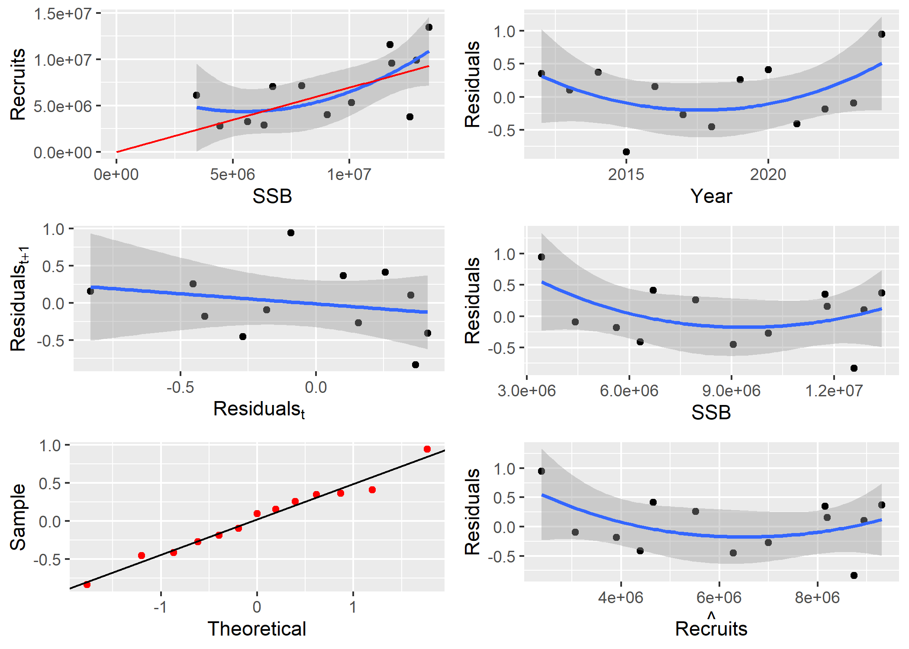<!-- -->

``` r
### the recruitment model is essentially the average of R/SSB
sr_tmp <- as.FLSR(stk_median, model = "cushing")
plot(rec(sr_tmp)/ssb(sr_tmp)) +
  ylim(c(0, NA)) +
  labs(x = "Year", y = "R/SSB") + 
  annotate("rect", xmin = 2013.5, xmax = 2026.5, ymin = -Inf, ymax = Inf,
           alpha = 0.05, fill = "red") + 
  geom_hline(yintercept = c(params(sr_med_rps)["a"]), colour = "red",
             linetype = "2121") +
  theme_bw(base_size = 8) +
  theme(strip.text = element_blank())
```

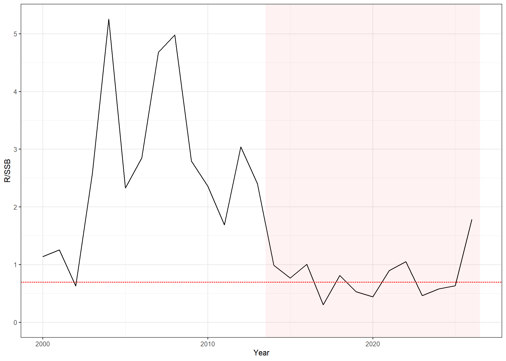<!-- -->

Let’s now apply this model to full stock with 1000 iterations and
generate residuals with the same approach as for the hockey-stick model.

``` r
### create FLSR object
sr_rps <- as.FLSR(stk_stf, model = "cushing")
sr_rps@initial <- function() return(FLPar(a = 1 , b = 1)) 
rec(sr_rps)[, ac(2000:2013)] <- NA

### fit model to all iterations
### run in parallel to speed up processing
cl_tmp <- makeCluster(10) ### 10 parallel workers
registerDoParallel(cl_tmp)
sr_rps <- fmle_parallel(sr_rps, cl_tmp, method = 'Brent', fixed = list(b = 1),
                        lower = 0, upper = 1e+9)
stopCluster(cl_tmp)

### check autocorrelation of residuals
### for simplicity, use SAM median 
check_AR1(residuals(sr_med_rps), plot = TRUE)
```

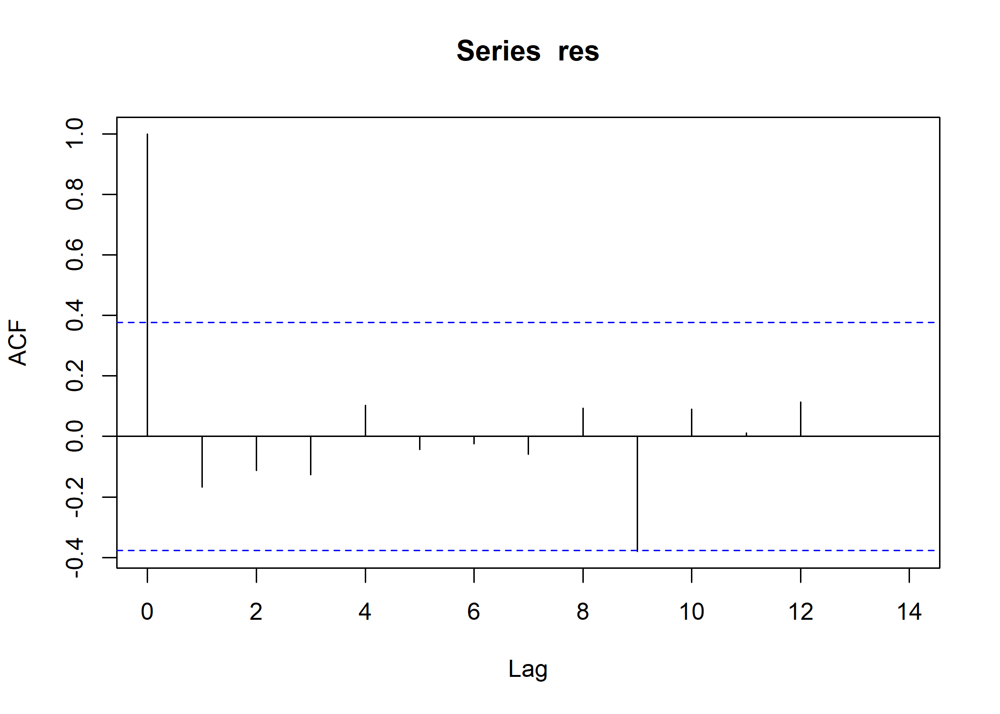<!-- -->

    ## [1] "lag-1 auto-correlation: -0.1677;  NOT statistically significant"

``` r
include_ar <- FALSE ### do not include

### generate residuals for MSE
### years with missing residuals
yrs_res <- colnames(rec(sr_rps))[which(is.na(iterMeans(rec(sr_rps))))]
yrs_res <- yrs_res[yrs_res >= 2026]

### generate residuals
res_new <- dens_resids(
  res = residuals(sr_rps), 
  template = window(residuals(sr_rps), start = 2027), res_ar1 = FALSE, 
  cut_2SD = TRUE)

### Niels approach for bias correction:
### bias-correct per iteration so mean(exp(dev)) == 1 (natural scale)
res_new <- res_new - (res_new %=% log(yearMeans(exp(res_new))))
summary(exp(res_new))
```

    ## An object of class "FLQuant" with:
    ## 
    ## dim:    age year unit season area iter 
    ##         1   100  1    1      1    1000 
    ## units:   
    ## 
    ##    Min. 1st Qu.  Median    Mean 3rd Qu.    Max.    %NAs 
    ##    0.22    0.62    0.90    1.00    1.25    4.34    0.00

``` r
### insert into model
residuals(sr_rps)[, yrs_res] <- res_new
### exponentiate residuals to get factor
residuals(sr_rps) <- exp(residuals(sr_rps))
sr_rps_res <- residuals(sr_rps)

### plot residuals
plot(sr_rps_res) + ylim(c(0, NA)) + theme_bw() + theme(strip.text = element_blank())
```

    ## Warning: Removed 14000 rows containing non-finite outside the scale range
    ## (`stat_fl_quantiles()`).
    ## Removed 14000 rows containing non-finite outside the scale range
    ## (`stat_fl_quantiles()`).
    ## Removed 14000 rows containing non-finite outside the scale range
    ## (`stat_fl_quantiles()`).
    ## Removed 14000 rows containing non-finite outside the scale range
    ## (`stat_fl_quantiles()`).

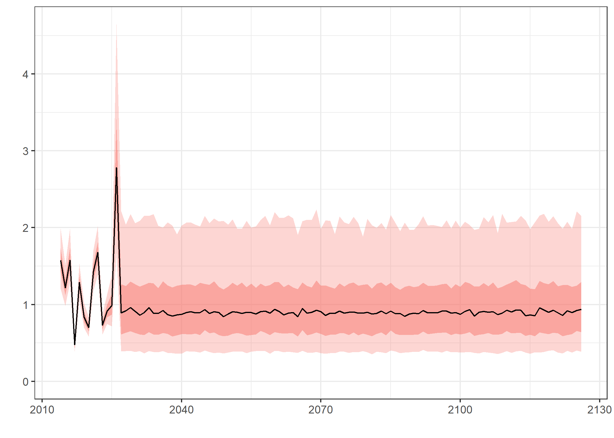<!-- -->

``` r
plot(sr_rps_res, iter = 1:5) + ylim(c(0, NA)) + theme_bw()  + theme(strip.text = element_blank()) ### show 1st 5 iterations
```

    ## Warning: Removed 14000 rows containing non-finite outside the scale range
    ## (`stat_fl_quantiles()`).
    ## Removed 14000 rows containing non-finite outside the scale range
    ## (`stat_fl_quantiles()`).
    ## Removed 14000 rows containing non-finite outside the scale range
    ## (`stat_fl_quantiles()`).
    ## Removed 14000 rows containing non-finite outside the scale range
    ## (`stat_fl_quantiles()`).

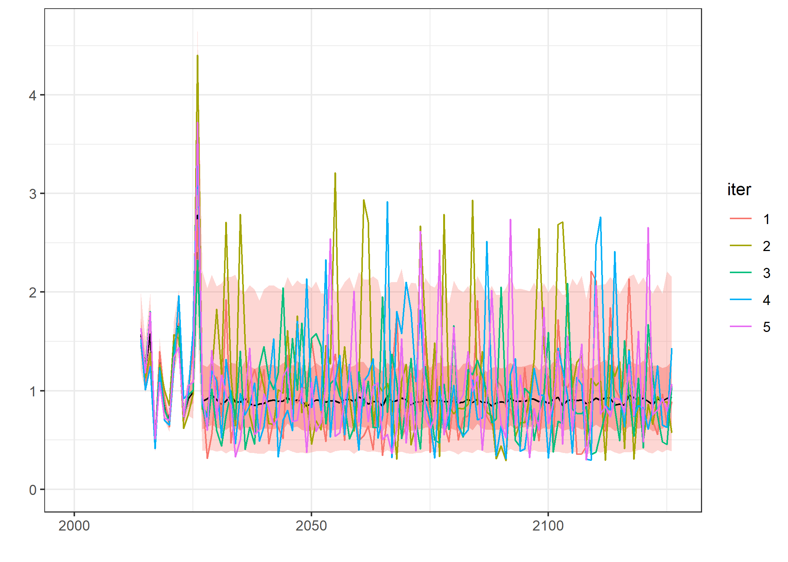<!-- -->

``` r
### Illustrate process of generating recruitment residuals
### code snippet for illustration purposes only - model and residuals defined previously

### median model fit
sr_rps_params <- params(sr_med_rps)
sr_rps_params <- list(a = c(sr_rps_params$a), b = c(sr_rps_params$b))
sr_rps_model <- function(ssb, a, b) {a * ssb^b}
df_sr_rps <- data.frame(year = as.numeric(dimnames(sr_med_rps)$year),
                    ssb = c(ssb(sr_med_rps)), 
                    rec = c(rec(sr_med_rps)), 
                    fitted = c(fitted(sr_med_rps)),
                    residuals = c(residuals(sr_med_rps))) %>%
  filter(year >= 2014)
### median - get density
dens <- density(x = df_sr_rps$residuals)
df_dens <- data.frame(x = dens$x, y = dens$y)
### iterations - get density
sr_rps_om <- window(sr_rps, start = 2014)
df_dens_iter <- lapply(seq(dim(sr_rps_om)[6]), function(i) {
  dens <- density(log(c(iter(sr_rps_om@residuals, i))), na.rm = TRUE)
  data.frame(x = dens$x, y = dens$y, iter = i)
})
df_dens_iter <- bind_rows(df_dens_iter)

p_res <- df_sr_rps %>%
  ggplot(aes(x = ssb, y = rec)) +
  #geom_blank(data = data.frame(ssb = 9, rec = 18)) +
  geom_linerange(aes(x = ssb, ymin = rec, ymax = fitted), 
                 colour = "blue", linewidth = 0.2, 
                 linetype = "2121") +
  geom_point(aes(x = ssb, y = rec), size = 0.5) +
  geom_function(fun = sr_rps_model, args = sr_rps_params, linewidth = 0.4) +
  scale_colour_manual(values = c(observation = "black", model = "black")) +
  scale_y_continuous(breaks = scales::pretty_breaks(),
                     limits = c(0, 15*1e+6), expand = c(0, 0), ) +
  scale_x_continuous(breaks = scales::pretty_breaks(),
                     limits = c(0, 1.4e+7), expand = c(0, 0)) +
  labs(x = "SSB (t)", y = "Recruitment") +
  theme_bw(base_size = 8)
#p_res
df_dens_max <- max(df_dens$y)
p_hist <- df_sr_rps %>%
  ggplot(aes(residuals)) +
  geom_histogram(bins = 13, colour = "black", fill = "white",
                 linewidth = 0.4) +
  geom_line(aes(x = x, y = y * 4.4 * df_dens_max, colour = "kernel"), 
            data = df_dens, show.legend = TRUE, linewidth = 0.4) + 
  scale_x_continuous(breaks = c(-1, 0, 1),
                     limits = c(-1.5, 1.5)) +
  scale_y_continuous(breaks = scales::pretty_breaks(),
                     sec.axis = sec_axis(~./(4.4 * df_dens_max), 
                                         name = "Density", 
                                         breaks = scales::pretty_breaks()),
                     limits = c(0, 4.1), expand = c(0, 0)) +
  scale_colour_manual("", values = c(kernel = "red"), 
                      labels = c("kernel\ndensity")) +
  labs(y = "Residual count", x = "Log residuals") +
  theme_bw(base_size = 8) +
  theme(axis.title.y.right = element_text(angle = 90),
        legend.position = "inside",
        legend.position.inside = c(0.78, 0.9),
        legend.background = element_blank(),
        legend.key = element_blank())
#p_hist
df_dens_iter_max <- max(df_dens_iter$y)
p_hist_iter <- ggplot() +
  geom_line(data = df_dens_iter, 
            aes(x = x, y = y, group = iter), 
            linewidth = 0.1, alpha = 0.05) + 
  scale_y_continuous(position = "right",
                     breaks = scales::pretty_breaks(),
                     limits = c(0, df_dens_iter_max*1.05), expand = c(0, 0)) +
  scale_x_continuous(breaks = scales::pretty_breaks(),
                     limits = c(-2.5, 2.5)) +
  labs(y = "Density", x = "Log residuals") +
  theme_bw(base_size = 8) +
  theme(axis.title.y.right = element_text(angle = 90))
#p_hist_iter
p_res / p_hist / p_hist_iter + plot_annotation(tag_levels = "a", 
                                 tag_prefix = "(", tag_suffix = ")")  &
  theme(plot.tag = element_text(face = "bold"))
```

    ## Warning: No shared levels found between `names(values)` of the manual scale and the
    ## data's colour values.

    ## Warning: Removed 2 rows containing missing values or values outside the scale range
    ## (`geom_bar()`).

    ## Warning: Removed 44 rows containing missing values or values outside the scale range
    ## (`geom_line()`).

    ## Warning: Removed 37 rows containing missing values or values outside the scale range
    ## (`geom_line()`).

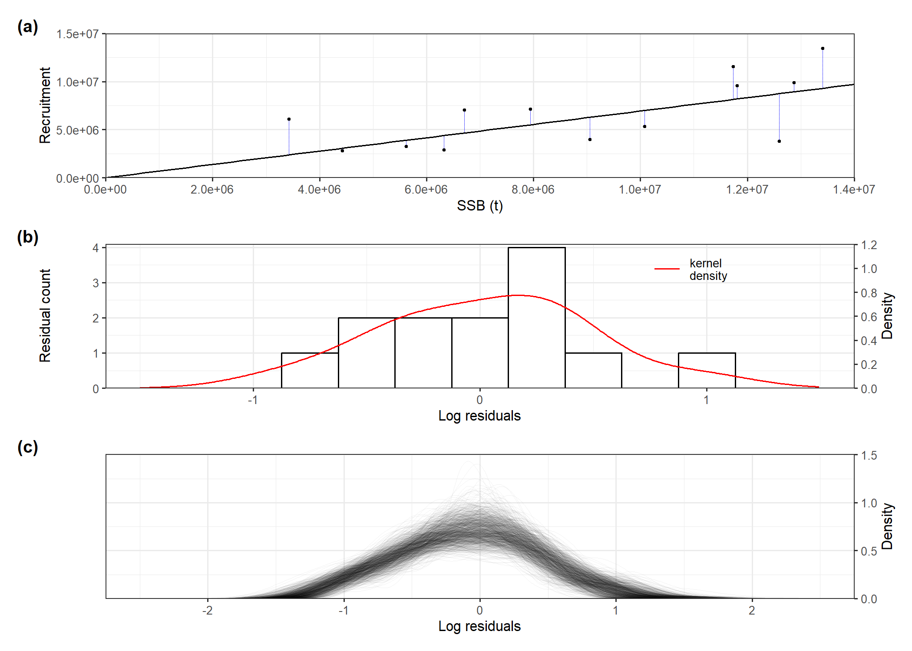<!-- -->

``` r
### now plot recruitment model for all iterations
df_sr_median <- data.frame(year = as.numeric(dimnames(ssb(sr_rps))$year),
                               ssb = c(iterMedians(ssb(sr_rps))), 
                               rec = c(iterMedians(rec(sr_rps)))) %>%
  filter(year <= 2026) %>%
  mutate(type = "median")
df_sr_iter <- data.frame(year = as.numeric(dimnames(ssb(sr_rps))$year),
                             ssb = c(ssb(sr_rps)), 
                             rec = c(rec(sr_rps)),
                             iter = c(as.numeric(dimnames(sr_rps)$iter))) %>%
  filter(year <= 2026) %>%
  mutate(type = "replicates")
df_sr <- bind_rows(df_sr_median, df_sr_iter) %>%
  mutate(type = factor(type, levels = c("median", "replicates"),
                       labels = c("median (stock-\nrecruit pairs)", 
                                  "replicates (stock-\nrecruit pairs)")))
sr_pars <- params(sr_rps)
sr_pars_med <- list(a = c(iterMedians(sr_pars$a)), b = c(iterMedians(sr_pars$b)))
ssbs <- c(0, 3067017, 2e+7)
sr_df <- lapply(seq(dim(sr_rps@rec)[6]), function(x) {
  data.frame(ssb = ssbs,
             rec = sr_rps_model(ssb = ssbs, 
                                a = c(sr_pars$a[, x]),
                                b = c(sr_pars$b[, x])),
             iter = x)
})
sr_df <- bind_rows(sr_df)
sr_df <- bind_rows(data.frame(ssb = ssbs,
                              rec = sr_rps_model(ssb = ssbs, 
                                                 a = c(iterMedians(sr_pars$a)),
                                                 b = c(iterMedians(sr_pars$b))),
                              iter = 0) %>%
                     mutate(type = "median"),
                   sr_df %>%
                     mutate(type = "replicates")) %>%
  mutate(type = factor(type, levels = c("median", "replicates"),
                       labels = c("median (model)", 
                                  "replicates (model)")))
ggplot() +
  ### print points/lines separately so that median is on top
  geom_point(data = df_sr %>% 
               filter(type == "replicates (stock-\nrecruit pairs)"),
             aes(x = ssb, y = rec, 
                 colour = type), 
             alpha = 0.05, size = 0.3) +
  geom_line(data = sr_df %>% filter(type == "replicates (model)"),
            aes(x = ssb, y = rec, group = iter,
                colour = type),
          linewidth = 0.1, alpha = 0.05) +
  geom_point(data = df_sr %>% filter(type == "median (stock-\nrecruit pairs)"),
             aes(x = ssb, y = rec, 
                 colour = type),
             size = 0.4) +
  geom_line(data = sr_df %>% filter(type == "median (model)"),
            aes(x = ssb, y = rec, group = iter,
                colour = type),
            linewidth = 0.4, alpha = 1) +
  scale_colour_manual("", 
    values = c("median (stock-\nrecruit pairs)" = "red", 
               "replicates (stock-\nrecruit pairs)" = "black",
               "median (model)" = "red", 
               "replicates (model)" = "black")) +
  guides(colour = guide_legend(override.aes = list(alpha = 1))) +
  scale_x_continuous("SSB (t)", breaks = scales::pretty_breaks()) +
  scale_y_continuous("Recruitment") +
  coord_cartesian(xlim = c(0, 2e+7), ylim = c(0, 2e+7), expand = FALSE) +
  theme_bw(base_size = 8) +
  theme(legend.key.height = unit(0.7, "lines"))
```

    ## Warning: Removed 16000 rows containing missing values or values outside the scale range
    ## (`geom_point()`).

    ## Warning: Removed 16 rows containing missing values or values outside the scale range
    ## (`geom_point()`).

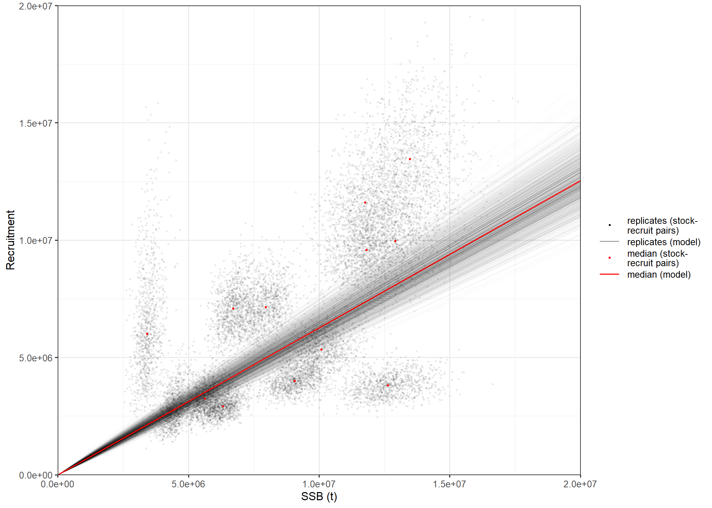<!-- -->

## Survival process error

The SAM model includes a survival process error, i.e. reducing the stock
numbers in a given year for a given age by natural and fishing mortality
does not exactly match the numbers for the next age in the following
year. This should be included in the MSE and can be include by adding
“residuals” to the numbers at age.

``` r
### survival process error estimated by SAM
uncertainty$proc_error
```

    ## An object of class "FLQuant"
    ## iters:  1000 
    ## 
    ## , , unit = unique, season = all, area = unique
    ## 
    ##     year
    ## age  all           
    ##   2  0.6124(0.0922)
    ##   3  0.0996(0.0104)
    ##   4  0.0996(0.0104)
    ##   5  0.0996(0.0104)
    ##   6  0.0996(0.0104)
    ##   7  0.0996(0.0104)
    ##   8  0.0996(0.0104)
    ##   9  0.0996(0.0104)
    ##   10 0.0996(0.0104)
    ##   11 0.0996(0.0104)
    ##   12 0.0996(0.0104)
    ## 
    ## units:  NA

``` r
### the values in the first age class will be overwritten by the recruitment model residuals

### create noise for process error
set.seed(3)
proc_res <- stock.n(stk_stf) %=% 0 ### template FLQuant
proc_res[] <- stats::rnorm(n = length(proc_res), mean = 0, 
                           sd = uncertainty$proc_error)
### the proc_res values follow a normal distribution,
### exponentiate to get log-normal residuals
proc_res <- exp(proc_res)
### proc_res is a factor by which the numbers at age are multiplied
### for historical period, numbers already include process error from SAM
### -> remove deviation
proc_res[, dimnames(proc_res)$year <= yr_data] <- 1
### remove deviation for first age class (recruits)
proc_res[1, ] <- 1

### plot
plot(proc_res) + ylim(c(0, NA)) + theme_bw()
```

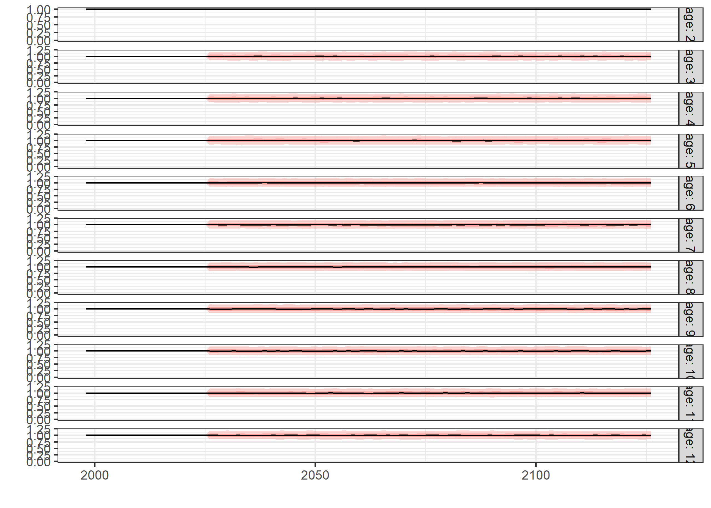<!-- -->

``` r
plot(iter(proc_res, 1)) + ylim(c(0, NA)) + theme_bw()
```

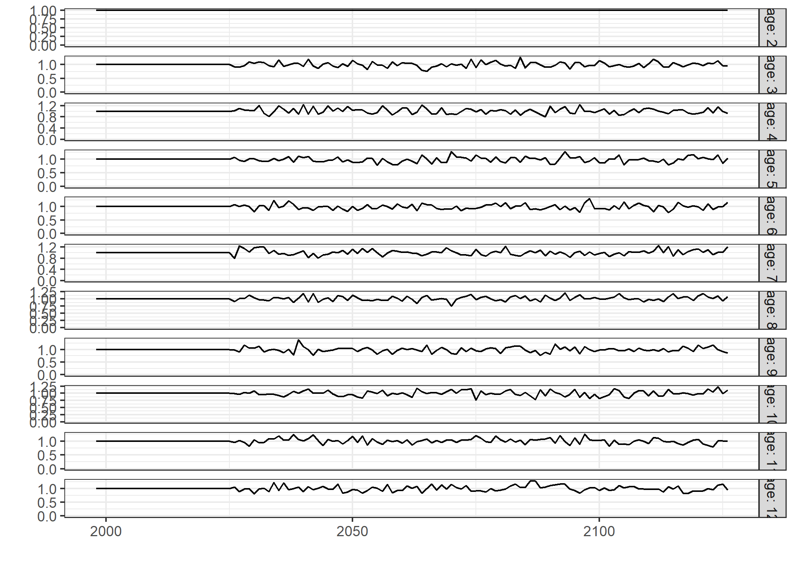<!-- -->

## Intermediate year(s)

The data go up to 2025 and some stock assessment results up to 2026. We
need to make some assumptions about the fishing in 2026 so that 2027 can
be the first year of the MSE projection.

WGWIDE 2026 decided on a *catch assumption for 2026 of 398,186 tonnes*.
This value will also be used by WGWIDE 2026 for the short-term forecast
going into the advice sheet.

``` r
int_yr_catch <- c(398186) ### update at WGWIDE 2026!
```

The value will be updated during WGWIDE 2026!

``` r
stk_fwd <- stk_stf
if (isTRUE(int_yr_add)) {

  ### use same discard rate in 2026 as in future years
  if (all(is.na(discards.n(stk_fwd)[, ac(2026)]))) {
    discards.n(stk_fwd)[, ac(2026)] <- discards.n(stk_fwd)[, ac(2027)]
    landings.n(stk_fwd)[, ac(2026)] <- landings.n(stk_fwd)[, ac(2027)]
  }
  
  ### duplicate stock for alternative recruitment model
  stk_fwd_rps <- stk_fwd
    
  for (i in seq_along(int_yr)) {
    
    ctrl_int <- fwdControl(data.frame(year = int_yr[i], 
                                      quant = "catch", 
                                      value = int_yr_catch[i]))
    ### project forward for intermediate year
    stk_fwd <- fwd(stk_fwd, control = ctrl_int, sr = sr, 
                   deviances = residuals(sr))
    
    ### add process noise
    stock.n(stk_fwd)[, ac(int_yr[i])] <- stock.n(stk_fwd)[, ac(int_yr[i])] * 
      proc_res[, ac(int_yr[i])]
    stock(stk_fwd)[, ac(int_yr[i])] <- computeStock(stk_fwd)[, ac(int_yr[i])]
    
  }
  
  ### same loop for alternative recruitment model
  for (i in seq_along(int_yr)) {
    
    ctrl_int <- fwdControl(data.frame(year = int_yr[i], 
                                      quant = "catch", 
                                      value = int_yr_catch[i]))
    ### project forward for intermediate year
    stk_fwd_rps <- fwd(stk_fwd_rps, control = ctrl_int, sr = sr_rps, 
                       deviances = residuals(sr_rps))
    
    ### add process noise
    stock.n(stk_fwd_rps)[, ac(int_yr[i])] <- stock.n(stk_fwd_rps)[, ac(int_yr[i])] * 
      proc_res[, ac(int_yr[i])]
    stock(stk_fwd_rps)[, ac(int_yr[i])] <- computeStock(stk_fwd_rps)[, ac(int_yr[i])]
    
  }
  
}

catch(stk_fwd)[, ac(2020:2026)]
```

    ## An object of class "FLQuant"
    ## iters:  1000 
    ## 
    ## , , unit = unique, season = all, area = unique
    ## 
    ##      year
    ## age   2020              2021              2022              2023             
    ##   all 1024459(9.01e+03) 1070520(9.65e+03) 1035877(6.14e+03) 1056111(5.89e+03)
    ##      year
    ## age   2024              2025              2026             
    ##   all  888710(3.49e+03)  806709(4.68e+03)  398186(2.60e-07)
    ## 
    ## units:  NA

``` r
catch(stk_fwd_rps)[, ac(2020:2026)]
```

    ## An object of class "FLQuant"
    ## iters:  1000 
    ## 
    ## , , unit = unique, season = all, area = unique
    ## 
    ##      year
    ## age   2020              2021              2022              2023             
    ##   all 1024459(9.01e+03) 1070520(9.65e+03) 1035877(6.14e+03) 1056111(5.89e+03)
    ##      year
    ## age   2024              2025              2026             
    ##   all  888710(3.49e+03)  806709(4.68e+03)  398186(2.65e-07)
    ## 
    ## units:  NA

## Biological observations

The management procedure (MP) should not receive data directly from the
OM. This includes biological data (stock and catch weights, etc).
Passing them directly to the MP is cheating. In the OM, these data were
resampled from historical values. In the MP, a simple approach is to use
averages from the sampled period.

``` r
### base on OM stock
stk_oem <- stk_fwd

### projection years
proj_yrs <- (yr_data + 1):range(stk_oem)[["maxyear"]]

### use means of sampled values for projection period
stock.wt(stk_oem)[, ac(proj_yrs)] <- 
  yearMeans(stock.wt(stk_oem)[, ac(sample_yrs)])
m(stk_oem)[, ac(proj_yrs)] <- yearMeans(m(stk_oem)[, ac(sample_yrs)])
mat(stk_oem)[, ac(proj_yrs)] <- yearMeans(mat(stk_oem)[, ac(sample_yrs)])
### remove stock assessment results
stock.n(stk_oem)[] <- stock(stk_oem)[] <- harvest(stk_oem)[] <- NA

### catch weights for projection years
catch.wt(stk_oem)[, ac(proj_yrs)] <- 
  yearMeans(catch.wt(stk_oem)[, ac(sample_yrs)])
landings.wt(stk_oem)[, ac(proj_yrs)] <- 
  yearMeans(landings.wt(stk_oem)[, ac(sample_yrs)])
discards.wt(stk_oem)[, ac(proj_yrs)] <- 
  yearMeans(discards.wt(stk_oem)[, ac(sample_yrs)])
```

## Observations - catch and indices

Not needed for shortcut.

## Shortcut assessment error

The residuals in a “shortcut MSE” should not just be random but follow
the behaviour of the assessment model (magnitude of assessment error,
bias, and auto-correlation). A simplistic way to get this is with a
retrospective analysis:

### SAM retro

Only 10-year retro possible. Going further back, SAM does not converge
and does not produce results.

``` r
### run 5-year retro

ret_yrs <- 0:9
dat_yrs <- cbind(2025-ret_yrs, 2026-ret_yrs, 2026-ret_yrs, 2024-ret_yrs,
                 2026-ret_yrs, 2024-ret_yrs)
### matrix for retro
### each column corresponds to a fleet
### each row is one retro run
### each cell corresponds to the last data year
dat_yrs
```

    ##       [,1] [,2] [,3] [,4] [,5] [,6]
    ##  [1,] 2025 2026 2026 2024 2026 2024
    ##  [2,] 2024 2025 2025 2023 2025 2023
    ##  [3,] 2023 2024 2024 2022 2024 2022
    ##  [4,] 2022 2023 2023 2021 2023 2021
    ##  [5,] 2021 2022 2022 2020 2022 2020
    ##  [6,] 2020 2021 2021 2019 2021 2019
    ##  [7,] 2019 2020 2020 2018 2020 2018
    ##  [8,] 2018 2019 2019 2017 2019 2017
    ##  [9,] 2017 2018 2018 2016 2018 2016
    ## [10,] 2016 2017 2017 2015 2017 2015

``` r
retro <- retro(fit, year = dat_yrs, ncores = 5)

opar <- par()
par(mar = c(2, 4.5, 0.5, 0.5))
plot(retro)
```

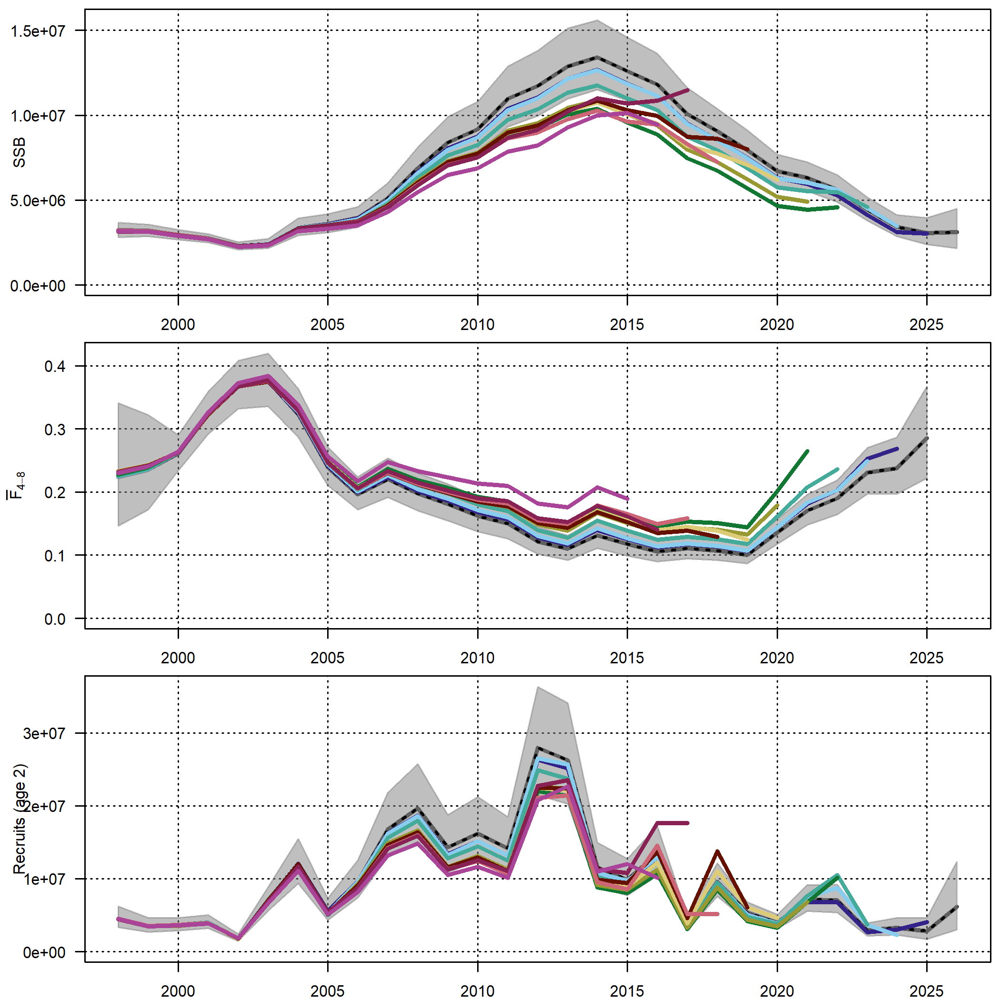<!-- -->

``` r
suppressWarnings(par(opar))

par(mar = c(2, 4.5, 0.5, 0.5))
plot(retro, xlim = c(2015, 2025))
```

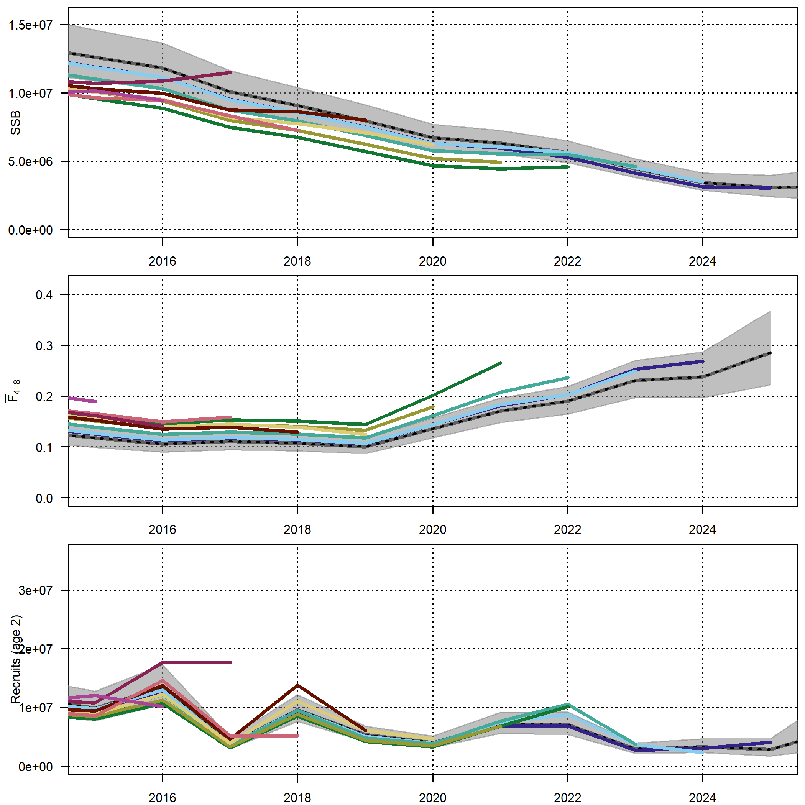<!-- -->

``` r
suppressWarnings(par(opar))

mohn(retro)
```

    ##    R(age 2)         SSB   Fbar(4-8) 
    ##  0.40764273 -0.06901253  0.19946889

``` r
### calculate Mohn's rho for x-peels
lapply(setNames(10:1, nm = paste(10:1, "peels")), function(x) {
  tmp <- retro[seq(x)]
  attr(tmp, "fit") <- fit
  class(tmp) <- "samset"
  mohn(tmp)
})
```

    ## $`10 peels`
    ##    R(age 2)         SSB   Fbar(4-8) 
    ##  0.40764273 -0.06901253  0.19946889 
    ## 
    ## $`9 peels`
    ##    R(age 2)         SSB   Fbar(4-8) 
    ##  0.48024835 -0.05459721  0.14666898 
    ## 
    ## $`8 peels`
    ##    R(age 2)         SSB   Fbar(4-8) 
    ##  0.08440123 -0.07875462  0.13699696 
    ## 
    ## $`7 peels`
    ##    R(age 2)         SSB   Fbar(4-8) 
    ##  0.16236991 -0.06125453  0.08850469 
    ## 
    ## $`6 peels`
    ##    R(age 2)         SSB   Fbar(4-8) 
    ##  0.16614365 -0.07249582  0.06087414 
    ## 
    ## $`5 peels`
    ##    R(age 2)         SSB   Fbar(4-8) 
    ##  0.16553108 -0.07222332  0.09238272 
    ## 
    ## $`4 peels`
    ##    R(age 2)         SSB   Fbar(4-8) 
    ##  0.21932664 -0.03485901  0.10493825 
    ## 
    ## $`3 peels`
    ##   R(age 2)        SSB  Fbar(4-8) 
    ## 0.14584419 0.01585562 0.01749552 
    ## 
    ## $`2 peels`
    ##    R(age 2)         SSB   Fbar(4-8) 
    ## 0.073240400 0.002511595 0.009355717 
    ## 
    ## $`1 peels`
    ##    R(age 2)         SSB   Fbar(4-8) 
    ##  0.43730876 -0.01163171 -0.02910262

The Mohn’s rho for SSB is actually quite low but higher for F.

``` r
### get SSB and F values from all retro runs
retro_table <- lapply(append(retro, list(fit)),
                      function(x) {#browser()
  tmp <- data.frame(SSB = ssbtable(x)[, "Estimate"],
                    F = fbartable(x)[, "Estimate"])
  tmp$year <- as.numeric(rownames(tmp))
  rownames(tmp) <- NULL
  tmp$assessment <- max(tmp$year)
  return(tmp)
})
retro_table <- do.call(rbind, retro_table)
yr_last <- max(retro_table$assessment)

### SSB error
retro_error <- retro_table %>%
  filter(assessment < max(assessment)) %>%
  group_by(assessment) %>%
  filter(year == max(year)) %>%
  ungroup() %>%
  mutate(SSB_retro = SSB, F_retro = F, 
         SSB = NULL, F = NULL,
         assessment = NULL) %>%
  left_join(retro_table %>% 
              filter(assessment == max(assessment)) %>% 
              mutate(assessment = NULL)) %>%
  mutate(SSB_ratio = SSB_retro/SSB,
         F_ratio = F_retro/F)
```

    ## Joining with `by = join_by(year)`

``` r
mean(retro_error$SSB_ratio)
```

    ## [1] 0.9309875

``` r
median(retro_error$SSB_ratio)
```

    ## [1] 0.957255

``` r
sd(retro_error$SSB_ratio)
```

    ## [1] 0.1262421

``` r
### plot
trans_from <- function(from = 1) {
  trans <- function(x) x - from
  inv <- function(x) x + from
  scales::trans_new("from", trans, inv, 
            domain = c(from, Inf))
}
retro_error %>%
  dplyr::select(year, SSB_ratio, F_ratio) %>%
  pivot_longer(-year) %>%
  mutate(name = factor(name, levels = c("SSB_ratio", "F_ratio"),
                       labels = c("Terminal SSB / SSB",
                                  "Terminal F / F"))) %>%
  ggplot(aes(x = year, y = value)) +
  geom_col(fill = "darkgrey", colour = "darkgrey") +
  facet_wrap(~ name, nrow = 1) + 
  theme_bw(base_size = 8) +
  labs(x = "Year", y = "") +
  geom_hline(yintercept = 1) +
  scale_y_continuous(trans = trans_from(),
                     limits = c(NA, NA),
                     breaks = c(seq(0.8, 1.6, 0.2))) +
  scale_x_continuous(breaks = scales::pretty_breaks())
```

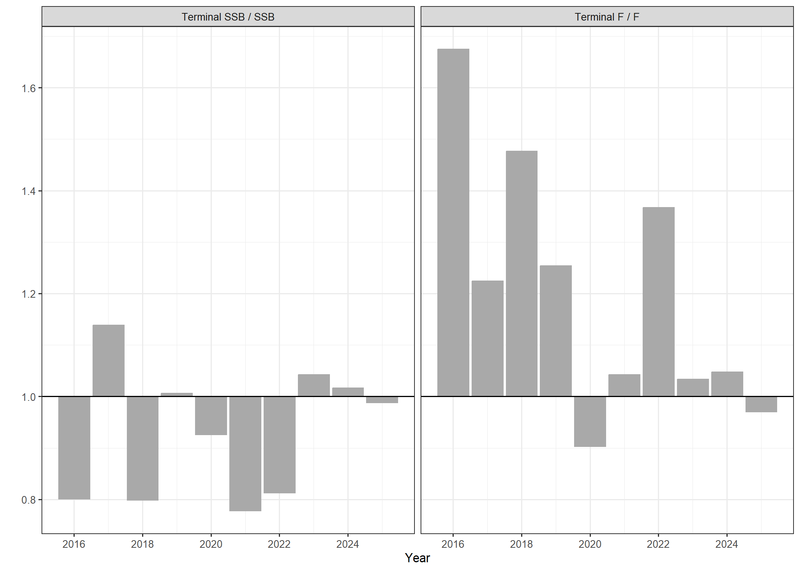<!-- -->

``` r
### check for auto-correlation
check_AR1(retro_error$SSB_ratio)
```

    ## [1] "lag-1 auto-correlation: -0.3113;  NOT statistically significant"

``` r
check_AR1(retro_error$F_ratio)
```

    ## [1] "lag-1 auto-correlation: 0.1267;  NOT statistically significant"

No significant auto-correlation in residuals, so we do not have to
include them.

### Kernel density smoother for retro residuals

Use same approach as for recruitment residuals: Fit kernel density
smoother to residuals, and sample from this to generate residuals for
projection. This keeps the magnitude, bias, and auto-correlation.

``` r
hist(retro_error$SSB_ratio, breaks = 10)
```

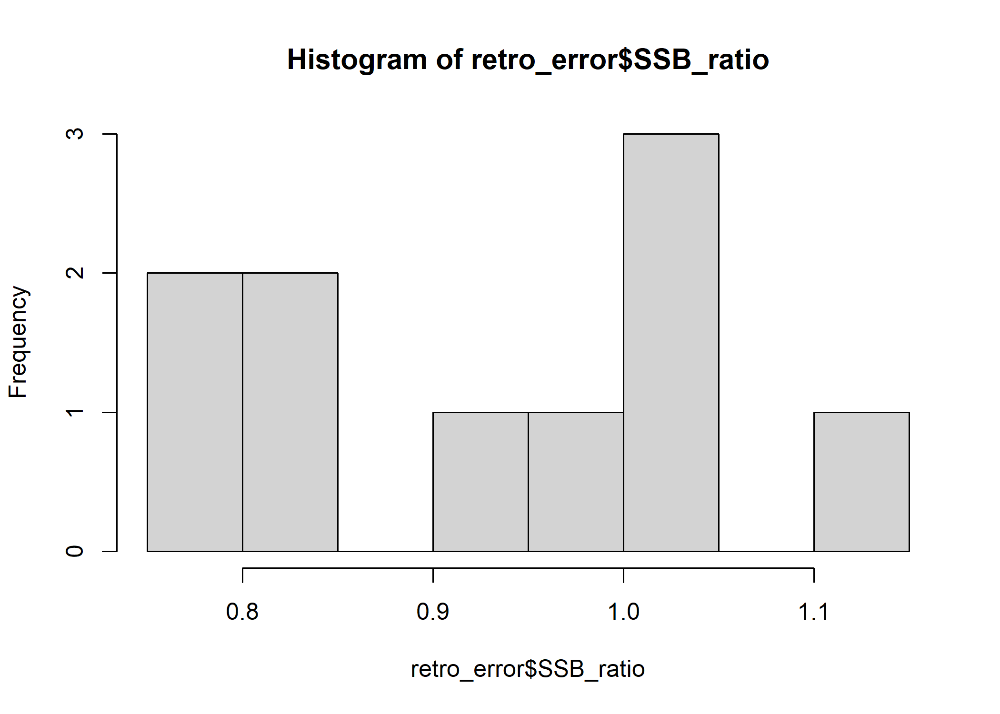<!-- -->

``` r
### use lower width (less smoothing) because of jagged histogram
error_SSB <- dens_resids(res = retro_error$SSB_ratio, density.bw = 0.05,
                         template = ssb(stk_fwd) %=% 1)
error_F <- dens_resids(res = retro_error$F_ratio, density.bw = 0.05,
                       template = ssb(stk_fwd) %=% 1)
### plot
plot(FLQuants("SSB" = error_SSB,
              "F" = error_F)) + theme_bw()
```

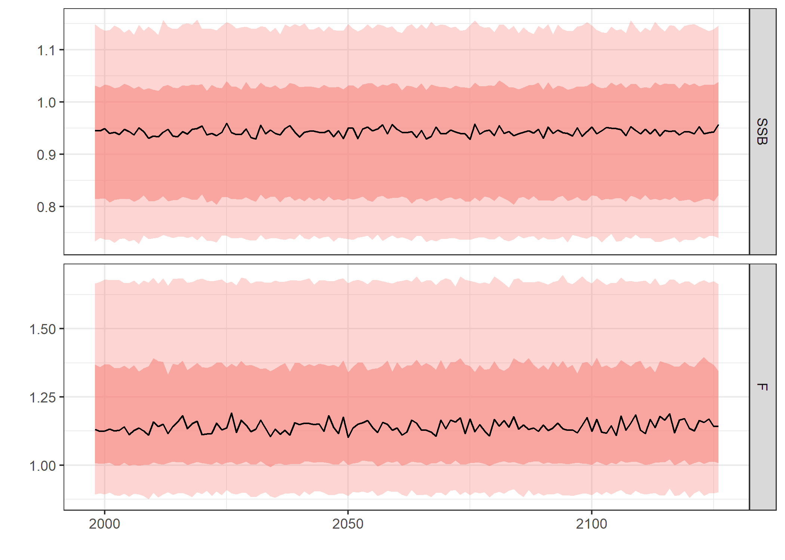<!-- -->

``` r
mean(error_SSB)
```

    ## [1] 0.9312175

``` r
mean(error_F)
```

    ## [1] 1.198969

``` r
median(error_SSB)
```

    ## [1] 0.9431874

``` r
median(error_F)
```

    ## [1] 1.14103

``` r
### plot historical values and distribution of generated residuals
FLQuants(SSB = error_SSB, "F" = error_F) %>%
  as.data.frame() %>%
  ggplot(aes(x = data)) +
  geom_histogram(fill = NA, colour = "black") +
  geom_linerange(data = data.frame(value = c(retro_error$SSB_ratio, 
                                             retro_error$F_ratio),
                                   qname = rep(c("SSB", "F"), 
                                               each = nrow(retro_error)),
                            ymin = 0, ymax = 1000),
                 aes(x = value), ymin = 0, ymax = 1000, 
                 colour = "blue", linewidth = 1) +
  facet_wrap(~ qname) +
  labs(x = "Residual value") +
  coord_cartesian(xlim = c(0.5, 1.99), ylim = c(0, 19000), expand = FALSE) + 
  theme_bw() +
  theme(axis.title.y = element_blank())
```

    ## `stat_bin()` using `bins = 30`. Pick better value `binwidth`.

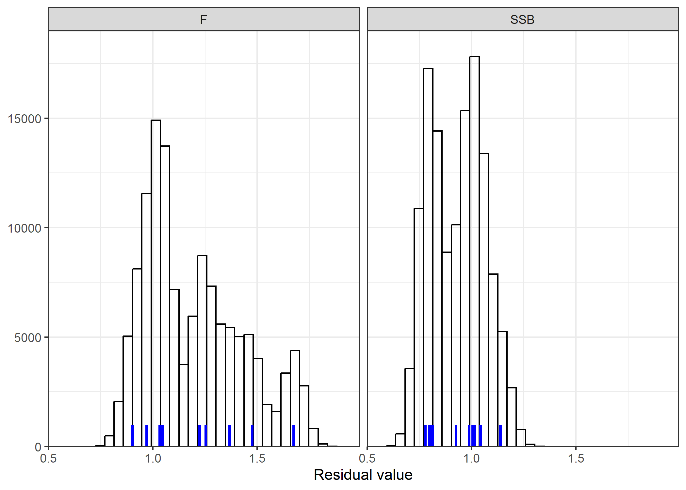<!-- -->

``` r
### check scale and spread with original residuals
### - SSB
mean(error_SSB)/mean(retro_error$SSB_ratio)
```

    ## [1] 1.000247

``` r
median(error_SSB)/median(retro_error$SSB_ratio)
```

    ## [1] 0.9853043

``` r
sd(error_SSB)/sd(retro_error$SSB_ratio)
```

    ## [1] 1.027864

``` r
### - F
mean(error_F)/mean(retro_error$F_ratio)
```

    ## [1] 0.9995829

``` r
median(error_F)/median(retro_error$F_ratio)
```

    ## [1] 1.00449

``` r
sd(error_F)/sd(retro_error$F_ratio)
```

    ## [1] 0.9682853

``` r
### => generated residuals look appropriate!
```

The generated residuals looks appropriate and have the same scale as the
original residuals.

## Implementation error

The realised catch has been above the ICES advice in recent years. The 8
July with WGWIDE requested that an implementation error be included in
the shortcut MSE with 3 scenarios:

- no implementation error

- based on the most recent years (e.g. ~5 years)

- based a longer time series (e.g. 20 years)

Updated at WGWIDE 2026: added values for 2025

``` r
### data from ICES advice sheet 2025, Version 2, 3 October 2025
### https://doi.org/10.17895/ices.advice.27202689
### Table 6
### columns:
### - catch corresponding to the advice (upper value for 2005-2015 where range
###     is given)
### - ICES catch
df_catch <- data.frame(
  year = 2005:2026,
  advice = c(420000, 487000, 509000, 456000, 578000, 572000, 672000, 639000, 542000, 1011000, 906000, 773842, 857185, 550948, 770358, 922064, 852284, 794920, 782066, 739386, 576958, 174357),
  catch = c(550285, 488906, 586893, 634794, 754057, 877420, 949529, 899576, 937003, 1401766, 1215760, 1100286, 1161226, 1023779, 838441, 1031828, 1082656, 1046702, 1056526, 897701, 809000, NA)) %>%
  mutate(overshoot = catch/advice)
df_catch %>%
  pivot_longer(-year, names_to = "Category") %>%
  mutate(facet = ifelse(Category == "overshoot", 
                        "Overshoot", "Catch")) %>%
  ggplot(aes(x = year, y = value, colour = Category, 
             linetype = Category)) +
  geom_line() +
  facet_wrap(~facet, scales = "free_y", ncol = 1) +
  ylim(c(0, NA)) +
  theme_bw(base_size = 8) +
  theme(axis.title = element_blank())
```

    ## Warning: Removed 2 rows containing missing values or values outside the scale range
    ## (`geom_line()`).

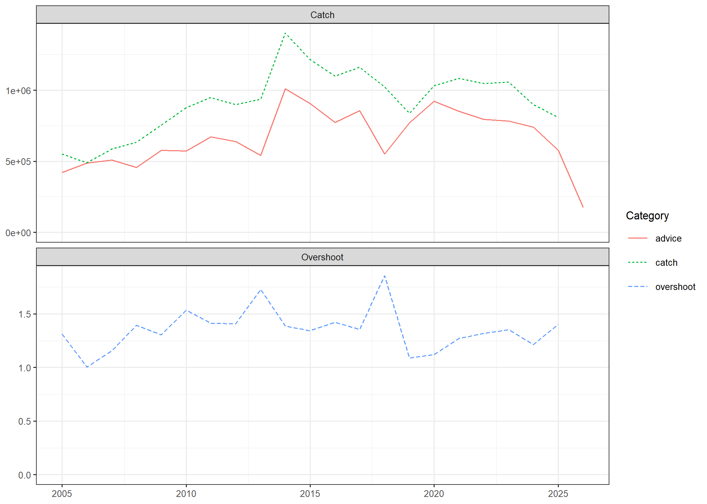<!-- -->

``` r
### check auto-correlation in residuals
check_AR1(df_catch$overshoot[df_catch$year %in% 2021:2025]) ### 5 years
```

    ## [1] "lag-1 auto-correlation: -0.6059;  NOT statistically significant"

``` r
check_AR1(df_catch$overshoot[df_catch$year %in% 2006:2025]) ### 20 years
```

    ## [1] "lag-1 auto-correlation: 0.0559;  NOT statistically significant"

``` r
### use same approach as for recruitment and retro residuals
iem_0 <- ssb(stk_fwd) %=% 1 ### no error

### 5 years
plot(density(df_catch$overshoot[df_catch$year %in% 2021:2025]))
```

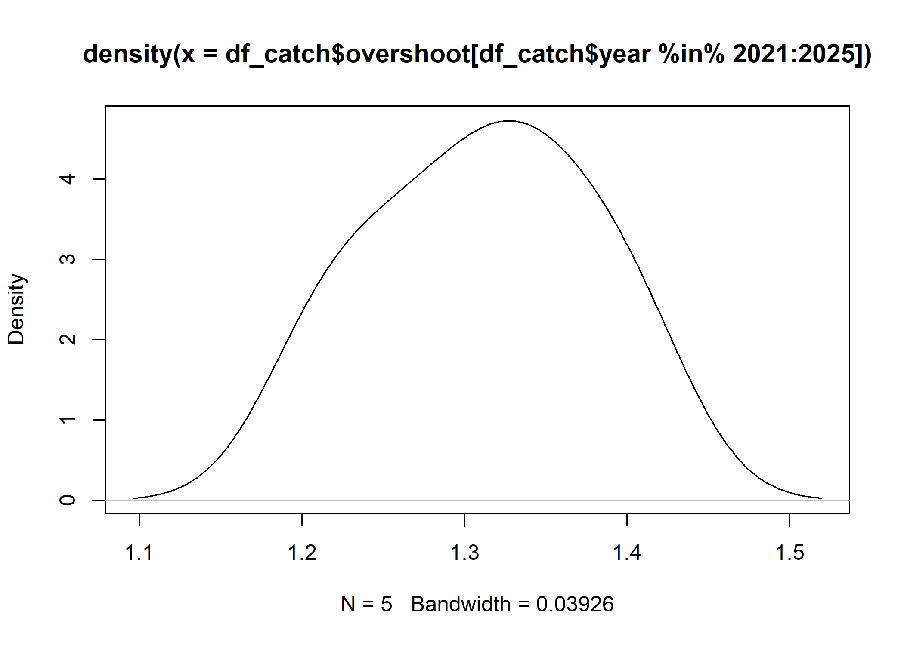<!-- -->

``` r
iem_5 <- dens_resids(res = df_catch$overshoot[df_catch$year %in% 2021:2025],
                     template = ssb(stk_fwd) %=% 1)
mean(iem_5)
```

    ## [1] 1.310905

``` r
mean(df_catch$overshoot[df_catch$year %in% 2021:2025])
```

    ## [1] 1.310856

``` r
sd(iem_5)
```

    ## [1] 0.07575366

``` r
sd(df_catch$overshoot[df_catch$year %in% 2021:2025])
```

    ## [1] 0.07243135

``` r
### 20 years
plot(density(df_catch$overshoot[df_catch$year %in% 2006:2025]))
```

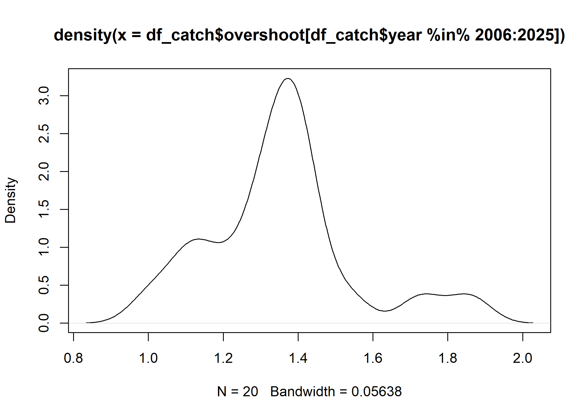<!-- -->

``` r
iem_20 <- dens_resids(res = df_catch$overshoot[df_catch$year %in% 2006:2025],
                     template = ssb(stk_fwd) %=% 1)
mean(iem_20)
```

    ## [1] 1.353289

``` r
mean(df_catch$overshoot[df_catch$year %in% 2006:2025])
```

    ## [1] 1.353101

``` r
sd(iem_20)
```

    ## [1] 0.2023274

``` r
sd(df_catch$overshoot[df_catch$year %in% 2006:2025])
```

    ## [1] 0.2002809

``` r
### plot historical values and distribution of generated residuals
FLQuants("5 years" = iem_5, "20 years" = iem_20) %>%
  as.data.frame() %>%
  ggplot(aes(x = data)) +
  geom_histogram(fill = NA, colour = "black") +
  geom_linerange(data = data.frame(
    value = c(df_catch$overshoot[df_catch$year %in% 2021:2025], 
              df_catch$overshoot[df_catch$year %in% 2006:2025]),
    qname = c(rep("5 years", 5), rep("20 years", 20))),
    ymin = 0, ymax = 1000, aes(x = value), ymin = 0, ymax = 1000,
    colour = "blue", linewidth = 1) +
  facet_wrap(~ qname) +
  labs(x = "Residual value") +
  #coord_cartesian(xlim = c(0.5, 1.8), ylim = c(0, 18000), expand = FALSE) + 
  theme_bw() +
  theme(axis.title.y = element_blank())
```

    ## Warning: Duplicated aesthetics after name standardisation: ymin and ymax

    ## `stat_bin()` using `bins = 30`. Pick better value `binwidth`.

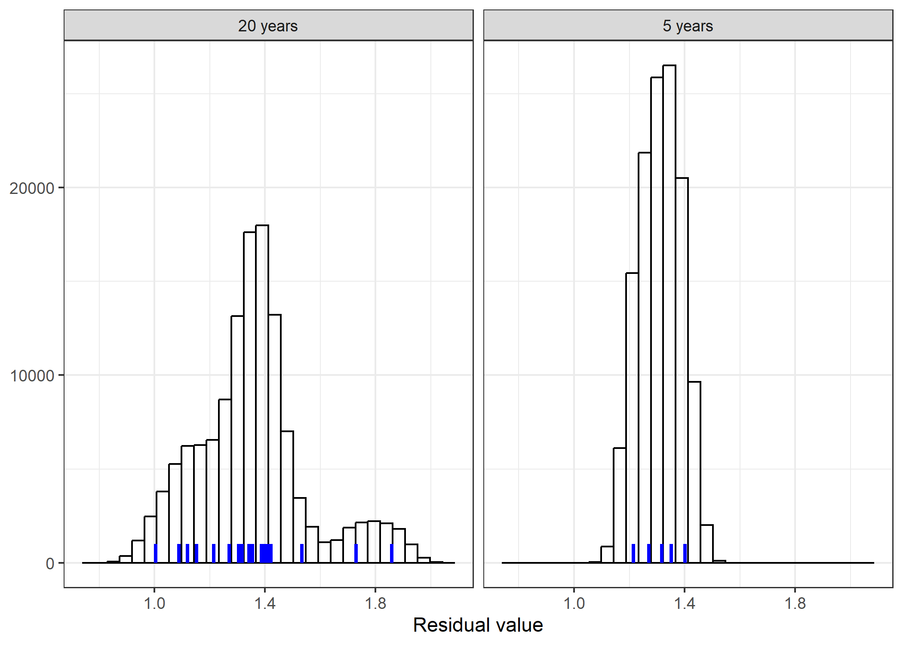<!-- -->

## Objects

Save objects

``` r
input_path <- paste0("data/mac.27.nea_2026/", n, "/")
dir.create(input_path, recursive = TRUE)
```

    ## Warning in dir.create(input_path, recursive = TRUE):
    ## 'data\mac.27.nea_2026\1000' already exists

``` r
### SAM model fit
saveRDS(fit, file = paste0(input_path, "SAM_fit.rds"))
### stock
saveRDS(stk_fwd, file = paste0(input_path, "stk.rds"))
saveRDS(stk_fwd_rps, file = paste0(input_path, "stk_rps.rds"))
### stock recruitment
saveRDS(sr, file = paste0(input_path, "sr.rds"))
saveRDS(sr_rps, file = paste0(input_path, "sr_rps.rds"))
### process error
saveRDS(proc_res, file = paste0(input_path, "proc_res.rds"))
### observed stock
saveRDS(stk_oem, file = paste0(input_path, "stk_oem.rds"))
### SAM uncertainty
saveRDS(uncertainty, file = paste0(input_path, "SAM_uncertainty.rds"))
### SSB & F shortcut uncertainty
saveRDS(error_SSB, file = paste0(input_path, "retro_error_SSB.rds"))
saveRDS(error_F, file = paste0(input_path, "retro_error_F.rds"))
### Implementation error
saveRDS(iem_0, file = paste0(input_path, "iem_0.rds"))
saveRDS(iem_5, file = paste0(input_path, "iem_5.rds"))
saveRDS(iem_20, file = paste0(input_path, "iem_20.rds"))
```

## Example projections – F=0

The R (FLR) objects from this markdown can then be used in the “shortcut
MSE”.

``` r
### set up MSE modules
const_oem <- FLoem(method = perfect.oem)
const_ctrl <- mpCtrl(list(est = mseCtrl(method = perfect.sa),
                          hcr = mseCtrl(method = fixedF.hcr,
                                        args = list(ftrg = 0))))
const_om <- FLom(stock = stk_fwd,
             sr = sr,
             projection = mseCtrl(method = fwd_procres,
                                  args = list(proc_res = proc_res)))
### start in 2026 (intermediate year, catch set for 2027)
const_args <- list(iy = 2026, fy = 2126)

### prepare for parallelisation
plan(multisession, workers = 10)
. <- foreach(x = 1:10) %dofuture% {
  pkgs <- c("ggplot2", "FLCore", "FLasher",
  "FLfse", "ggplotFL", "stockassessment", "foreach",
  "dplyr", "tidyr", "doParallel", "doFuture", 
  "mse", "patchwork")
  for (i in pkgs) 
    suppressWarnings(suppressMessages(library(package = i, character.only = TRUE)))
  source("funs_OM.R")
  source("funs_MSE.R")
}
### only run MP if file does not exist
if (file.exists(paste0(input_path, "mp_F0.rds"))) {
  res0 <- readRDS(paste0(input_path, "mp_F0.rds"))
} else {
  system.time({res0 <- mp(om = const_om, oem = const_oem, control = const_ctrl, 
             args = const_args,
             parallel = TRUE, progress = FALSE, verbose = FALSE)})
  
  saveRDS(res0, file = paste0(input_path, "mp_F0.rds"))
}

plot(stock(res0))
```

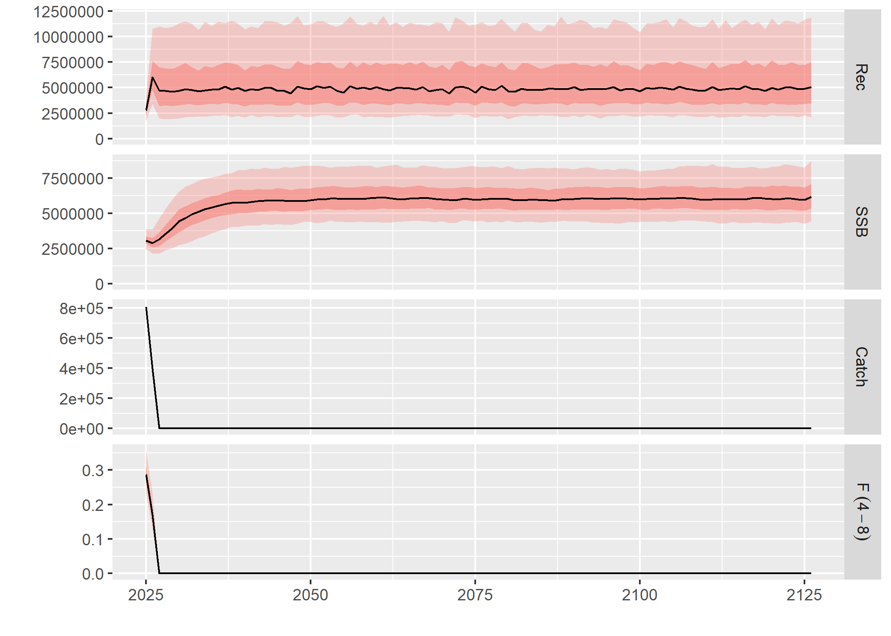<!-- -->

``` r
stk_tmp <- stk_fwd
stk_tmp[, ac(2027:2126)] <- stock(res0)[, ac(2027:2126)]
plot(stk_tmp)
```

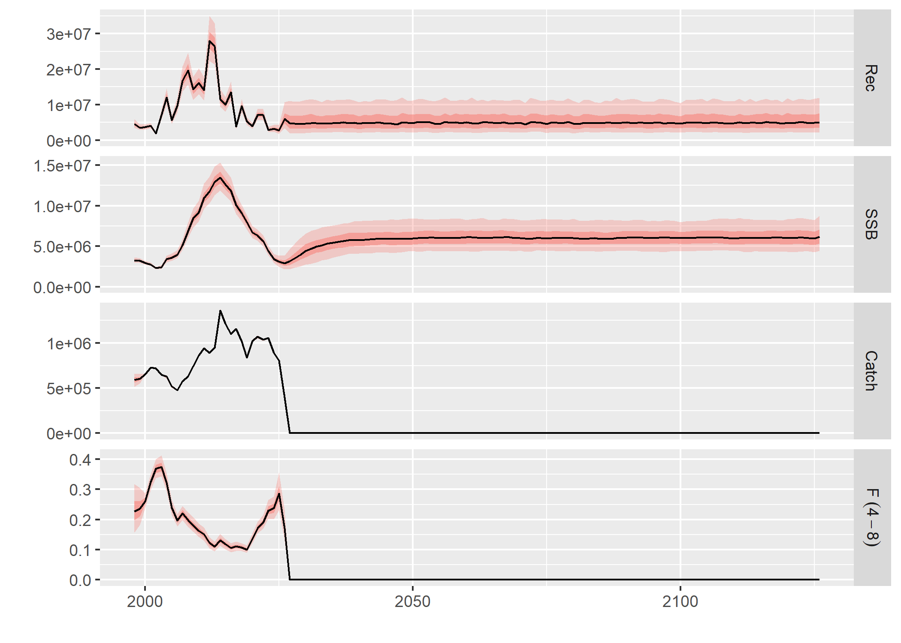<!-- -->

## Find OM B0 and MSY

``` r
### reuse MSE modules from previous section
### process:
### - fish at constant F for 100 years
### - find F that produces highest long-term catch (last 10 years)
### - est_MSY() uses as golden section search to find the F corresponding to the
###   highest catch
res <- est_MSY(om = const_om, oem = const_oem, control = const_ctrl,
               scenario = "baseline",
               args = const_args, parallel = TRUE, 
               path = input_path,
               vals_ini = seq(0, 1, 0.1), lower = 0, upper = 0.5)
```

    ## Ftrgt=0; C=0; SSB=6046860.36410403; R=4909967.04800013
    ## Ftrgt=0.1; C=404682.198126534; SSB=4392347.83182833; R=4844881.28185448
    ## Ftrgt=0.2; C=537624.641338955; SSB=3460465.06025419; R=4326351.65054221
    ## Ftrgt=0.3; C=447973.367447169; SSB=2163956.76373417; R=2873834.53825585
    ## Ftrgt=0.4; C=112194.585118528; SSB=441832.477704265; R=726703.296290623
    ## Ftrgt=0.5; C=16719.2638008349; SSB=54685.2146852378; R=94950.9547699424
    ## Ftrgt=0.6; C=2549.87932475635; SSB=7397.62108953701; R=13280.5678928556
    ## Ftrgt=0.7; C=425.633365859985; SSB=1074.51491648839; R=2006.93735773064
    ## Ftrgt=0.8; C=75.4352541747332; SSB=177.979438256444; R=335.747122940873
    ## Ftrgt=0.9; C=14.4384121227096; SSB=31.468773030615; R=61.2105164916275
    ## Ftrgt=1; C=2.93038779063804; SSB=6.04372018785519; R=12.3667353246766
    ## Ftrgt=0.190983005625053; C=533872.41088069; SSB=3544807.48975864; R=4403339.55084845
    ## Ftrgt=0.309016994374947; C=414170.17835819; SSB=1977090.88954492; R=2715969.1555265
    ## Ftrgt=0.118033988749895; C=441960.751995787; SSB=4213799.98467605; R=4796182.34496839
    ## Ftrgt=0.207415195090887; C=540557.968654528; SSB=3384883.09997064; R=4238603.89169482
    ## Ftrgt=0.220513123118903; C=541610.706461682; SSB=3246042.35094041; R=4097640.6505457
    ## Ftrgt=0.217599056913489; C=541957.772187582; SSB=3278069.16278561; R=4131848.76550865
    ## Ftrgt=0.216015853517702; C=542202.629915827; SSB=3296078.29575323; R=4152975.50977411
    ## Ftrgt=0.212730694324287; C=541079.077594416; SSB=3329597.51712915; R=4184519.56690381
    ## Ftrgt=0.214761034364272; C=541694.384392499; SSB=3310089.56403945; R=4160402.96063698
    ## Ftrgt=0.216415341651483; C=542112.013077669; SSB=3290640.85139637; R=4144054.3765373
    ## Ftrgt=0.215536555250826; C=541891.203016131; SSB=3302723.41622357; R=4157177.75852954
    ## Ftrgt=0.216015853517702; C=542202.629915827; SSB=3296078.29575323; R=4152975.50977411

    ## `geom_smooth()` using method = 'loess' and formula = 'y ~ x'

    ## Warning: Removed 123 rows containing missing values or values outside the scale range
    ## (`geom_smooth()`).

    ## `geom_smooth()` using method = 'loess' and formula = 'y ~ x'

    ## Warning: Removed 123 rows containing missing values or values outside the scale range
    ## (`geom_smooth()`).

``` r
print(res$plot)
```

    ## `geom_smooth()` using method = 'loess' and formula = 'y ~ x'

    ## Warning: Removed 123 rows containing missing values or values outside the scale range
    ## (`geom_smooth()`).

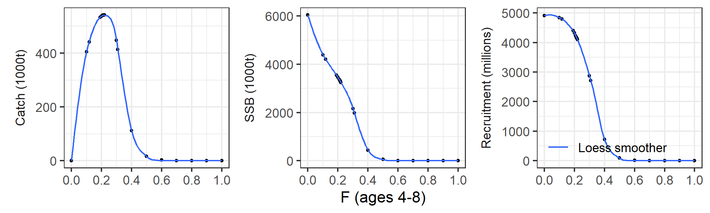<!-- -->

``` r
res$result
```

    ##        Ftrgt        catch          ssb          tsb          rec
    ## 1  0.0000000 0.000000e+00 6.046860e+06 6.283706e+06 4.909967e+06
    ## 2  0.1000000 4.046822e+05 4.392348e+06 4.623515e+06 4.844881e+06
    ## 3  0.2000000 5.376246e+05 3.460465e+06 3.664328e+06 4.326352e+06
    ## 4  0.3000000 4.479734e+05 2.163957e+06 2.307438e+06 2.873835e+06
    ## 5  0.4000000 1.121946e+05 4.418325e+05 4.728566e+05 7.267033e+05
    ## 6  0.5000000 1.671926e+04 5.468521e+04 5.916563e+04 9.495095e+04
    ## 7  0.6000000 2.549879e+03 7.397621e+03 8.012718e+03 1.328057e+04
    ## 8  0.7000000 4.256334e+02 1.074515e+03 1.158996e+03 2.006937e+03
    ## 9  0.8000000 7.543525e+01 1.779794e+02 1.918998e+02 3.357471e+02
    ## 10 0.9000000 1.443841e+01 3.146877e+01 3.422679e+01 6.121052e+01
    ## 11 1.0000000 2.930388e+00 6.043720e+00 6.554858e+00 1.236674e+01
    ## 12 0.1909830 5.338724e+05 3.544807e+06 3.754815e+06 4.403340e+06
    ## 13 0.3090170 4.141702e+05 1.977091e+06 2.120997e+06 2.715969e+06
    ## 14 0.1180340 4.419608e+05 4.213800e+06 4.439040e+06 4.796182e+06
    ## 15 0.2074152 5.405580e+05 3.384883e+06 3.590059e+06 4.238604e+06
    ## 16 0.2205131 5.416107e+05 3.246042e+06 3.446442e+06 4.097641e+06
    ## 17 0.2175991 5.419578e+05 3.278069e+06 3.475367e+06 4.131849e+06
    ## 18 0.2160159 5.422026e+05 3.296078e+06 3.496378e+06 4.152976e+06
    ## 19 0.2127307 5.410791e+05 3.329598e+06 3.531240e+06 4.184520e+06
    ## 20 0.2147610 5.416944e+05 3.310090e+06 3.508232e+06 4.160403e+06
    ## 21 0.2164153 5.421120e+05 3.290641e+06 3.492418e+06 4.144054e+06
    ## 22 0.2155366 5.418912e+05 3.302723e+06 3.500353e+06 4.157178e+06

``` r
### B0
head(res$result, 1)
```

    ##   Ftrgt catch     ssb     tsb     rec
    ## 1     0     0 6046860 6283706 4909967

``` r
### MSY
res$result[which.max(res$result$catch), ]
```

    ##        Ftrgt    catch     ssb     tsb     rec
    ## 18 0.2160159 542202.6 3296078 3496378 4152976

``` r
Fmsy <- res$result$Ftrgt[which.max(res$result$catch)]
```

``` r
### run F = Fmsy
const_ctrl_Fmsy <- const_ctrl
const_ctrl_Fmsy$hcr@args$ftrg <- Fmsy
if (file.exists(paste0(input_path, "mp_Fmsy.rds"))) {
  res_Fmsy <- readRDS(paste0(input_path, "mp_Fmsy.rds"))
} else {
  res_Fmsy <- mp(om = const_om, oem = const_oem, control = const_ctrl_Fmsy, 
                 args = const_args,
                 parallel = TRUE, progress = FALSE, verbose = FALSE)
  saveRDS(res_Fmsy, file = paste0(input_path, "mp_Fmsy.rds"))
}

stk_tmp_fmsy <- stk_fwd
stk_tmp_fmsy[, ac(2027:2126)] <- stock(res_Fmsy)[, ac(2027:2126)]
plot(stk_tmp_fmsy)
```

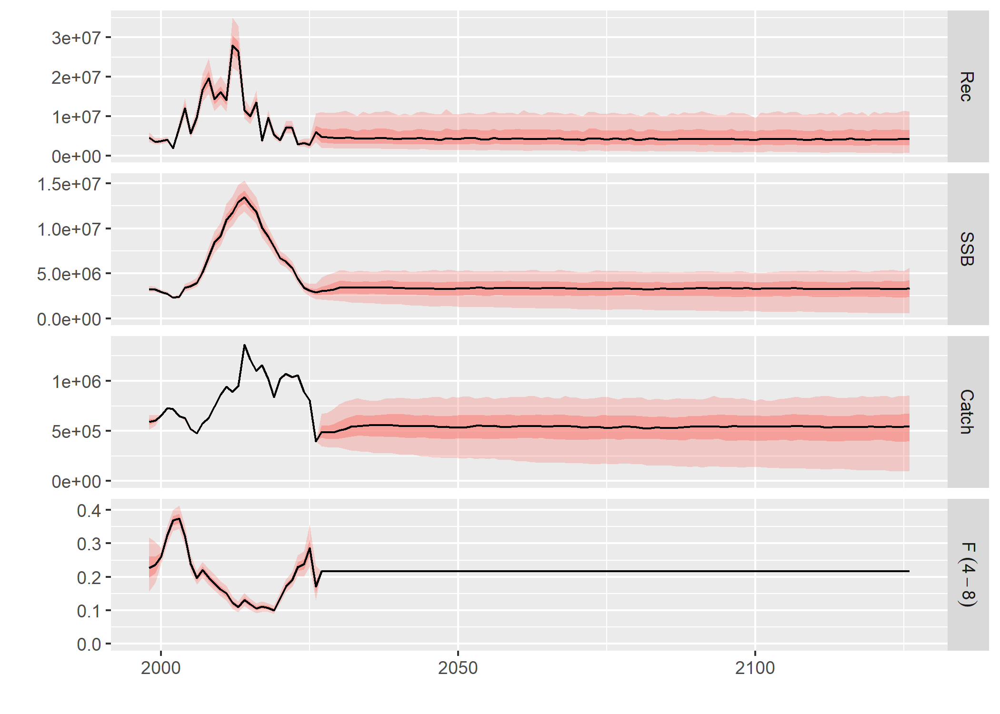<!-- -->

## Alternative recruitment modelling exploration

F=0 projection for the alternative recruitment model

``` r
### set up OM with alternative recruitment model
const_om_rps <- const_om
stock(const_om_rps) <- stk_fwd_rps
sr(const_om_rps) <- sr_rps
const_args_rps <- list(iy = 2026, fy = 2126)

if (file.exists(paste0(input_path, "mp_rps_F0.rds"))) {
  res0_rps <- readRDS(paste0(input_path, "mp_rps_F0.rds"))
} else {
  system.time({res0_rps <- mp(om = const_om_rps, oem = const_oem, 
                              control = const_ctrl, args = const_args_rps,
                              parallel = TRUE, progress = FALSE, verbose = FALSE)})
  
  saveRDS(res0_rps, file = paste0(input_path, "mp_rps_F0.rds"))
}

plot(stock(res0_rps))
```

<!-- -->

``` r
stk_tmp_rps <- stk_fwd_rps
stk_tmp_rps[, ac(2027:2126)] <- stock(res0_rps)[, ac(2027:2126)]
plot(FLStocks("Baseline" = stk_tmp, "Alternative\nrecruitment" = stk_tmp_rps))
```

<!-- -->

The results look a bit surprising… Explanation:

- The SSB has been decreasing in recent years and is at a very low size
  at the beginning of the projection.

- Recruitment in this recruitment model is much lower compared to the
  baseline recruitment model (with the breakpoint fixed to Blim) at low
  SSB values.

- The recruitment is linearly linked to SSB in this recruitment model.
  This means that the recruitment will be very low in the beginning of
  the projection.

- Conclusion: the recruitment level is too low to sustain the stock and
  the stock is continuously decreasing over time, even with zero
  fishing!

Reference points (e.g. MSY or unfished state) cannot be estimated
because the stock does not reach an equilibrium, even after 100 years.

Plot comparison of the two recruitment models

``` r
data.frame(SSB = c(0, median(c(params(sr)["b"])), 2e+7),
           R = c(0, prod(iterMedians(params(sr))), prod(iterMedians(params(sr)))),
           Model = "Hockey-stick") %>%
  bind_rows(data.frame(SSB = c(0, 2e+7),
           R = c(0, iterMedians(params(sr_rps)["a"]*2e+7)),
           Model = "R/SSB")) %>%
  ggplot(aes(x = SSB/1e+6, y = R/1e+6, colour = Model, linetype = Model)) +
  geom_line() +
  labs(x = "SSB (million tonnes)", y = "Recruitment (millions)") +
  coord_cartesian(xlim = c(0, 20), ylim = c(0, 15), expand = FALSE) +
  theme_bw()
```

<!-- -->

Lets do some checks to make sure there aren’t any serious issues with
the recruitment model or numerical optimisation in FLasher’s `fwd()`.

First, lets check the R/SSB ratio to ensure the productivity is in the
same ballparks as in recent years:

``` r
plot(rec(stk_tmp_rps)/ssb(stk_tmp_rps)) + 
  geom_vline(xintercept = 2026.5, linetype = "2121") +
  annotate("rect", xmin = 2013.5, xmax = 2026.5, ymin = -Inf, ymax = Inf,
           alpha = 0.05, fill = "blue") + 
  labs(y = "R/SSB") +
  ylim(c(0, NA)) +
  theme_bw() +
  theme(strip.text = element_blank())
```

<!-- -->

``` r
### the vertical line shows the start of the projection
### blue shaded area shows the period from which the R/SSB model was condition
```

This looks okay, so the recruitment (productivity level) is probably
okay.

Now, let’s check the actual recruitment values and see if they match the
expected values from the recruitment model:

``` r
r_tmp <- ssb_tmp <- rec(stk_tmp_rps)[, ac(2026:2126)] %=% NA_real_
### insert SSB value and account for time lag between SSB and recruitment
### - recruitment age = 2, i.e. 2-year time lag
ssb_tmp[] <- ssb(stk_tmp_rps)[, ac((2026:2126)-2)] 
summary(c(ssb_tmp[, ac(2026)]/ssb(stk_tmp_rps)[, ac(2024)])) ### okay
```

    ##    Min. 1st Qu.  Median    Mean 3rd Qu.    Max. 
    ##       1       1       1       1       1       1

``` r
### recruitment parameters
a_tmp <- res0_rps@om@sr@params["a"]
b_tmp <- res0_rps@om@sr@params["b"]
### estimate recruitment (based on SSB two years before)
r_tmp <- a_tmp * ssb_tmp^b_tmp
### include recruitment residuals
r_tmp[] <- r_tmp * res0_rps@om@sr@residuals[, ac(2026:2126)]
### compare to recruitment from projected stock
r_tmp[, ac(2026:2030)]/rec(stk_tmp_rps)[, ac(2026:2030)]
```

    ## An object of class "FLQuant"
    ## iters:  1000 
    ## 
    ## , , unit = unique, season = all, area = unique
    ## 
    ##      year
    ## age   2026           2027           2028           2029          
    ##   all 1.01(1.21e-03) 1.01(1.23e-03) 1.00(8.43e-04) 1.00(6.58e-16)
    ##      year
    ## age   2030          
    ##   all 1.00(6.58e-16)
    ## 
    ## units:  NA

``` r
summary(c(r_tmp[, ac(2026)]/rec(stk_tmp_rps)[, ac(2026)]))
```

    ##    Min. 1st Qu.  Median    Mean 3rd Qu.    Max. 
    ##   1.009   1.012   1.012   1.012   1.013   1.018

``` r
plot(r_tmp/rec(stk_tmp_rps)[, ac(2026:2126)]) + ylim(c(0, NA))
```

<!-- -->

The recruitment values in the stock seem to be slightly (1%) too high in
the first 2 years (includes the intermediate year 2026, the MSE
projection starts in 2027). In all the following years, the recruitment
matches the expected values exactly.

There seems to be bug in FLasher’s `fwd()`… This happens with a
hockey-stick/segmented regression model, and the breakpoint is very high
(infinity) but also with the Cushing model. `fwd()` does not return any
warnings or issues, but may run into numerical issues. None of the
arguments (min/max, number of iterations) passed for FLasher’s internal
C++ function
(<https://github.com/flr/FLasher/blob/13761894283b40261f4bd85b638908c11f78db85/R/fwd.R#L311-L313>)
seems to be able to change that.

Conclusion: the alternative recruitment model does not seem entirely
reliable to be used in an MSE… However, the general perception with this
recruitment model is that the stock continues to decline even with zero
fishing.

### Conclusion on recruitment modelling

The two recruitment modelling approaches were presented and discussed at
WGWIDE 2026. The general conclusion was to proceed with the baseline
recruitment model (hockey-stick). The last recruitment estimate for 2026
was slightly higher than the values in previous years, and, therefore,
making this model appear more plausible. In the alternative recruitment
model (based on R/SSB), the latest recruitment estimate for 2026 is well
above the recruitment model and the trend of decreasing recruitment with
decreasing SSB observed in recent years did not continue, making this
model appear less plausible. However, this is only based on one
additional value and may not continue into the future, so the less
optimistic R/SSB model should still be mentioned in any communication
from the shortcut MSE.
